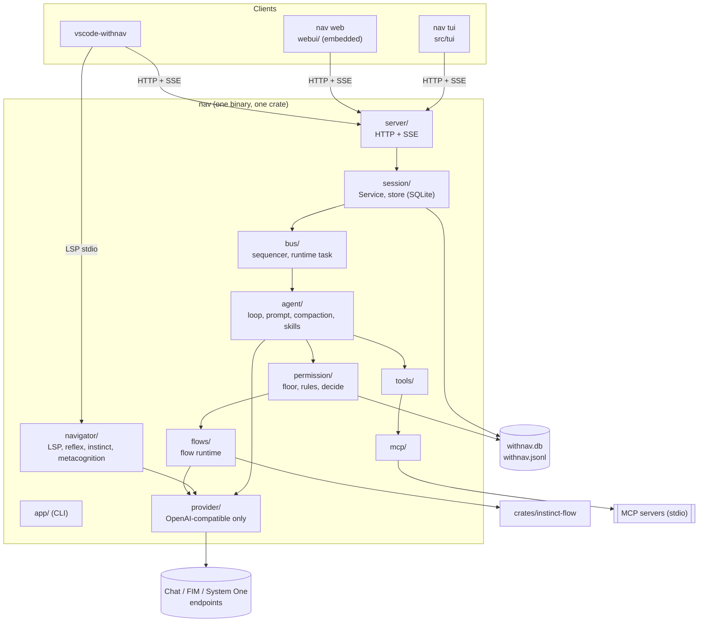
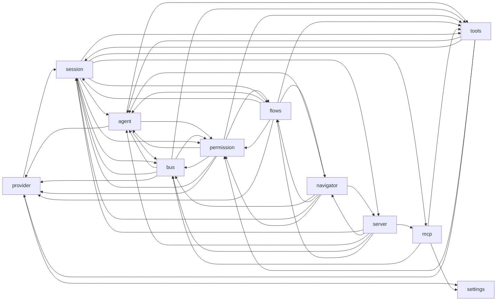
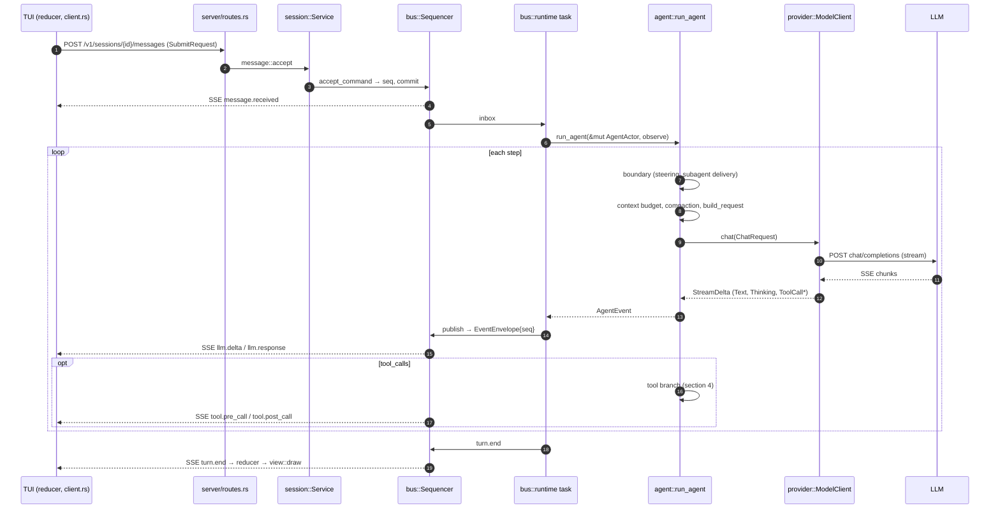
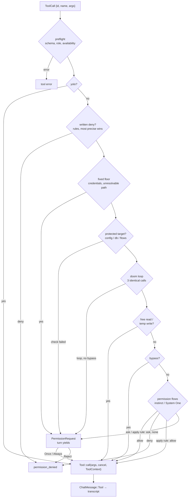

# WithNav 0.8 — current state

Diagrams of the code as it stands (0.8.1, single crate `withnav` + `crates/instinct-flow`).
Details: [`ARCHITECTURE.md`](../ARCHITECTURE.md), decisions: [`docs/adr/`](../docs/adr/).

## 1. Processes and layers

## 2. Real dependencies between modules (non-test `crate::` imports)

The documented rule ("a module never imports one above it") is not enforced: everything sits in one crate.

Cycles: `agent⇄bus`, `agent⇄tools`, `agent⇄permission`, `permission⇄flows`, `flows⇄navigator`,
`session⇄server`, `provider→session` (for one constant). Only `workspace/` is a leaf.

## 3. A Captain message: TUI → LLM → TUI

## 4. A tool call: today's decision chain

Order as implemented in `permission/decide.rs::decide_with` (it differs slightly from the prose in
`ARCHITECTURE.md`: a written deny wins before the floor, bypass skips the doom-loop question);
flows are reached via the `PermissionFlows` trait.

## 5. Key types today

| Type | File | Fields / role |
| --- | --- | --- |
| `ChatMessage` | `provider/openai.rs` | `System`, `User{provenance}`, `Assistant{tool_calls}`, `Tool{tool_call_id, answered_by}`: both transcript **and** OpenAI wire format |
| `ToolCall` | `provider/mod.rs` | `id, name, args: Value, args_valid` |
| `StreamDelta` | `provider/mod.rs` | `Text`, `Thinking`, `ToolCallStarted`, `ToolCallArgs` |
| `Tool` | `tools/mod.rs` | `name()`, `schema() -> Value`, `call(args, cancel, &ToolContext)` |
| `permission::Input` / `Decision` | `permission/decide.rs` | `Control`, call, commands, floor, store, agent… → `Verdict{Run, Deny, AskCaptain}` + `Trace` |
| `EventEnvelope` | `bus/event.rs` | `schema, event_id, seq, session_id, actor_id, kind, at, causation, correlation, payload: Value` |
| `EventKind` | `bus/event.rs` | 25 kinds: `session.*`, `message.received`, `turn.*`, `llm.*`, `tool.*`, `permission.*`, `context.*`, `subagent.*`, `model.changed`, `mcp.status`… |
| `ModelConfig` / `ApiKind` | `provider/config.rs` | `Chat`, `Fim`, `SystemOne`: one wire family (OpenAI-compatible) |

## 6. What works, what hurts

**Works (keep):** single server API for every client · sequencer + `seq` + SSE replay · pure
`decide` over a trait · flows as data · durable child delivery · `crates/instinct-flow` extracted.

**Hurts:**
- **Cycles** (section 2): nothing is testable alone; any change recompiles everything.
- **God files**: `bus/runtime.rs` 3.6k lines, `session/store.rs`, `session/service.rs`, `agent/loop.rs` ~3.5k each.
- **One provider format**: `ChatMessage` is both the domain transcript and the OpenAI wire type.
- **Hooks are ad-hoc**: `tool.pre_call` flow trigger, `ToolCallFlows`, boundary, `ConversationFeed`,
  delivery each have their own call site. No common chain, no plugin entry point.
- **Payloads are `serde_json::Value`** (event payload, tool args/schema): contracts live in prose, not types.
- **Wire types duplicated by hand** in `tui/protocol.rs`, `webui/src`, `vscode-withnav/src`.
- **Telemetry**: ~90 `tracing` calls, a JSONL decision log, `flow_trace` in SQLite; no metrics, no spans per turn/tool.
