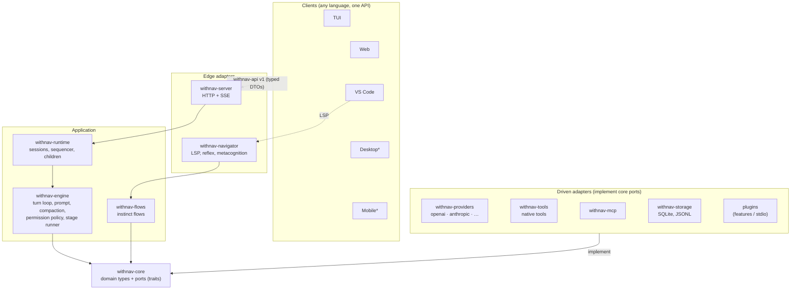
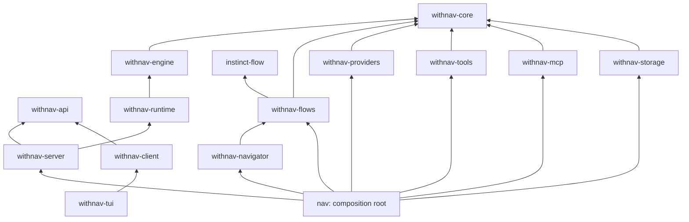

# WithNav v1 — target architecture

From one 107k-line crate to a Cargo workspace whose boundaries the compiler enforces.
Still **one process, one binary** (`nav`): modular, not distributed.

| Doc | Content |
| --- | --- |
| this file | layers, crates, dependency rule |
| [data-flow.md](data-flow.md) | a Captain message from client to LLM and back, events |
| [pipeline.md](pipeline.md) | the stackable processing chains (pre-call, permission, flow, result…) |
| [types.md](types.md) | ports (traits) and core data structures |
| [providers.md](providers.md) | the four wire families (Chat Completions, Responses, Anthropic, Gemini) behind one port |
| [events-and-hooks.md](events-and-hooks.md) | the 25 events typed, today's interception points, the v1 hook catalog, schema evolution |
| [plugins-and-telemetry.md](plugins-and-telemetry.md) | plugin manifest, lifecycle, stdio protocol; spans, metrics, logs, audit |
| [migration.md](migration.md) | shippable steps, risks, open questions |

Current state for comparison: [`../doc-pré-v1/`](../doc-pré-v1/README.md).

## 1. Layers

`*` illustrative. `nav` (composition root) is the **only** crate that sees everything: it builds the
adapters and injects them into the runtime.

## 2. Crates and dependency rule

Arrows = `use` (compile-time). Runtime calls go the other way through ports.

Rules:
1. **Adapters never import each other** nor anything above `core`.
2. **`withnav-api` is a leaf**: wire DTOs only, versioned (`v1`), TS types generated from it.
3. **`core` holds values and traits only**: no I/O, no config loading, no orchestration.
4. A component is tested with fakes of the ports it uses (scripted provider, in-memory store,
   fake clock, recording stage). Each port has one contract test suite run on fake *and* real adapter.

| Today | Goes to |
| --- | --- |
| `provider/` | `providers` (wire), `core` (neutral types), `runtime` (assignment/selection) |
| `tools/` | `tools`; `task`, `steer_subagent`, `decide_subagent` → `runtime` |
| `mcp/` | `mcp` (returns a status snapshot; runtime publishes it) |
| `agent/` | `engine` |
| `permission/` | `engine` (policy), `storage` (tables) |
| `bus/`, `session/` | `runtime` (logic), `storage` (`store.rs`) |
| `flows/` | `flows` |
| `navigator/` | `navigator`; bootstrap → `nav` |
| `server/` | `server`; DTOs → `api` |
| `tui/` | `tui` + `client` (HTTP/SSE transport shared with future Rust clients) |
| `bus/event.rs` wire types | `api` |

How today's cycles break:

| Cycle | Fix |
| --- | --- |
| `provider → session/settings` | resolved config is injected; providers never read settings |
| `tools ⇄ agent/session` | session-control tools live in `runtime`, implement `core::Tool` |
| `permission ⇄ agent/bus/flows` | evidence types move to `core`; flows reached through a port |
| `flows → navigator` | flows get intent through a `WorkspacePort`, not `navigator::intent` |
| `mcp → bus` | MCP exposes a status `watch`; runtime turns it into `mcp.status` |
| `session ⇄ server` | server depends on runtime, never the reverse |
