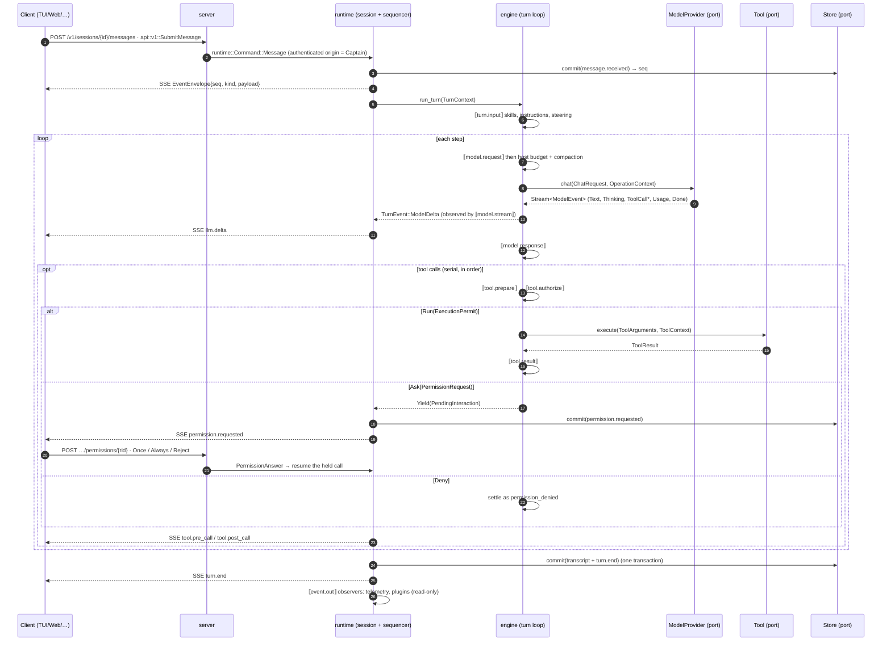
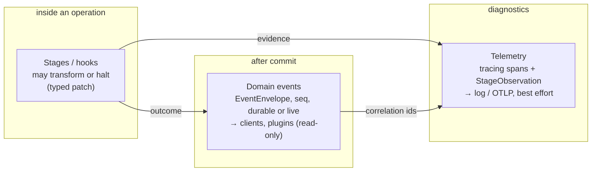
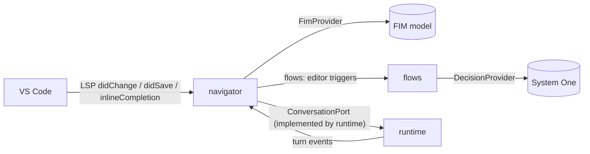

# Data flow

## 1. Captain message → LLM → client

Every box is a crate; every arrow crosses a typed boundary. The stage chains (`⟦…⟧`) are described in
[pipeline.md](pipeline.md).

Invariants carried over from today:
- the runtime's sequencer is the **only** `seq` allocator; durable events are committed before they are sent;
- a client reconnects with `Last-Event-ID` and gets replay then live;
- replay rebuilds projections; it **never** re-runs tools or hooks;
- a Captain question is a yielded `PendingInteraction`, never an async stage waiting on a UI.

## 2. Three kinds of "signal", three semantics

| | Stage / hook | Domain event | Telemetry |
| --- | --- | --- | --- |
| When | during the operation | after commit | any time |
| Can change things | yes, typed patch / halt | no | no |
| Ordered, replayable | per chain | yes (`seq`) | no |
| Failure | per-chain policy | — | dropped, never blocks |
| Audit records kept as-is | — | — | `permission_decisions`, `flow_trace`, navigator JSONL (product evidence, not sampled logs) |

Telemetry: `tracing` spans `turn → model_call → tool_call → stage`, ids = session/turn/call. OpenTelemetry
exporter is an optional subscriber in `nav`; the engine has no exporter dependency.

## 3. Navigator (editor) path

The navigator never imports the runtime: it receives a `ConversationPort` built in `nav`.
