# Processing chains ("effects rack")

Like an audio chain: stages stacked in order, each one receives the signal and passes it on, or cuts it.
Unlike an audio chain: **some stages are bolted to the rack** (security), the others sit in slots.

## 1. The chains

| Chain | Input → patch | What a stage may do | Fixed host step after it |
| --- | --- | --- | --- |
| `turn.input` | `TurnInput` → `InputPatch` | add context, select skill | origin (Captain / parent / subagent) never rewritten |
| `model.request` | `RequestDraft` → `RequestPatch` | add system text, tools, options | budget, compaction, capability check |
| `model.stream` | `&ModelEvent` → — | observe only (bounded) | — |
| `model.response` | `AssistantTurn` → `ResponsePatch` | annotate, drop/rename tool calls | tool planning |
| `tool.prepare` | `ToolDraft` → `ToolPatch` | rewrite name/args | preflight (schema, role, availability) |
| `tool.authorize` | `PermissionView` → `Restriction` | see §2 | permit issued by host only |
| `tool.result` | `ToolResult` → `ResultPatch` | redact, truncate, summarise output | status, ids, approval evidence immutable |
| `event.out` | `&EventEnvelope` → — | observe only | — |

Any rewrite happens **before** authorization. After the permit the call is frozen; a changed call
needs a new decision.

## 2. The tool chain, end to end

```mermaid
flowchart LR
  IN([ToolCall]) --> PREP

  subgraph PREP["⟦tool.prepare⟧ slot"]
    direction LR
    p1[plugin hooks…]
  end

  PREP --> PF[[preflight]] --> Y{{yolo?}}
  Y -- yes --> EXEC
  Y -- no --> AUTH

  subgraph AUTH["⟦tool.authorize⟧"]
    direction LR
    D[[written deny]] --> F[[floor + protected check]] --> L[[doom loop]] --> FR[[free read / temp write]] --> B[[bypass]] --> SLOT
    subgraph SLOT["review slot (configurable)"]
      direction LR
      fl[permission flows / Jev] --> rv[plugin reviewers<br/>escalate only]
    end
    SLOT --> CAP[[apply rule / ask Captain]]
  end

  AUTH -- "Run(permit)" --> EXEC[[dispatch]]
  AUTH -- "Ask" --> Q([PendingInteraction])
  AUTH -- "Deny" --> X([permission_denied])
  EXEC --> RES

  subgraph RES["⟦tool.result⟧ slot"]
    direction LR
    r1[redaction] --> r2[plugin hooks…]
  end

  RES --> SET[[settle: transcript, decision row, events]]
```



`[[…]]` = host step, fixed, cannot be removed or reordered. Plain boxes = stages in a slot.

The fixed authorization skeleton is today's `permission::decide_with`, wrapped, **not rewritten**.

## 3. Stage contract

```rust
pub trait Stage<I, P>: Send + Sync {
    fn descriptor(&self) -> &StageDescriptor;          // id, version, chain, slot, failure policy
    fn run<'a>(&'a self, input: &'a I, cx: &'a StageContext)
        -> BoxFuture<'a, Result<StageStep<P>, StageError>>;
}

pub enum StageStep<P> {
    Continue(P),        // patch applied by the runner (may be a no-op)
    Halt(StageHalt),    // Reject { reason } | Yield(PendingInteraction) | Cancel
}

pub enum Restriction {  // what a review stage may return in tool.authorize
    NoOpinion,
    Ask { reason: String },
    Deny { reason: String },
    // no Allow: plugin reviewers only escalate
}
```

Runner rules:
1. **Serial** within a chain invocation; async allowed. No `next()` middleware closures.
2. Stages get `&I` and return a patch: they never mutate session state.
3. `Continue` never means "authorized": only the host issues `ExecutionPermit`.
4. Failure policy per chain: flow failure → apply the rule; observer failure → report only;
   transform failure → abort that operation. Cancellation is never turned into a fallback.
5. The **plan** (ordered stage list + versions) is frozen per turn and kept with a pending permission;
   a config reload applies to the next turn.
6. Each stage run yields a `StageObservation {stage, version, chain, duration, outcome, ids}`
   → telemetry, redacted before export.

## 4. Configuration

```jsonc
// config.json
"pipeline": {
  "tool.prepare": ["plugin:rtk-rewrite"],
  "tool.authorize.review": ["flows", "plugin:secret-scan"],
  "tool.result": ["redaction", "plugin:output-trim"]
}
```

A slot list may enable, disable and reorder stages **inside** its slot. Naming a host step or a
stage from another chain is a config error at load, not at run time.

## 5. Who can register stages

| Source | How | Trust |
| --- | --- | --- |
| built-in | compiled in `nav` | full |
| compiled plugin | Cargo feature, `Plugin::register` | Captain-installed, full |
| external plugin (later) | versioned JSON-RPC over supervised stdio, same `Stage` semantics | Captain-installed; isolated from crashes, not sandboxed |

MCP stays the protocol for **tools**. Hooks and stages get their own small protocol when the first
external plugin needs it. WASM and dynamic `.so` loading: not planned.
