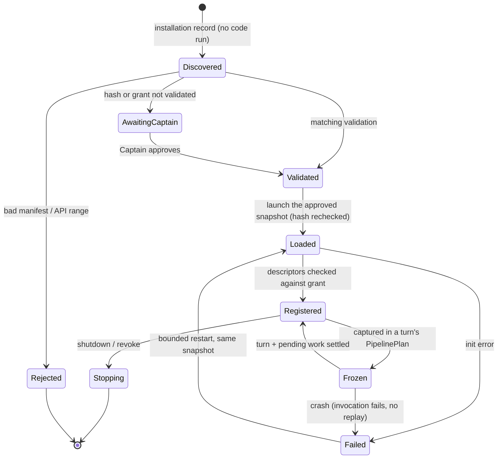

# Plugins and telemetry

Start with compiled plugins (Cargo features). External plugins (stdio JSON-RPC) when the first real
one needs it. MCP stays the protocol for tools. No `.so`, no WASM, no marketplace.

## 1. Manifest

```rust
pub struct PluginManifest {
    pub id: PluginId,                  // namespaced, e.g. "local.output-trim"; collisions refused
    pub version: Version,
    pub api: VersionReq,               // plugin API, versioned apart from HTTP, events, storage
    pub capabilities: Capabilities,    // requested; the Captain grants
    pub config_schema: JsonSchema,     // bounded subset, no remote $ref
}
pub struct Capabilities {
    pub tools: Vec<ToolName>,                          // external tools come through MCP
    pub stages: BTreeMap<SlotId, Vec<StageId>>,
    pub events: Vec<EventKindName>,
}
```

```toml
id = "local.output-trim"
version = "1.0.0"
api = ">=1.0, <2.0"

[capabilities]
events = ["turn.end"]
stages = { "tool.result.present" = ["trim"] }

[config_schema]
type = "object"
properties.max_bytes = { type = "integer", minimum = 256, maximum = 65536, default = 8192 }
```

## 2. Lifecycle

A plugin is validated by the Captain **like a skill or a flow**: by content hash, in the existing
`validations` table (`permission/validation.rs:23`). It gets its own `Plugin` kind; today only
`Skill` and `Flow` exist (`validation.rs:9`, SQL constraint in `permission/store.rs:90`).



- Hash = canonical manifest + executable/package bytes + resources + launch/config/grant snapshot.
  Any change, or a capability expansion, needs a new validation.
- Revocation blocks new turns at once and cancels the plugin's running invocations.
- Yolo never discovers, approves or launches a plugin.
- Hash approval is consent to *this content*, not a sandbox.

## 3. External protocol (JSON-RPC 2.0, stdio, one message per line)

| Method | Direction | Contract |
| --- | --- | --- |
| `initialize` | host → plugin | API offers, granted capabilities, validated config, limits → chosen API, stage descriptors |
| `stage.run` | host → plugin | invocation id, plan id, slot, typed input view, deadline → `continue{patch}` or allowed `halt` |
| `event.notify` | host → plugin (notification) | scoped, bounded event view + dropped count; never a decision |
| `$/cancelRequest` | host → plugin | final; late results discarded |
| `shutdown` | host → plugin | stop, exit; host enforces the deadline |
| tools | separate MCP connection | `tools/list`, `tools/call`, dispatched by the host after authorization |

No plugin → host calls: no commands, no permission answers, no credentials, no storage.

```json
{"jsonrpc":"2.0","id":7,"method":"stage.run","params":{"invocation_id":"inv-7","plan_id":"plan-4","slot":"tool.result.present","stage":"trim","deadline_ms":2000,"input":{"tool_call_id":"call-3","status":"ok","output":"…"}}}
{"jsonrpc":"2.0","id":7,"result":{"step":"continue","patch":{"presented_output":"…"}}}
```

| Limit (default) | Value |
| --- | --- |
| `initialize` / `stage.run` / `shutdown` timeout | 5 s / 2 s / 2 s, clamped to the enclosing deadline |
| frame / patch / stderr kept | 1 MiB / 64 KiB / 4 KiB |
| event queue per plugin | 256 messages or 1 MiB; stream observations dropped first, loss counted |
| restarts | 3 per 5 min (1/2/4 s backoff), then quarantined until the Captain acts |

A crash fails in-flight invocations through their slot's failure policy; an in-flight stage is
**never retried** (side effects may have happened). Output is untrusted: validated, bounded,
redacted before storage or export, control sequences stripped. No provider credentials in the
plugin environment unless explicitly referenced.

## 4. Telemetry

Today: `tracing` + fmt subscribers (LSP to stderr `app/lsp.rs:36`, TUI to a file `app/tui.rs:28`),
`rmcp` excluded (`app/logging.rs:4`), no spans per turn/tool, no metrics, no OTLP. Some warnings log
raw model text (`navigator/metacognition/mod.rs:439`): replaced by bounded codes first.

### Spans

```text
session.turn            session.id, turn.id, plan.id, origin, agent
├─ pipeline.stage       slot, stage.id, plugin.id, outcome
├─ model.call           provider, model, wire, purpose, attempt, status
├─ tool.call            call.id, tool.name, source, status
│  ├─ permission.decide verdict, approved_by
│  │  └─ flow.run       flow.id, run.id → model.call (purpose=permission)
│  ├─ tool.execute
│  └─ pipeline.stage    slot=tool.result.present
├─ context.compact      reason, generation → model.call (purpose=compaction)
└─ storage.commit       operation, outcome
navigator.trigger · watchdog.check   (linked to turns, not parented)
```

A permission wait ends the segment; the answer starts a **linked** one with the same turn and plan ids.

```rust
pub struct StageObservation {
    pub trace_id: TraceId, pub span_id: SpanId,
    pub session_id: Option<SessionId>, pub turn_id: Option<TurnId>, pub tool_call_id: Option<ToolCallId>,
    pub plan_id: PlanId, pub plugin_id: Option<PluginId>, pub stage: StageId, pub version: Version,
    pub slot: SlotId, pub duration_ms: u64, pub outcome: StageOutcome,   // Continued|Rejected|Yielded|Cancelled|Failed|TimedOut
    pub error_code: Option<StageErrorCode>, pub input_bytes: u64, pub output_bytes: u64,
}   // never: prompts, args, patches, model text, free-form reasons
```

### Metrics

| Name | Type | Labels (bounded) |
| --- | --- | --- |
| `withnav_model_tokens_total` | counter | provider, wire, purpose, direction |
| `withnav_model_call_duration_seconds` | histogram | provider, wire, purpose, outcome |
| `withnav_model_first_token_seconds` | histogram | provider, wire |
| `withnav_tool_execution_duration_seconds` | histogram | tool, source, outcome |
| `withnav_permission_decisions_total` | counter | verdict, approved_by, control |
| `withnav_stage_duration_seconds` | histogram | slot, stage, outcome |
| `withnav_stage_failures_total` | counter | slot, stage, error_code |
| `withnav_plugin_restarts_total` | counter | plugin, reason |
| `withnav_observer_dropped_total` | counter | plugin, topic |

Labels come from installed inventory (unknown → `other`); never a session id, path, URL or text.
Usage is counted once, at provider completion; unknown usage is missing, not zero.

### Logs and audit

ERROR lost persistence / broken invariant · WARN degradation, quarantine · INFO lifecycle ·
DEBUG safe transitions · TRACE counts and timings, never raw wire bodies.
Redact at capture, again at export. OTLP is an opt-in subscriber in `nav`; exporter failure never
blocks a turn.

Audit records stay product evidence, never sampled. v1 adds nullable `trace_id, span_id, plan_id`:

| Record | Where |
| --- | --- |
| permission decisions + `flow_trace` (a JSON column, not a table) | `withnav.db` (`permission/store.rs:30`, `:77`) |
| flow runs | workspace `runs.jsonl` (`flows/records.rs:231`) |
| navigator decisions | `withnav.jsonl` (`navigator/log.rs:284`) |

Today the permission turn id is minted separately from the bus turn id (`agent/loop.rs:115` vs
`bus/runtime.rs:1302`): v1 injects one `TurnId`.

## 5. A plugin can never

- mint Captain provenance, answer a permission request, validate itself, change yolo/bypass;
- touch a fixed step (preflight, floor, written deny, protected check, budget, cancellation);
- return Allow from review, override a deny, reuse a permit for a changed call;
- add tools beyond its grant, impersonate a native tool, dispatch a tool from a hook;
- mutate accepted messages, transcript, checkpoints, pending interactions, outbox, holds;
- allocate `seq`, emit domain events, rewrite history, turn replay into execution;
- rewrite tool status, approval evidence or audit records;
- read ungranted sessions or credentials, disable redaction, block the sequencer.
