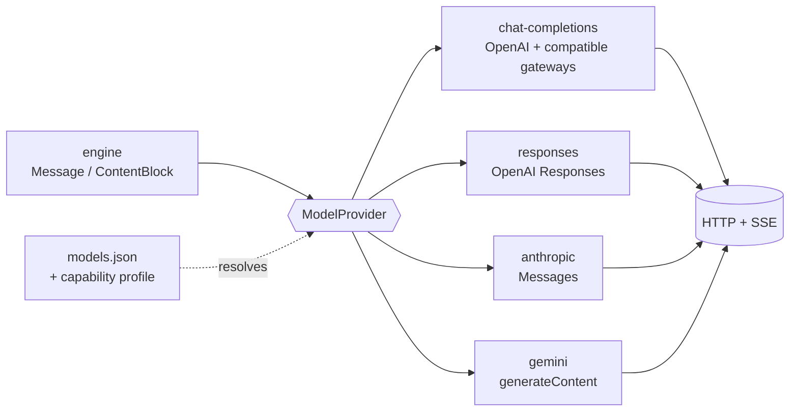

# Providers

One `ModelProvider` port, one adapter per **wire family**, not per vendor. An OpenAI-compatible gateway
(OpenRouter, vLLM, llama.cpp, OmniRoute) is the Chat Completions adapter plus a capability profile.



Today only the first adapter exists, and `ChatMessage` (its wire type) is also the transcript.
`ApiKind::{Chat, Fim, SystemOne}` cannot express "Anthropic chat": v1 splits **endpoint family**
(`wire: chat_completions | responses | anthropic | gemini`) from **capability** (`chat`, `fim`, `decision`).

## 1. What differs between the four wires

| Concern | Chat Completions | Responses | Anthropic Messages | Gemini |
| --- | --- | --- | --- | --- |
| System prompt | `system`/`developer` message | `instructions` | top-level `system` | `systemInstruction` |
| Tool call | assistant `tool_calls[{id}]` | `function_call` item, `id` **and** `call_id` | `tool_use{id}` block | `functionCall` part, **no id** |
| Tool result | `role:"tool"` message | `function_call_output{call_id}` | `tool_result` block in a **user** turn | `functionResponse` part, matched by name |
| Streamed tool args | indexed JSON fragments | `function_call_arguments.delta` | `input_json_delta` per block | whole calls per chunk, not portable fragments |
| Reasoning to send back | none portable | reasoning item + `encrypted_content` | `thinking.signature`, `redacted_thinking` | `thoughtSignature` on parts |
| Prompt cache | automatic (gateway-specific) | automatic | explicit `cache_control` breakpoints | `cachedContent` resource |
| End of stream | `[DONE]` | terminal response event | `message_stop` | stream exhausted |
| Usage extras | cached, reasoning tokens | cached, cache-write, reasoning | cache read / write | thoughts, cached |

Opaque reasoning (signatures, encrypted content) is **bound to provider + model**: replayed verbatim to
the same one, dropped when the session switches model. Never transplanted.

## 2. Neutral types, completed

Additions to [types.md §2](types.md#2-domain-types-provider-neutral) that the four wires require:

```rust
pub enum ContentBlock {
    Text(String),
    Image(ImageRef),
    Thinking { text: String, opaque: Option<ProviderOpaque> },
    RedactedThinking(ProviderOpaque),          // no readable text at all
    ToolCall(ToolCall),
    ToolResult { call: ToolCallId, output: ToolOutput, is_error: bool, answered_by: Option<Answerer> },
    SkillSelection { name: SkillName },
}

/// Bytes only the producing provider understands. Sent back only when
/// `provider` and `model` match the next request's; otherwise dropped.
pub struct ProviderOpaque { pub provider: WireFamily, pub model: ModelName, pub kind: OpaqueKind, pub bytes: Box<str> }

pub struct ToolCall {
    pub id: ToolCallId,                        // always ours, stable in the transcript
    pub wire_id: Option<WireCallId>,           // the provider's ids (Responses: item id + call_id); None for Gemini
    pub name: ToolName,
    pub args: ToolArguments,                   // raw text kept until validated; never re-serialised as evidence
}

pub struct BlockMeta { pub cache_breakpoint: bool }   // per block, honoured only where the wire has breakpoints
```

## 3. Capabilities, finish, errors

```rust
pub struct ModelCapabilities {
    pub streamed_tool_args: bool,
    pub parallel_tool_calls: Tri,              // Yes | No | Unknown: gateways often do not say
    pub tool_call_ids: bool,                   // false: adapter allocates ours and correlates by order
    pub strict_schema: bool,
    pub images: bool,
    pub reasoning: Option<ReasoningReplay>,    // None | Summary | Signed | Encrypted
    pub prompt_cache: PromptCache,             // None | Automatic | Breakpoints | Resource
    pub limits: Limits,                        // context, max input, max output
}

pub enum FinishReason {
    Stop, MaxTokens, ToolCalls, StopSequence, PauseTurn,
    Refusal, ContentFilter, Recitation, ContextWindowExceeded, MalformedToolCall,
    Other(String),                             // raw provider value always kept beside it
}

pub struct ModelError {
    pub kind: ModelErrorKind,                  // InvalidRequest | Auth | Permission | NotFound | RateLimited
                                               // | Quota | ContextLength | ContentPolicy | Server
                                               // | Timeout | Transport | Cancelled | Unknown
    pub message: String,
    pub status: Option<u16>,
    pub request_id: Option<String>,
    pub retry_after: Option<Duration>,
}
```

Retry is a policy over `kind` (transient: `RateLimited`, `Server`, `Timeout`, `Transport`), not a field.
`ContextLength` feeds compaction instead of a retry.

## 4. Adapter contract tests

Each adapter passes the same suite, against recorded wire fixtures (no network in CI):

1. text-only turn → `Text…`, `Usage`, `Done{Stop}`;
2. two parallel tool calls with interleaved arg fragments → two complete `ToolCall`s, in order;
3. a malformed tool-arg JSON → `ToolCall` with invalid args kept raw, not dropped;
4. reasoning round-trip: opaque bytes replayed identically to the same model, dropped for another;
5. stream cut before the end event → `ModelError{Transport}` with the partial output preserved;
6. 429 with `Retry-After` → `RateLimited`, `retry_after` set;
7. cancellation mid-stream → `Cancelled`, connection closed.

## 5. Pitfalls

- "OpenAI-compatible" is a dialect, not a guarantee: gate usage, images, parallel calls by profile.
- Schema dialects differ (strict mode, Gemini's OpenAPI subset): the adapter adapts the schema, the
  engine keeps one JSON Schema per tool.
- Usage may only arrive at stream end, or never (Chat needs `stream_options.include_usage`).
- Gemini call ids are ours: never shown as if they came from the provider.

Sources: [OpenAI Chat](https://developers.openai.com/api/docs/guides/chat-completions) ·
[Responses](https://developers.openai.com/api/docs/guides/responses) ·
[function calling](https://developers.openai.com/api/docs/guides/function-calling) ·
[Anthropic Messages](https://docs.anthropic.com/en/api/messages) ·
[streaming](https://docs.anthropic.com/en/api/messages-streaming) ·
[extended thinking](https://docs.anthropic.com/en/docs/build-with-claude/extended-thinking) ·
[prompt caching](https://docs.anthropic.com/en/docs/build-with-claude/prompt-caching) ·
[Gemini generateContent](https://ai.google.dev/api/generate-content) ·
[function calling](https://ai.google.dev/gemini-api/docs/function-calling) ·
[thinking](https://ai.google.dev/gemini-api/docs/thinking).
