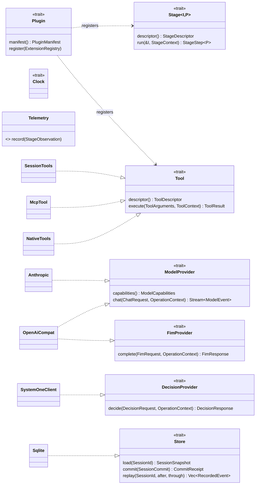
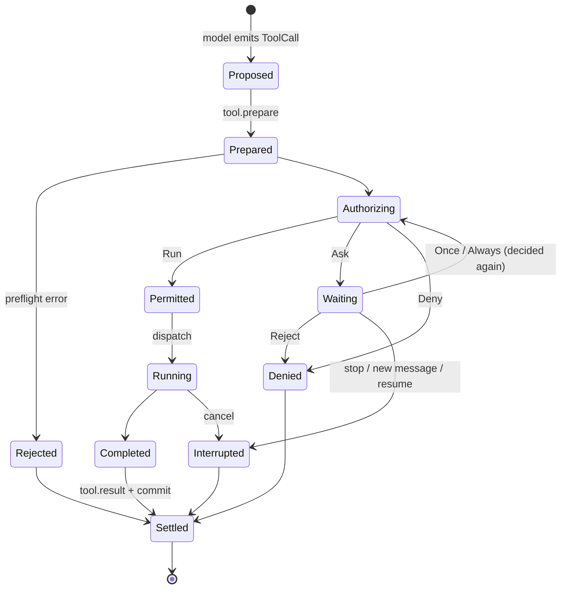

# Ports and data structures

Sketches, not final code. `BoxFuture` / `BoxStream` keep the traits object-safe (`Arc<dyn …>` injection).

## 1. Ports (in `withnav-core`)



```rust
pub trait ModelProvider: Send + Sync {
    fn capabilities(&self) -> ModelCapabilities;
    fn chat<'a>(&'a self, req: ChatRequest, op: OperationContext)
        -> BoxFuture<'a, Result<BoxStream<'a, Result<ModelEvent, ModelError>>, ModelError>>;
}

pub trait Tool: Send + Sync {
    fn descriptor(&self) -> &ToolDescriptor;           // name, typed JSON schema, read/write class
    fn execute<'a>(&'a self, args: ToolArguments, cx: ToolContext)
        -> BoxFuture<'a, Result<ToolResult, ToolError>>;
}

pub trait Store: Send + Sync {
    fn load<'a>(&'a self, s: SessionId) -> BoxFuture<'a, Result<SessionSnapshot, StoreError>>;
    // One atomic unit: transcript/checkpoint/selection + sequenced events + outbox markers.
    // Never "append event" then "save state" separately: recovery depends on it.
    fn commit<'a>(&'a self, c: SessionCommit) -> BoxFuture<'a, Result<CommitReceipt, StoreError>>;
    fn replay<'a>(&'a self, s: SessionId, after: Seq, through: Seq)
        -> BoxFuture<'a, Result<Vec<RecordedEvent>, StoreError>>;
}
```

Rules:
- FIM, chat and System One are **separate ports**: a FIM-only model does not fake `chat`.
- `ModelCapabilities` says what is supported (tools, images, reasoning, limits); absent = unsupported, never emulated.
- Ports receive **resolved** config and credentials; they never read `config.json`.
- Narrow repositories (`RuleRepository`, `ValidationRepository`, `DecisionLog`) for permission data: no generic CRUD.

## 2. Domain types (provider-neutral)

Today `ChatMessage` is both the transcript **and** the OpenAI wire format. v1 splits them:
the engine speaks `Message`/`ContentBlock`; each provider adapter encodes its own wire format.

```rust
pub struct Message {
    pub id: MessageId,
    pub role: Role,                    // System | User | Assistant | Tool
    pub origin: Origin,                // Captain | Parent | Subagent | Navigator | Host
    pub content: Vec<ContentBlock>,
}

pub enum ContentBlock {
    Text(String),
    Image(ImageRef),
    Thinking { text: String, signature: Option<ProviderOpaque> }, // kept for the same provider
    ToolCall(ToolCall),
    ToolResult { call: ToolCallId, output: ToolOutput, answered_by: Option<Answerer> },
    SkillSelection { name: SkillName },
}

pub struct ToolCall { pub id: ToolCallId, pub name: ToolName, pub args: ToolArguments }

pub enum ModelEvent {
    Text(String),
    Thinking(String),
    ToolCallStarted { index: u32, id: ToolCallId, name: ToolName },
    ToolCallArgs { index: u32, fragment: String },
    Usage(Usage),
    Done { finish: FinishReason },    // EOF without Done = error, partial output kept
}
```

Host-owned values have **private constructors** (only `engine`/`runtime` can build them):
`ExecutionPermit`, `CaptainEvidence`, `Control` (yolo/bypass/normal), and `Origin`.
A Rust enum cannot hide one variant, so `Origin` is a newtype with a private field
(`pub struct Origin(OriginKind)`, read through `origin.kind()`); a plain `pub enum` would let any
crate write `Origin::Captain`. `ExecutionPermit`'s private field is proven by a `compile_fail` test
in [`sketch/`](sketch/).
A JSON argument or a plugin patch cannot forge them.

## 3. Turn and tool-call state

```rust
pub struct TurnContext {
    pub session: SessionId,
    pub turn: TurnId,
    pub generation: TurnGeneration,
    pub execution: Arc<ExecutionSnapshot>,  // agent, model, roots, control level
    pub captain: Arc<CaptainEvidence>,
    pub plan: Arc<PipelinePlan>,            // frozen stage lists for this turn
    pub op: OperationContext,               // cancel token + deadline + trace ids
}

pub enum Authorization { Run(ExecutionPermit), Ask(PermissionRequest), Deny(Denial) }

pub enum ToolOutcome {
    Completed(ToolResult),
    Denied(Denial),
    Waiting(PendingInteraction),
    Interrupted { partial: Option<ToolResult> },
}
```



## 4. Wire contract (`withnav-api`)

```rust
pub mod v1 {
    pub struct EventEnvelope {
        pub schema: u16,
        pub event_id: EventId,
        pub seq: Seq,
        pub session_id: SessionId,
        pub actor_id: ActorId,
        pub at: Timestamp,
        pub causation: Option<EventId>,
        pub correlation: Option<OperationId>,
        #[serde(flatten)] pub event: Event,   // typed, replaces `kind: String` + `payload: Value`
    }

    #[serde(tag = "kind", content = "payload")]
    pub enum Event {
        #[serde(rename = "message.received")] MessageReceived(MessageReceived),
        #[serde(rename = "llm.delta")]        LlmDelta(LlmDelta),
        #[serde(rename = "tool.pre_call")]    ToolPreCall(ToolPreCall),
        // … the 25 current kinds, same wire names
        // + Unknown { kind, raw }: decoded by a hand-written fallback, keeps the payload
    }
}
```

Wire keys stay exactly as today (`schema_version`, `occurred_at`, `causation_id`…); the short names
above are illustrative. Full catalog: [events-and-hooks.md](events-and-hooks.md).

- Same JSON as today: the move is a typing exercise, not a protocol change.
- TS types for `webui/` and `vscode-withnav/` generated with `ts-rs` from this crate (no hand copies).
- Three distinct versions: URL `/v1`, envelope `schema`, storage format. A breaking change = `/v2`.
- Domain types never appear on the wire: `server` converts `core` → `api`.
