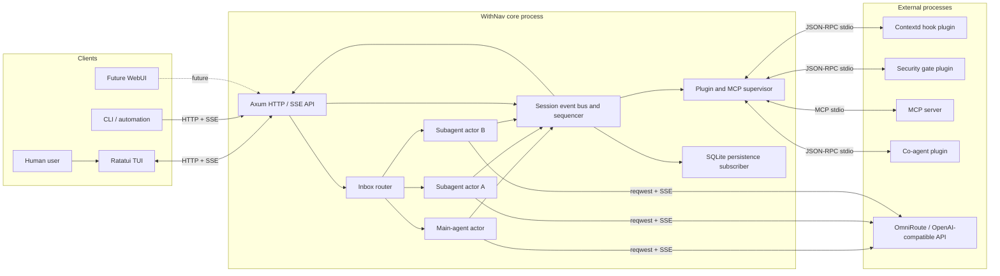
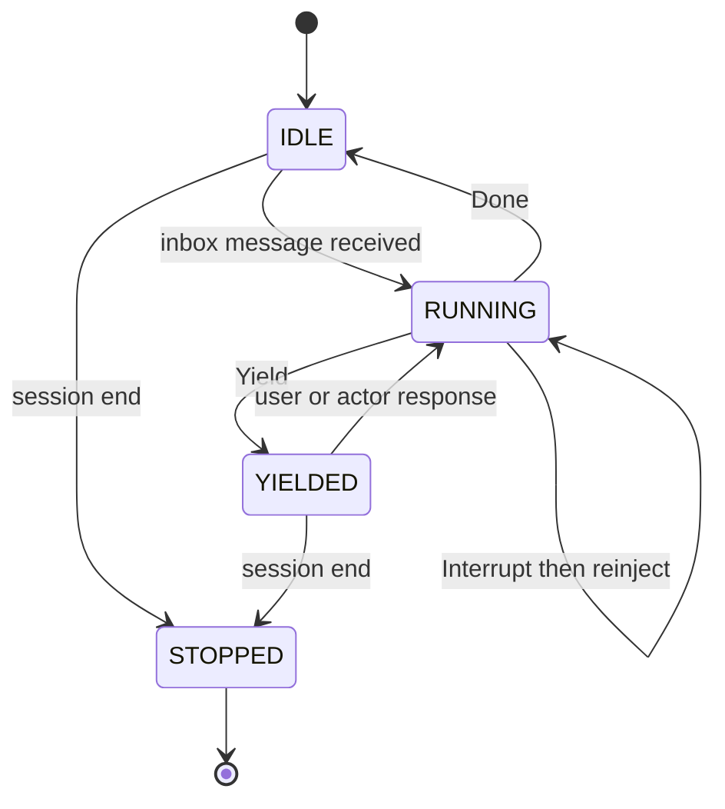

# WithNav v0.1 Specification (original design)

**Status:** The original design, partly built. Read the notes under each section heading.  
**Audience:** Pixma and coding agents implementing the project  
**Repository:** https://github.com/PixmaNts/withnav  
**Primary artifact:** A headless, single-binary Rust coding-agent core with an event API  
**Delivery model:** Four vertical phases, each a demonstrable end-to-end slice

> **How to read this file.** It is the first design of the agent core. It is **not** a description of the code. WithNav grew in a different direction: the terminal client, the VS Code navigator (Language Server, four model layers), build and plan agents, the permission gate, skills, rules, the model catalog, variants, the context budget and manual compaction were built. Plugins, MCP, subagents, hot reload and the co-agent were not.
>
> - **What the code does:** [`ARCHITECTURE.md`](../ARCHITECTURE.md) (modules and flows) and [`CONTEXT.md`](../CONTEXT.md) (vocabulary). The decisions are in [`docs/adr/`](adr/).
> - **Status of each section** is the line that starts with "Status" under its heading: *built*, *partly built*, *not built*, *superseded*, *historical* or *direction*. Sections 9, 10.3, 17, 18, 20, 21, 22, 24 and 27 were rewritten to match the code. The others keep their original wording; where a statement is not true of the code, the status line says so.
> - Sections 11 to 14 and 16 are kept as design references for work that is not built. They are not a promise.

## 1. Vision

> **Status: direction.** The vision holds; the plugin, MCP and co-agent parts of it are not built.

WithNav is a personal, minimal-but-complete coding agent inspired by `pi` and `oh-my-pi`, but not constrained by compatibility with either. It must remain understandable, fast, reliable, and cooperative with its operator. The core agent loop should be approximately 200 lines of direct orchestration: call a model, execute requested tools, append results, and either continue, finish, or yield to the human.

The system is built around one unifying primitive: an asynchronous event bus connecting independent actors. Main agents, subagents, users, plugins, persistence, user interfaces, and the optional co-agent all participate through messages and events rather than bespoke integration paths.

The design deliberately leaves judgment to the model when judgment does not need to be enforced in code. The core enforces security, protocol integrity, process lifecycle, and state consistency. It does not encode gameable proxies for success such as requiring an empty todo list before a task may end.

## 2. Goals

> **Status: partly built.** Built: items 1, 2, 4 to 6, 9 (as one actor, no subagents), 10, 11 and 14. Item 3 became eight tools plus `skill`. Not built: 7 (plugins), 8 (MCP), 12 (hot reload), 13 (co-agent), and non-blocking subagents.

Version 0.1 SHALL provide:

1. A headless Rust agent loop using an OpenAI-compatible model endpoint.
2. Streaming assistant text and tool calls.
3. Native development tools: first `read`, `write`, `edit`, `bash` and `grep`; now also `glob` and `fetch` (section 9).
4. Explicit `Continue`, `Done`, and `Yield` loop outcomes.
5. An asynchronous event bus with per-actor inboxes.
6. A local HTTP and SSE API implemented with Axum.
7. External-process plugins over JSON-RPC stdio.
8. MCP tool integration through `rmcp`.
9. Non-blocking subagents using the same loop as the main agent.
10. SQLite persistence implemented as an event-bus subscriber.
11. Standard project rules, persona, and skill file loading.
12. Hot reload for configuration, personas, and plugin definitions.
13. An optional co-agent implemented through the same plugin and event mechanisms.
14. A Ratatui client that consumes the server API rather than importing agent internals.

## 3. Non-Goals

> **Status: still in force.** Added since: no WebUI, and no automatic compaction yet.

Version 0.1 SHALL NOT attempt to provide:

- Drop-in compatibility with Claude Code, OpenCode, Codex, `pi`, or another agent.
- A provider abstraction supporting hundreds of provider-specific protocols.
- Protocols other than OpenAI-compatible chat completions.
- Embedded Python, JavaScript, WebAssembly, PyO3, or `deno_core` plugin runtimes.
- Automatic Rust self-modification followed by self-recompilation.
- A distributed worker scheduler or multi-host subagent cluster.
- A plugin marketplace, package manager, or remote plugin installation.
- A production multi-tenant service.
- A WebUI or mobile application.
- A mandatory todo system.
- Forced continuation until a goal, plan, or todo list is declared complete.
- Autonomous semantic compaction that silently discards conversation history.
- A secure OS sandbox for `bash` or external plugins.
- Perfect compatibility with every nominally OpenAI-compatible provider.
- Complex orchestration algorithms that can instead be expressed in a system prompt or co-agent prompt.
- Automatic skill selection inside the core.
- Memory or Contextd-specific privileges in the core.
- Mid-token steering that mutates an already-running model request.

## 4. Normative Language

> **Status: reference.** Defines the words this document uses.

The terms **MUST**, **MUST NOT**, **SHOULD**, **SHOULD NOT**, and **MAY** describe requirements for v0.1.

- **MUST** indicates a required invariant.
- **SHOULD** indicates the default unless implementation evidence justifies an exception.
- **MAY** indicates an optional behavior.
- **Actor** means an independently scheduled task or process with a mailbox.
- **Event** means an immutable record describing something that happened.
- **Command** means a targeted request delivered to one actor.
- **Turn** means one user- or agent-initiated unit of interaction.
- **Model step** means one request to the model and its streamed response.
- **Task** means the work correlated with an initiating inbox message. Task completion is advisory, not an enforced goal condition.

## 5. Core Principles

> **Status: principles, still guide the code.** Parts 5.4 to 5.6 mention plugins and hooks, which are not built.

### 5.1 Keep the Agent Loop Small

The conceptual agent is:

1. Send the transcript and tool definitions to the model.
2. Stream and normalize the response.
3. If the response contains tool calls, execute them and continue.
4. If it contains final text, finish the turn.
5. If human action is required, yield.

Most complexity in production agents comes from streaming recovery, provider inconsistencies, process cancellation, context management, security, persistence, and UI synchronization. Version 0.1 implements only the portion of that long tail required for a dependable personal agent.

### 5.2 Do Not Encode Gameable Proxies

The harness MUST NOT equate observable proxies with actual task success.

Examples of prohibited constraints include:

- Refusing to stop while a todo list is non-empty.
- Treating deletion of a goal file as goal completion.
- Requiring a particular number of tool calls.
- Continuing merely because the model has unused token budget.
- Inferring success from a self-reported completion flag without exposing the result to the user.

Every enforced state MUST have an honest exit. When progress requires human action, unavailable credentials, clarification, or an external physical step, the correct outcome is `Yield`, not fabricated completion or forced continuation.

### 5.3 Prompt First, Code Only Necessary Invariants

Judgment, workflow style, planning preferences, and task-specific orchestration SHOULD live in prompts, personas, skills, or plugins.

Code SHALL be reserved for invariants such as:

- Protocol validation.
- Tool permission boundaries.
- Process lifecycle.
- Cancellation.
- Durable ordering.
- Event persistence.
- Hook timeouts.
- Path validation for native file tools.
- Model and tool allowlists.

### 5.4 One Extensibility Primitive

The event bus and actor model are the common mechanism for:

- User messages.
- Agent-to-agent messages.
- Subagent completion.
- Plugin observations.
- Hook invocations.
- UI updates.
- Persistence.
- Goal monitoring.
- Context retrieval.
- MCP tools.
- Co-agent behavior.

A feature that requires a second, unrelated orchestration framework SHOULD be rejected or redesigned.

### 5.5 Actors Never Mutually Wait

The main agent MUST NOT block waiting for a subagent result. Subagents MUST NOT require the main agent to synchronously receive their output. User messages MUST be accepted while an agent is running.

Bounded hook invocations are the sole exception: a pre-action hook may delay an action long enough to modify or deny it. Hook execution MUST have a timeout and explicit failure policy.

### 5.6 Make Mutations Visible

When a plugin rewrites a prompt, modifies tool arguments, changes a tool result, or denies an action:

- The original input MUST remain available in the event history where safe.
- The applied decision MUST be recorded.
- The UI SHOULD identify the responsible plugin.
- Hidden prompt mutation MUST NOT be presented as if it came directly from the user.

## 6. Architecture Overview

> **Status: partly built.** The loop, bus, server, SQLite subscriber and clients exist (`nav serve`, `nav tui`, `nav run`, plus `nav lsp`). The plugin supervisor, MCP supervisor and co-agent in the diagram do not exist. See `ARCHITECTURE.md`.

### 6.1 System Diagram



### 6.2 Runtime Model

The core is a single Rust binary with multiple operating modes:

```text
nav serve
nav tui
nav run
```

- `serve` starts the authoritative core, event bus, agent actors, plugin supervisor, SQLite subscriber, and Axum API.
- `tui` is a client. It connects through HTTP (commands) and SSE (events) and MUST NOT reach directly into agent-loop state.
- `run` starts a local core for a single terminal invocation. It MAY use an in-process client, but that client MUST still communicate through the same command and event interfaces.

The binary remains mono-binary even though user-selected plugins run as external processes. Plugin language runtimes are not bundled or embedded.

### 6.3 Actor Isolation

Main agents and subagents SHOULD be Tokio tasks within the core process. Each actor owns:

- Its transcript.
- Its model configuration.
- Its persona.
- Its enabled tool set.
- Its state machine.
- Its inbox receiver.
- Its cancellation token.

No actor may mutate another actor's transcript directly. Communication MUST use a targeted inbox command or a published event.

External hook plugins, MCP servers, and the reference co-agent run as OS processes supervised by the core.

### 6.4 Commands Versus Events

The implementation MUST distinguish commands from events.

A command is targeted:

```json
{
  "command_id": "01J...",
  "session_id": "session-01J...",
  "source_actor_id": "user:tui-1",
  "target_actor_id": "agent:main",
  "mode": "next-turn",
  "content": [
    {
      "type": "text",
      "text": "Please run the focused test."
    }
  ],
  "created_at": "2026-09-03T10:00:00Z"
}
```

An event is immutable and broadcast:

```json
{
  "schema_version": 1,
  "event_id": "01J...",
  "seq": 42,
  "session_id": "session-01J...",
  "actor_id": "agent:main",
  "kind": "tool.post_call",
  "occurred_at": "2026-09-03T10:00:02Z",
  "causation_id": "01J...",
  "correlation_id": "task-01J...",
  "payload": {}
}
```

Events MUST have total order within one session through the monotonically increasing `seq` field. No global order across sessions is required.

## 7. Core Agent State Machine

> **Status: built.** The three states are `idle`, `running` and `yielded` (the `agent.state` values). Stopping a session ends the actor; there is no `STOPPED` value on the wire.

An agent actor has four externally visible states:

```text
IDLE
RUNNING
YIELDED
STOPPED
```

Transitions:



- `IDLE` means no active model turn. A new inbox message wakes the actor immediately.
- `RUNNING` means a model request, stream, or tool execution is active.
- `YIELDED` means the actor explicitly requested human input or action.
- `STOPPED` means the session or actor has ended.

`Done` is a turn outcome, not a permanent actor state. After `Done`, the actor returns to `IDLE` unless queued messages immediately start another turn.

## 8. Agent Loop

> **Status: built.** `StepOutcome` is in `src/agent/response.rs`. A fourth outcome, a held permission request, is handled as a yield (`RunOutcome::PermissionRequired`). The step budget is 50 (`WITHNAV_MAX_STEPS`); running out yields, never forces a continuation.

### 8.1 Loop Outcomes

Every model step MUST resolve to one of three outcomes:

```rust
enum StepOutcome {
    Continue {
        tool_calls: Vec<ToolCall>,
    },
    Done {
        response: AssistantMessage,
    },
    Yield {
        request: HumanRequest,
    },
}
```

- `Continue` executes tool calls, appends their results, and performs another model step.
- `Done` publishes the assistant response, ends the current turn, and waits for another inbox message.
- `Yield` cleanly ends the active loop while preserving resumable state.

### 8.2 Rust-Flavored Pseudocode

```rust
async fn run_agent(mut actor: AgentActor) -> Result<()> {
    loop {
        actor.set_state(AgentState::Idle).await?;

        let initial = actor.inbox.wait_and_drain().await?;
        if initial.contains_shutdown() {
            return actor.stop().await;
        }

        let mut turn = actor.begin_turn(initial).await?;
        actor.set_state(AgentState::Running).await?;

        'turn: loop {
            // next-turn messages received during a previous turn are injected here.
            turn.inject_ready_messages(InjectionPoint::TurnStart);

            let turn_start = actor
                .hooks
                .apply("turn.start", turn.turn_start_payload())
                .await?;

            if let HookAction::Deny(reason) = turn_start.action {
                actor.yield_with_reason(reason).await?;
                break 'turn;
            }

            let prompt = actor.build_prompt(&turn).await?;

            let pre_llm = actor
                .hooks
                .apply("prompt.pre_llm", prompt.into_hook_payload())
                .await?;

            let prompt = match pre_llm.action {
                HookAction::Continue => pre_llm.payload,
                HookAction::Modify => pre_llm.payload,
                HookAction::Deny(reason) => {
                    actor.yield_with_reason(reason).await?;
                    break 'turn;
                }
            };

            let mut stream = actor.provider.start(prompt).await?;
            let mut response = ResponseAccumulator::new();
            let step_cancel = CancellationToken::new();

            loop {
                tokio::select! {
                    chunk = stream.next() => {
                        match chunk.transpose()? {
                            Some(chunk) => {
                                response.push(chunk)?;
                                actor.publish_stream_delta(response.last_delta()).await?;
                            }
                            None => break,
                        }
                    }

                    command = actor.inbox.recv() => {
                        let command = command?;

                        match command.mode {
                            DeliveryMode::NextTurn => {
                                actor.inbox_buffer.push(command);
                            }

                            DeliveryMode::Steer => {
                                // Never mutates the request already in flight.
                                actor.inbox_buffer.push(command);
                            }

                            DeliveryMode::Interrupt => {
                                actor.inbox_buffer.push(command);
                                step_cancel.cancel();
                                stream.cancel().await;
                                actor.record_interrupted_step().await?;
                                turn.inject_ready_messages(
                                    InjectionPoint::AfterInterrupt
                                );
                                continue 'turn;
                            }
                        }
                    }
                }
            }

            let normalized = response.finish()?;
            let normalized = actor
                .hooks
                .apply("llm.response", normalized.into_hook_payload())
                .await?
                .require_allowed()?;

            match classify_response(normalized)? {
                StepOutcome::Continue { tool_calls } => {
                    // v0.1 executes calls serially for deterministic behavior.
                    for call in tool_calls {
                        let pre_call = actor
                            .hooks
                            .apply("tool.pre_call", call.into_hook_payload())
                            .await?;

                        let result = match pre_call.action {
                            HookAction::Deny(reason) => {
                                ToolResult::denied(reason)
                            }
                            HookAction::Continue | HookAction::Modify => {
                                actor.execute_tool_cancellable(
                                    pre_call.payload,
                                    &mut actor.inbox_buffer,
                                ).await?
                            }
                        };

                        let result = actor
                            .hooks
                            .apply("tool.post_call", result.into_hook_payload())
                            .await?
                            .require_allowed()?;

                        turn.append_tool_result(result);

                        if actor.inbox_buffer.has_interrupt() {
                            actor.cancel_running_work().await?;
                            turn.inject_ready_messages(
                                InjectionPoint::AfterInterrupt
                            );
                            continue 'turn;
                        }

                        if actor.inbox_buffer.has_steer() {
                            // The end of a tool call is the normal steer boundary.
                            turn.inject_ready_messages(
                                InjectionPoint::AfterToolCall
                            );
                            continue 'turn;
                        }

                        if turn.last_tool_requested_yield() {
                            actor.publish_yield(turn.last_human_request()).await?;
                            actor.set_state(AgentState::Yielded).await?;
                            break 'turn;
                        }
                    }

                    continue 'turn;
                }

                StepOutcome::Done { response } => {
                    turn.append_assistant_message(response);
                    actor.finish_turn(&turn, TurnOutcome::Done).await?;

                    if actor.inbox_buffer.has_ready_next_turn() {
                        let next = actor.inbox_buffer.drain_for_next_turn();
                        turn = actor.begin_turn(next).await?;
                        continue 'turn;
                    }

                    break 'turn;
                }

                StepOutcome::Yield { request } => {
                    actor.publish_yield(request).await?;
                    actor.finish_turn(&turn, TurnOutcome::Yielded).await?;
                    actor.set_state(AgentState::Yielded).await?;
                    break 'turn;
                }
            }
        }
    }
}
```

The production implementation MAY split this function into helpers, but the control flow MUST remain legible from one primary loop. The architecture MUST NOT hide the loop behind a general workflow engine.

### 8.3 Yield and the `ask` Control Tool

`ask` is a core control-plane tool used when progress requires human input or action.

Example:

```json
{
  "question": "Please insert the SD card and confirm when it is visible.",
  "kind": "physical_action",
  "details": {
    "expected_device": "/dev/sdX"
  }
}
```

Calling `ask` MUST:

1. Publish `agent.yield`.
2. Persist the active transcript and turn state.
3. End the current model loop without reporting failure.
4. Leave the actor in `YIELDED`.
5. Resume only after a new inbox message is received.

A plain-text assistant question may still result in `Done`, but personas SHOULD instruct the model to use `ask` when explicit resumability is required.

## 9. Tools

> **Status: built, and larger than first specified.** The registry holds eight tools (`read`, `write`, `edit`, `bash`, `grep`, `glob`, `fetch`, `ask`), and a ninth, `skill`, is added per session. The permission decision (9.4) was not in the first design. Code: `src/tools/`, `src/agent/authorize.rs`, `src/permission/`.

### 9.1 Registry Tools

A session gets these tools (`src/session/actor.rs`):

| Tool | Purpose | Behavior |
|---|---|---|
| `read` | Read a file or a bounded line range | `offset` is 1-indexed, `limit` is a line count. Reports truncation. Accepts the writable and the read-only roots. |
| `write` | Create or replace a file | Atomic: a temporary file beside the target, then a rename. |
| `edit` | Replace an exact literal string | Fails on no match or on several matches, unless `replace_all` is set. |
| `bash` | Run a shell command | Runs in the workspace, in its own process group. `timeout` in milliseconds (default 120 000). On timeout or cancel it sends `SIGTERM` to the group, waits a grace period (5 s, `WITHNAV_BASH_GRACE_MS`), then `SIGKILL`. |
| `grep` | Search file contents by regex | Uses `rg` when it is installed, else a built-in walk. At most 1,000 matches; output bounded. |
| `glob` | Find files by a relative pattern | Sorted relative paths. Links are not followed. Hidden entries, `node_modules` and `target` are skipped unless the pattern names them. 200 paths by default (1,000 at most), 100,000 entries visited, 5 s. Absolute patterns and `..` are refused. |
| `fetch` | HTTP(S) GET | Returns markdown (default), text or raw HTML. Its own client, with no provider credentials. Same-origin redirects only (at most 10); another origin comes back as a URL for a new call. 5 MiB streamed cap, text types only, 30 s default timeout (120 s at most). HTML is converted by a memory- and CPU-limited child process (`nav internal-html-convert`). |
| `ask` | Yield to the human | See 8.3. |

`skill` is not in the base registry. A session registers it only when discovery found at least one skill (section 18.3).

Output of every tool is bounded to 64 KiB, with the original size in the result metadata when it was cut. Extra development tools were meant to come from MCP; MCP is not built (section 13).

### 9.2 Control Tools

`ask` and `skill` are control tools: they talk to core state, not to the workspace.

- `ask` yields the turn (8.3).
- `skill` loads one skill by its exact id and returns its instructions and the files next to it. It runs nothing. It replaces the `load_skill` of the first design.
- `spawn_agent` is not built (section 14).

### 9.3 Tool Safety Defaults

- Paths are checked against roots. `write`, `edit` and `bash` may change files under the workspace and the WithNav config directory. `read` and `grep` also accept the read-only roots, which are the skill directories. Path traversal outside the roots is refused.
- `bash` is not sandboxed. It runs with the operator's OS permissions.
- A `write` or `edit` whose destination was reviewed is opened without following any link (`src/tools/nofollow.rs`: `openat2` with `RESOLVE_NO_SYMLINKS`, else a component-by-component `O_NOFOLLOW` walk). A link put in the destination after the check is refused and the call is checked again.
- Tool denial is a structured tool result, so the model can recover. Tool errors never crash the agent actor.

### 9.4 Permission Decision

Every tool call is decided before it runs, in a fixed order: yolo, the fixed floor (credentials, WithNav's own configuration and database), free reads inside the project, the Captain's rules (a `deny` stops the call), bypass, the permission flow, then the Captain. See ADR 0015.

- A call that needs the Captain does not run. The turn yields and the server publishes a durable `permission.requested`, with `always_label` when an "Always" answer can save a rule.
- The Captain answers with `POST /v1/sessions/{id}/permissions/{request_id}`: `allow_once`, `allow_always` or `reject` with an optional message. Older answers still parse: `allow_folder` and `allow_config_session` count as `allow_once`, `deny` as `reject`. Chat text never approves a request: a message sent while a request waits cancels it.
- `permission.resolved` ends every request: the answer, `cancelled` (a stop, or a message) or `expired` (a restart). A restart never runs a held call.
- `nav run` never approves by itself: it prints `permission_required: <tool> <scope>` and exits with code 3. `--yes` turns on the session's bypass before the first prompt, so ordinary requests run once without asking; a request that still arrives (protected configuration, credentials or keys, for the session or a subagent) is printed with its tool, scope and reason and exits 3 (unsafe).

An agent's limits are rules with `agent` scope; WithNav seeds none (ADR 0015 replaces the plan role guard of ADR 0008).

## 10. Event Bus

> **Status: partly built.** The envelope (10.1) and sequencing are built. Hook processing (10.2) is not. The catalog (10.3) was rewritten to match the code.

### 10.1 Event Envelope

```rust
struct EventEnvelope {
    schema_version: u32,
    event_id: Ulid,
    seq: u64,
    session_id: Ulid,
    actor_id: String,
    kind: String,
    occurred_at: String,              // RFC 3339, UTC, millisecond precision
    causation_id: Option<Ulid>,
    correlation_id: Option<Ulid>,
    payload: serde_json::Value,
}
```

Requirements:

- Event IDs SHOULD be ULIDs for sortable uniqueness.
- `seq` MUST be assigned by the session sequencer.
- Payloads MUST be versioned by the envelope schema and validated by event kind.
- Core event kinds use reserved names without a vendor prefix.
- Plugin-defined event kinds MUST use `plugin.<plugin_id>.<name>`.
- Events are immutable after sequencing.
- Slow UI and observational subscribers MUST NOT block the agent loop.
- A reconnecting client MUST be able to resume from `seq` or SSE `Last-Event-ID`.

### 10.2 Hook Processing Versus Event Publication

For a hookable lifecycle point, the core performs:

```text
Construct candidate payload
        |
Invoke subscribed hooks in deterministic order
        |
Validate continue / patch / deny decisions
        |
Persist hook decisions and finalized event
        |
Publish finalized event
        |
Execute the permitted action
```

A hook mutates the candidate payload before the finalized event is published. It does not rewrite an event already present in the log.

### 10.3 Event Catalog

> **Status: built, without hooks.** The code emits 19 kinds (`src/bus/event.rs`, `EVENT_KIND_COUNT`). Every event is observe-only: no hook can modify or deny one. All kinds are stored and replayed except `llm.delta` and `context.updated`, which are live-only. The envelope is unchanged since version 1; its `actor_id` is always `agent:main`.

| Event | Fired when | Payload shape |
|---|---|---|
| `session.start` | A session is configured and its actor is ready | `{workspace, root_actor_id}` |
| `session.end` | A session shuts down after cleanup | `{reason, final_seq}` |
| `message.received` | A user or actor command was accepted into an inbox, or an outbox result was committed to the parent's transcript | `{command_id, source, target, mode, content, selected_skill?{name,origin:"captain"}}`. A selected skill's event content stays Captain text only; the server embeds its bounded instructions in the consuming user message. Acceptance precedes pinned-role validation: a whole-command refusal is a durable `command.result` with command-id correlation. Delivered results use `source: "subagent"` with optional `child_session_id`, `agent`, `outcome`; watchdog deliveries add `watchdog: true` and doubt adds `verdict`. The content is the bounded untrusted JSON transcript entry. Consumption, transcript and event are one acknowledged sequencer commit: live publication follows the commit and replay contains the entry exactly once even if the process dies before publication. No additional event kind. |
| `turn.start` | The actor begins a turn | `{turn_id, actor_id, task_id}` |
| `turn.end` | A turn reaches `done`, `yielded`, `interrupted` or `error` | `{turn_id, actor_id, outcome, usage?, duration_ms, error?{code, message}}` |
| `llm.delta` | A normalized text, reasoning or tool-call delta arrived (live-only) | `{turn_id, step_id, delta}` |
| `llm.response` | A full streamed response was normalized | `{turn_id, step_id, message, usage?, finish_reason?}` |
| `tool.pre_call` | Before a tool runs | `{tool_call_id, name, source, args, actor_id}`; `source` is always `native` |
| `tool.post_call` | A tool completed, before its result enters the transcript | `{tool_call_id, name, status, output, metadata}`; `metadata` carries `duration_ms` and, for a guarded `plan` call, `guard` |
| `agent.state` | The actor changed state | `{actor_id, from, to, reason?}`; the values are `idle`, `running`, `yielded` |
| `agent.yield` | The actor pauses for human input | `{actor_id, turn_id, question, kind?, details?}` |
| `task.done` | The actor produced a final response for the task | `{task_id, actor_id, result_message_id, status}`; `status` is `done` |
| `command.result` | A session command (`/help`, `/model`, `/compact`, ...) has run | `{operation_id, name, ok, data?, error?}`; `data` bounded to 16 KiB |
| `session.agent_changed` | The session's primary agent was changed (`/agent`) | `{agent, previous}` |
| `permission.requested` | A gated tool call (`write`, `edit`, `bash`, `fetch`) waits for a decision; it has not run | `{request_id, tool_call_id, tool, arguments, scope{kind, value}, agent, reason}`; `arguments` is JSON text cut to 4 KiB |
| `permission.resolved` | A permission request ended | `{request_id, tool_call_id, resolution, message?}`; `resolution` is `allow_once`, `allow_always`, `reject` (optional `message`), `cancelled` (stop, or a message sent meanwhile) or `expired` (restart); events written before ADR 0015 may also say `allow_folder`, `allow_config_session` or `deny` |
| `model.changed` | The model selection of the session was committed: its first selection at start, then each `/model <alias>` switch, variant change, or resume refresh of the variant | `{operation_id?, revision, reason, previous?{alias, provider, model}, new{alias, provider, model}, variant, window, input_budget, from_message}`; `reason` is `initial`, `switch`, `variant` or `resume-refresh`; `from_message` is the transcript index where the new selection starts |
| `context.updated` | The estimated size of the next request changed (after a provider response, after a step's tool results, at turn start and end) | The context snapshot: `{alias, variant?, window, window_source, estimate_total, breakdown{system, rules, skills_catalog, tools, messages}, output_reserve, margin, input_budget, percent, estimated, skills{listed, omitted}, rule_files, last_usage?{alias, prompt_tokens, completion_tokens, step}, incarnation, revision}`. `revision` counts within one runtime `incarnation` (a stopped and resumed session starts a new one). Incarnation ids carry no order, so a client retires the incarnation it moves past and ignores later snapshots of it. Live-only (not stored or replayed); also readable from `GET /v1/sessions/{id}/context`. |
| `context.compacted` | A compaction was saved (`/compact`): a summary now stands for the start of the conversation | `{generation, through_message, pruned, estimate_before, estimate_after}`; explanatory only (the stored checkpoint is what a resume restores) |

Kinds in the first design that are **not built** and never emitted:

| Event | Why |
|---|---|
| `prompt.pre_llm` | No hooks. |
| `tool.progress` | Tools do not stream progress. |
| `context.pre_compact` | No compaction plugin; compaction is a command (section 24). |
| `subagent.spawned`, `subagent.done` | No subagents (section 14). |
| `hook.decision`, `plugin.error` | No plugins (section 11). |

`task.done` MUST NOT mean that a todo list is empty. It records that the actor finished responding to the current task correlation.

## 11. Plugin Architecture

> **Status: not built.** There is no plugin supervisor, no hook protocol and no JSON-RPC stdio. Kept as a design reference.

### 11.1 Process Model

Plugins are external processes. The core starts them using configured commands such as:

```text
python plugin.py
bun plugin.ts
contextd plugin
./target/release/my-plugin
```

The core MUST NOT embed Python, JavaScript, or another runtime.

Benefits of this decision:

- OS process isolation.
- Independent crash boundaries.
- No GIL or async FFI integration.
- Poly-language plugins.
- No plugin-language dependencies in the core binary.
- Simple restart and hot-reload behavior.
- The Rust core remains auditable.

This isolation is not a security sandbox. A plugin still runs with the user's OS permissions.

### 11.2 Plugin Kinds

Version 0.1 supports two process kinds:

```toml
[[plugins]]
id = "contextd"
kind = "hook"
command = "contextd"
args = ["plugin"]
failure_mode = "open"

[[plugins]]
id = "filesystem-mcp"
kind = "mcp"
command = "bun"
args = ["/path/to/server.ts"]
```

- `hook` processes speak the mini hook protocol.
- `mcp` processes speak standard MCP through `rmcp`.

A single package may provide both functions, but v0.1 MUST launch them as separate process modes. Multiplexing MCP and hook messages over one stdio stream is out of scope.

### 11.3 Transport and Framing

Hook plugins speak JSON-RPC 2.0 over stdio using newline-delimited JSON.

Rules:

- One complete JSON-RPC message per stdout line.
- Newlines inside strings use normal JSON escaping.
- Plugin logs MUST go to stderr.
- The core MUST enforce a configurable maximum frame size, defaulting to 4 MiB.
- Malformed frames MUST produce `plugin.error`.
- Requests MUST have deadlines.
- Process exit MUST fail all outstanding requests.
- The supervisor MAY restart a crashed plugin with bounded exponential backoff.

### 11.4 Handshake

The core starts the process and sends:

```json
{
  "jsonrpc": "2.0",
  "id": 1,
  "method": "plugin.initialize",
  "params": {
    "protocol_version": "0.1",
    "core_version": "0.1.0",
    "workspace": "/home/pixma/dev/withnav",
    "session_id": "session-01J...",
    "capabilities": {
      "json_patch": "rfc6902",
      "bidirectional_rpc": true,
      "custom_events": true,
      "post_message": true
    }
  }
}
```

The plugin responds:

```json
{
  "jsonrpc": "2.0",
  "id": 1,
  "result": {
    "plugin_id": "contextd",
    "plugin_version": "0.1.0",
    "protocol_version": "0.1",
    "subscriptions": [
      {
        "event": "prompt.pre_llm",
        "mode": "hook",
        "priority": 50,
        "timeout_ms": 2000,
        "failure_mode": "open"
      },
      {
        "event": "turn.end",
        "mode": "observe"
      }
    ]
  }
}
```

The core validates the response and sends:

```json
{
  "jsonrpc": "2.0",
  "method": "plugin.ready",
  "params": {
    "accepted_subscriptions": [
      "prompt.pre_llm",
      "turn.end"
    ]
  }
}
```

A plugin MUST NOT receive events it did not subscribe to.

### 11.5 Hook Contract

The core invokes a synchronous hook with:

```json
{
  "jsonrpc": "2.0",
  "id": 28,
  "method": "hook.invoke",
  "params": {
    "event": "tool.pre_call",
    "event_version": 1,
    "session_id": "session-01J...",
    "actor_id": "agent:main",
    "correlation_id": "task-01J...",
    "payload": {
      "tool_call_id": "call-01J...",
      "name": "bash",
      "source": "native",
      "args": {
        "command": "cargo test"
      }
    }
  }
}
```

The plugin returns exactly one of three decisions.

Continue:

```json
{
  "jsonrpc": "2.0",
  "id": 28,
  "result": {
    "decision": "continue"
  }
}
```

Modify:

```json
{
  "jsonrpc": "2.0",
  "id": 28,
  "result": {
    "decision": "modify",
    "patch": [
      {
        "op": "replace",
        "path": "/args/command",
        "value": "cargo test --workspace"
      }
    ],
    "reason": "Workspace policy requires the full Rust test suite."
  }
}
```

Deny:

```json
{
  "jsonrpc": "2.0",
  "id": 28,
  "result": {
    "decision": "deny",
    "reason": "The command targets a protected path."
  }
}
```

Patches MUST use RFC 6902 JSON Patch. The core MUST:

1. Apply hooks sequentially by ascending priority, then plugin ID.
2. Give each hook the payload resulting from previous accepted patches.
3. Validate every patch against the event's payload schema.
4. Reject patches to immutable envelope fields.
5. Stop processing hooks after the first valid `deny`.
6. Record a `hook.decision` event with affected paths and hashes.
7. Avoid duplicating sensitive raw values in hook audit metadata.

### 11.6 Failure Policy

Each hook subscription declares:

```text
failure_mode = open | closed
```

- `open`: continue with the last valid payload if the plugin crashes or times out.
- `closed`: deny the action if the plugin crashes or times out.

Defaults:

- Context enrichment and co-agent hooks SHOULD fail open.
- Security gates MAY fail closed.
- Observational subscribers never affect the action.
- A timeout MUST produce `plugin.error` and `hook.decision`.

Closed failure behavior must remain recoverable:

- A denied tool call becomes a structured tool error.
- A denied prompt causes `Yield` with a visible reason.
- The core MUST NOT spin retrying a failed closed hook indefinitely.

### 11.7 Plugin-to-Core Methods

The stdio connection is bidirectional. Hook plugins MAY call:

#### `core.post_message`

```json
{
  "jsonrpc": "2.0",
  "id": 91,
  "method": "core.post_message",
  "params": {
    "target_actor_id": "agent:main",
    "mode": "next-turn",
    "content": [
      {
        "type": "text",
        "text": "Goal drift detected: the active task is still to fix streaming cancellation."
      }
    ]
  }
}
```

#### `core.publish`

```json
{
  "jsonrpc": "2.0",
  "id": 92,
  "method": "core.publish",
  "params": {
    "kind": "plugin.co-agent.summary",
    "payload": {
      "text": "The agent updated cancellation handling and is running tests."
    }
  }
}
```

The core MUST:

- Associate emitted messages and events with the plugin identity.
- Reject event names outside `plugin.<plugin_id>.*`.
- Apply normal inbox routing and delivery semantics.
- Rate-limit plugin-originated messages to prevent feedback loops.
- Prevent a plugin from impersonating the user or another actor.

## 12. Plugin Examples

> **Status: not built.** Depends on section 11.

### 12.1 Contextd Plugin

Contextd must be implementable without direct access to the core database, transcript objects, or provider internals.

Subscriptions:

```text
prompt.pre_llm  hook
turn.end        observe
session.end     observe
```

At `prompt.pre_llm`, Contextd retrieves relevant memory and appends a typed context block:

```json
{
  "jsonrpc": "2.0",
  "id": 14,
  "result": {
    "decision": "modify",
    "patch": [
      {
        "op": "add",
        "path": "/context_blocks/-",
        "value": {
          "source": "plugin:contextd",
          "label": "Relevant project memory",
          "content": "The prior implementation used a cancellation token per model step.",
          "metadata": {
            "memory_ids": ["mem-42"],
            "confidence": 0.91
          }
        }
      }
    ],
    "reason": "Relevant prior implementation decision."
  }
}
```

At `turn.end`, Contextd receives the finalized turn asynchronously and ingests it.

This is the plugin-protocol validity test:

> If automatic Contextd retrieval and ingestion require a privileged Contextd-specific API, the plugin protocol is not expressive enough.

Contextd MAY also expose explicit search and ingest tools through a separate MCP process.

### 12.2 Pre-Tool Security Gate

A security plugin subscribes to `tool.pre_call` with `failure_mode = "closed"`.

Given:

```json
{
  "name": "bash",
  "args": {
    "command": "rm -rf /"
  }
}
```

It returns:

```json
{
  "jsonrpc": "2.0",
  "id": 28,
  "result": {
    "decision": "deny",
    "reason": "Destructive command targets the filesystem root."
  }
}
```

The model receives a structured result:

```json
{
  "status": "denied",
  "error": {
    "code": "plugin_denied",
    "plugin_id": "destructive-command-gate",
    "message": "Destructive command targets the filesystem root."
  }
}
```

The agent may explain the denial, choose a safer command, or use `ask`. It MUST NOT automatically bypass the plugin.

## 13. MCP Integration

> **Status: stdio client delivered.** `src/mcp/` uses `rmcp` 3.5 with no HTTP/TLS
> transport features. HTTP, live tool refresh and client status panels are follow-ups.

The core is an MCP client using `rmcp`.

Version 0.1 SHALL support:

- MCP servers launched as configured stdio child processes.
- Tool discovery after initialization.
- Object-shaped arguments checked locally; full JSON Schema validation delegated to the server
  in the stdio MVP (no extra validator dependency).
- Tool invocation.
- Cancellation where supported.
- Connection loss and restart reporting.
- Namespaced tool names.

MCP tools SHOULD be exposed to models as:

```text
mcp__<server_id>__<tool_name>
```

Example:

```text
mcp__contextd__search
mcp__github__get_issue
```

This prevents collisions with native tools and tools from other servers.

Dots are rejected by OpenAI-compatible providers. Tool names are sanitized to ASCII letters,
digits, `_` and `-`; names above 64 characters are truncated with a stable six-hex SHA-256
suffix. Sanitization collisions keep the first original name in sorted order and report the
others in `nav doctor`. Schemas drop `$schema` and `format`, inline acyclic local references,
and require an object root; unsupported references or root composition skip only that tool.

Global `config.json` owns the `mcp` map; server ids match `[a-z0-9_-]{1,24}` and cannot contain `__`. Each stdio entry
has a `command` argv array, optional `env`, `enabled` (true), `startup_timeout_ms` (10000),
`call_timeout_ms` (60000), and `tools` glob deny filters. `{env:NAME}` expands only in `env`.
Children inherit only PATH, HOME, LANG, LC_*, TMPDIR and XDG_* plus declared environment.
No shell or workspace configuration is used.

The service starts servers asynchronously with at most four simultaneous initializations.
Session creation never waits: only Ready tools enter that session's frozen registry. Disconnects
fail in-flight calls with `mcp_disconnected`; servers get five restarts with 1/2/4/8/16-second
backoff (general cap 60 seconds), then remain failed until service restart. Shutdown closes
stdio, allows bounded grace, and terminates the process group, including descendants.
Stderr is continuously drained into a last-200-lines/64-KiB memory buffer. `nav doctor` starts
configured servers and reports states, tool counts, skipped tools and redacted failure tails;
`--offline` only inspects declarations.

Calls have cancellation notifications and configured deadlines (`mcp_timeout`), bounded 64-KiB
output and `mcp_server`/`mcp_tool` metadata. Text is joined; structured content is pretty JSON
when no text exists; resource links include URI/name; image/audio content is a placeholder.
`isError` becomes `mcp_tool_error` with the server as `plugin_id`. MCP result text remains
untrusted and grants no authorization. MCP uses the ordinary permission rule model without
MCP-specific exceptions (no rule = ask). Always saves a global tool / `*` allow rule.
Yolo skips review.

Version 0.1 does not require:

- Remote HTTP MCP transport.
- MCP resources.
- MCP prompts.
- Exposing WithNav itself as an MCP server.
- Dynamic installation of MCP servers.

MCP covers external tools. The mini hook protocol covers inverse control flow where the core calls a plugin during lifecycle processing.

## 14. Subagents

> **Status: not built.** Only the agent definitions it relies on exist (section 18.2): `vigie` and `lux` are defined and cannot be started yet. The current design for background child sessions lives in the maintainers' working notes, not in this file.

### 14.1 Definition

A subagent is another instance of the same agent loop with:

- A distinct actor ID.
- Its own transcript.
- Its own inbox.
- A selected persona.
- A selected model.
- A restricted tool set.
- A parent actor ID.
- A task correlation ID.

There is no separate subagent execution engine.

### 14.2 `spawn_agent`

Schema:

```json
{
  "persona": "reviewer",
  "model": "fast",
  "prompt": "Review the cancellation design for race conditions.",
  "background": true,
  "tools": ["read", "grep", "bash"]
}
```

Result:

```json
{
  "agent_id": "agent-01J...",
  "status": "spawned"
}
```

`spawn_agent` MUST return immediately after successful actor creation. It MUST NOT wait for the child model, tools, or final response.

Parameter semantics:

- `persona`: references `agents/<name>.md`.
- `model`: optional override of the persona's configured model.
- `prompt`: explicit child task.
- `background`: controls lifetime, not blocking.
- `tools`: requested subset of permitted tools.

`background = false` means the child is cancelled if its parent task is cancelled or ends.  
`background = true` means the child may continue after the parent turn ends.

Both modes are non-blocking.

### 14.3 Permissions

A child tool set MUST be the intersection of:

```text
requested tools
∩ persona-allowed tools
∩ parent-delegable tools
∩ session policy
```

A child model override MUST reference a configured model alias. Models and arbitrary API endpoints MUST NOT be introduced through tool arguments.

### 14.4 Context

A child SHOULD receive:

- The core system contract.
- Applicable global, user, and project rules.
- Its persona body.
- The explicit spawn prompt.
- Small, explicit context attachments selected by the parent.

A child MUST NOT receive the full parent transcript by default. This keeps context small and prevents accidental propagation of irrelevant or sensitive material.

### 14.5 Completion

A child completion emits:

```json
{
  "kind": "subagent.done",
  "payload": {
    "agent_id": "agent-01J...",
    "parent_id": "agent:main",
    "status": "done",
    "result": {
      "type": "text",
      "text": "The cancellation design has one race..."
    },
    "error": null,
    "usage": {
      "input_tokens": 3120,
      "output_tokens": 640
    }
  }
}
```

Allowed statuses:

```text
done
yielded
cancelled
error
```

The result is also routed to the parent inbox using `next-turn` unless session policy disables automatic routing.

Spawning N subagents SHALL create N independently scheduled actors. Completion order is event order, not spawn order. The main agent MUST remain responsive while any child runs.

## 15. Message Delivery Modes

> **Status: partly built.** The `mode` field is accepted and recorded. `steer` and `interrupt` are downgraded: they run at next-turn timing, and the message ack carries a `notice` saying so (`src/bus/command.rs`).

Every message sent by a user, subagent, or plugin uses the same delivery selector.

| Mode | Meaning | Injection point |
|---|---|---|
| `next-turn` | Normal follow-up that must not disturb active work | End of current turn or beginning of next turn |
| `steer` | Reorient active work without discarding completed tool work | After the current tool call finishes, before the next model request |
| `interrupt` | Stop the current turn and immediately prioritize the new message | After cancellation and cleanup of the active stream or tool |

### 15.1 Idle Behavior

When the target actor is `IDLE` or `YIELDED`:

- Any message wakes it immediately.
- The inbox is drained as one ordered batch.
- `next-turn`, `steer`, and `interrupt` all begin a new turn.
- Mode metadata remains recorded for audit, even when its timing effect is equivalent.

### 15.2 Running Behavior

When the target actor is `RUNNING`:

- `next-turn` remains buffered until the active turn ends.
- `steer` remains buffered until a natural boundary.
- `interrupt` triggers cancellation immediately and is injected after cleanup.

The system uses one logical inbox buffer. Delivery mode controls eligibility at each injection point; it does not create three unrelated queues.

### 15.3 Steer Semantics

Version 0.1 deliberately implements sane steering, not mid-stream request mutation.

If `steer` arrives:

- During model streaming that later requests a tool, the tool call is allowed to complete, then steer is injected before the next model request.
- During a running tool call, the tool is allowed to complete, then steer is injected.
- During a final text response with no tool call, the response finishes and steer starts the next turn.
- Before a new model request, all eligible steer messages are injected in inbox sequence order.

### 15.4 Interrupt Semantics

An interrupt MUST:

1. Mark the current model step or tool call as cancellation-requested.
2. Cancel the HTTP request or subprocess.
3. Wait for bounded cleanup.
4. Record an interrupted result.
5. Inject the interrupting message.
6. Start a fresh model step with the preserved transcript.

For `bash`, cancellation SHOULD send `SIGTERM` to the process group, wait a short grace period, then send `SIGKILL`. The exact grace period remains configurable.

The UI MUST acknowledge message acceptance immediately, independent of injection timing.

## 16. Meta-Loop and Co-Agent

> **Status: not built.** The navigator (`src/navigator/`) is a different mechanism: it watches the editor, not the bus. See `CONTEXT.md`.

### 16.1 Definition

The co-agent is an optional external plugin using a small, cheap, fast model. It maintains its own context and subscribes to the event bus. It is not inserted into the main agent transcript unless it deliberately posts a message or modifies a hook payload.

The co-agent MUST NOT become a second mandatory orchestration engine. Its advice remains inspectable and non-authoritative unless the user configures a specific hook as a security gate.

### 16.2 Initial Responsibilities

The reference co-agent MAY implement:

1. **UI summaries:** Summarize the last meaningful event or assistant response and publish `plugin.co-agent.summary`.
2. **Goal drift detection:** At `turn.end`, compare recent actions with `goal.md`.
3. **Todo integrity observation:** Detect a todo list being cleared without corresponding work evidence.
4. **Prompt improvement:** At `turn.start`, propose a clearer formulation of the user request.
5. **Motivation:** Inject a short reminder at the next `prompt.pre_llm` when the actor is drifting.

### 16.3 Emergent Goal Feature

The goal feature is intentionally file-based:

```text
goal.md
```

The core only loads the file as ordinary context when configured. The co-agent:

1. Watches `goal.md`.
2. Observes turns and tool events.
3. Evaluates whether work still matches the goal.
4. Posts a `next-turn` or `steer` reminder when useful.

There is no goal-state machine and no forced goal completion.

### 16.4 Anti-Todo-Hacking Behavior

The core MUST NOT force todos to be empty.

The co-agent may detect suspicious behavior such as:

- Todos removed without relevant edits or commands.
- A completion claim immediately after deleting the task list.
- Repeated rewriting of task wording without progress.

It may then post:

```text
The todo list was cleared, but the requested test has not run and no
implementation event supports completion. Re-check the actual goal.
```

This works because the observer is outside the main loop and has an independent context. It remains advisory and therefore cannot trap the main agent in a forced-continuation loop.

### 16.5 Prompt Rewrite Transparency

If the co-agent rewrites a user prompt:

- `message.received` retains the original.
- `turn.start` records the applied patch.
- The UI SHOULD show that a co-agent rewrite occurred.
- The rewrite MUST NOT change the user's authorization intent.
- Security-sensitive escalation, such as adding permission to run destructive commands, MUST be rejected.

## 17. Persistence

> **Status: partly built.** Conversations persist in one SQLite file, written by a subscriber of the event bus. The design below the code is simpler than the first spec: two tables, no actors, no inbox table, no plugin state. Code: `src/session/store.rs`, `src/session/store/read.rs`.

### 17.1 Model

- One database per user: `<data dir>/withnav.db` (`~/.local/share/withnav/withnav.db` on Linux). WAL mode. One dedicated writer thread owns the connection and is fed by a channel; reads open their own connection. The sequencer never waits on SQLite.
- Every write is one transaction: an event insert and the `last_seq` bump commit together or not at all. A failed write is remembered until `flush`, which is also a barrier.
- The events table is the log clients replay. The `transcript` column holds the model-facing messages. A resume rebuilds the actor from the transcript (and the checkpoint) and replays the events to the client. The transcript is not rebuilt from events.

Tables:

```sql
sessions(
    id TEXT PRIMARY KEY,
    workspace TEXT NOT NULL,
    model TEXT NOT NULL,
    profile TEXT,
    title TEXT,                 -- from the first Captain message, 60 characters
    created_at TEXT NOT NULL,
    updated_at TEXT NOT NULL,
    last_seq INTEGER NOT NULL DEFAULT -1,
    transcript TEXT,            -- the chat messages, JSON
    model_resolution TEXT,      -- provider, model, api, window and limits, versioned JSON, no credentials
    variant TEXT,               -- the variant in use; NULL for none
    variant_override TEXT,      -- the override object saved with the variant
    checkpoint TEXT,            -- the compaction checkpoint, versioned JSON
    primary_agent TEXT,         -- NULL means build
    reasoning_floor INTEGER     -- transcript index below which earlier reasoning is left out after a model switch; NULL for none
)

events(
    session_id TEXT NOT NULL,
    seq INTEGER NOT NULL,
    kind TEXT NOT NULL,
    envelope TEXT NOT NULL,     -- the whole event envelope, JSON
    PRIMARY KEY (session_id, seq)
)
```

Columns after `last_seq`/`transcript` were added one by one; an older database gets each as a nullable column at the next start, and resumes as before.

Not built: the `workspaces`, `actors`, `messages`, `inbox_messages` and `plugin_state` tables of the first design.

### 17.2 Durability Ordering

1. The session sequencer assigns `seq`.
2. The persisting emitter queues every durable envelope to the writer thread, in `seq` order, inside the sequencer task. The queueing is a channel send; it does not wait for the disk.
3. The event is then broadcast to subscribers.

Queueing is not an acknowledgement: a crash can lose events still in the channel, so a live client can have seen an event that was never stored. Keep two things apart:

- **State persistence.** Some state changes are written and acknowledged before the event that reports them. The compaction checkpoint is saved with the transcript before `context.compacted` is published. The primary agent is stored before `session.agent_changed` is published. The event is then an ordinary queued event; the state it reports is already durable.
- **Event durability.** `publish_acked` (command results, `session.agent_changed`) waits until the event is sequenced and on the stream. It does not wait for the disk. Only `commit_acked`, used by the model switch, commits the event row itself (with the new model state, in one transaction) and emits the event only after the store acknowledged.

`llm.delta` and `context.updated` are never stored. `session.end` is stored like any other durable event. Tool outputs are bounded to 64 KiB before they reach the transcript, but messages and tool payloads are stored as they are, with no redaction: a secret that a tool read or the Captain typed is in the database.

### 17.3 Replay and Resume

`POST /v1/sessions` with `resume` rebuilds an actor and a sequencer under the same id. A conversation is resumable while its row exists, whether or not its runtime is live; `DELETE` removes it.

- A subscriber replays the stored events after its `Last-Event-ID`, then goes live.
- A tool call that was running when the process stopped is settled as interrupted in the transcript. It is never repeated.
- A pending `ask` is restored. A pending permission request is expired (`permission.resolved` `expired`) and its calls are settled as interrupted.
- A stored checkpoint is validated against the transcript; a mismatch fails the resume with an explicit error. A saved variant or agent that no longer exists fails the resume, never a silent fallback.
- Replay does not re-execute model requests or tools.

### 17.4 Database Defaults

- WAL mode and one writer: built.
- The file is created by SQLite with the process umask; WithNav does not set user-only permissions on it. Encryption at rest is out of scope.
- `model_resolution` holds no credentials, and API keys live in `auth.json` (mode 0600). There is no general redaction: transcript messages and event payloads are stored as they are.

## 18. Standard File Loading

> **Status: partly built, with other paths than the first design.** Rules, agent definitions and skills are discovered. They are read once, when a session is created or resumed, and edits take effect at the next session or resume. There is no hot reload and nothing under `/etc/withnav`. Code: `src/agent/instructions.rs`, `src/agent/definitions.rs`, `src/agent/skills.rs`.

### 18.1 Rules

Rules are `AGENTS.md`, `CLAUDE.md` and `rules.md` files. They reach the model as one system message after the role prompt, each source labelled. Discovery order (later text is closer to the work):

1. The global file: `~/.agents/AGENTS.md`, else `~/.claude/CLAUDE.md`.
2. The optional global supplement `~/.agents/rules.md`.
3. For each directory from the worktree root down to the workspace: `AGENTS.md`, else `CLAUDE.md`, then the optional `rules.md`.

The worktree root is the nearest ancestor holding a `.git` directory or file. Without Git it is the workspace itself, so nothing above it is read. A file reached twice through links is read once. Files over 16 KiB, or beyond 64 KiB in all, are cut with a visible marker. The log tells what was loaded, shadowed, truncated or unreadable.

The request is built in this order: the embedded agent contract, the role prompt of the primary agent, the rules message, the skills catalog, then the history. Rules never override the contract or the role. Security invariants enforced by the core cannot be overridden by files or prompts.

### 18.2 Agent Definitions

Personas became **agent definitions**. A session runs as one primary agent: `build` (the default), `plan`, or a custom one. Built-ins are `build`, `plan` (primary) and `vigie`, `lux` (read-only subagents). Files are Markdown with a YAML header; the body is the role prompt. Sources, later ones replacing earlier ones that carry the same id:

1. the built-ins;
2. `~/.config/opencode/agents/*.md` (only read);
3. `~/.config/withnav/agents/*.md`;
4. `.withnav/agents/*.md` of the project, from the worktree root down to the workspace (nearer directories last).

`build` and `plan` are reserved: a file with one of those names never replaces the built-in and is reported.

```markdown
---
description: A focused Rust reviewer
mode: subagent
model: fast
tools:
  bash: false
access: read-only
---

You are a focused Rust reviewer. ...
```

Header fields, all optional: `description`; `mode` (`primary`, `subagent` or `all`; `all` when absent); `model` (an alias); `tools` (a map of tool name to boolean; `false` removes a tool); `access` (`read-only` or `full`; `full` when absent). **`model`, `tools` and `access` are loaded and validated but not applied today:** they do not change which tools a session can call, and they do not change the session's model. A session uses the model it was created with, and the permission gate (section 9.4) is what limits `write`, `edit`, `bash` and `fetch`. Only the role prompt (the body) and `mode` take effect. Any other key is kept and has no effect. A malformed header rejects that file, reports it, and the others still load. At most 200 files per directory, 64 KiB each.

An agent definition says what the agent is for. It does not say what it may execute: permissions are separate (section 9.4, ADR 0008). `/agent` lists and switches the primary agent between turns. Only primary agents can be selected; subagents cannot be started yet (section 14).

### 18.3 Skills

A session finds `SKILL.md` files once, lists them in a bounded catalog message after the rules, and lets the model load one with the `skill` tool. Where it looks, nearest first:

1. For each directory from the workspace up to the worktree root: `.agents/skills`, `.claude/skills`, `.opencode/skills`.
2. The user's `~/.agents/skills`, then `~/.claude/skills`.

Each root is walked recursively (nested folders count), down to 8 levels and 20,000 entries, without `.git`, `node_modules` or `target`. Two skills with one id: the nearer project scope wins, then `.agents` before `.claude` before `.opencode`, then the user's. Equal ranks make the id ambiguous and neither is offered.

The header needs `name` and `description`. `disable-model-invocation: true` keeps a skill out of the catalog. Other keys are ignored. The catalog is capped at about 8,192 estimated tokens and 256 characters per description. `read` and `grep` may open skill files outside the workspace; this adds no write permission.

The core only discovers, loads and reports provenance. It does not decide which skill is relevant.

### 18.4 Hot Reload and Self-Awareness

**Not built.** There is no file watcher (`notify` is not a dependency). Rules, agents and skills are snapshots taken at session create and resume. `models.json` is read when a session starts.

Behaviour is still inspectable as files, so an agent can edit them; the change is picked up by the next session. Editing Rust source and recompiling is out of scope.

## 19. Core Versus Plugin Rule

> **Status: direction.** Applies to the parts that exist. Hook validation, MCP transport and process supervision are not built.

The core owns:

- The agent loop.
- The native development tools.
- The control-plane tools (`ask`, `skill`).
- Actor mailboxes.
- Event sequencing and publication.
- Hook protocol validation.
- MCP transport.
- Provider transport.
- Server API.
- Deterministic file loading.
- Process supervision.
- Persistence ordering.

Plugins own intelligence or policy that is not a core invariant:

- Memory retrieval.
- Contextd integration.
- Skill relevance.
- Prompt improvement.
- Goal drift detection.
- Todo integrity observation.
- Security policy beyond basic process and path safety.
- Specialized tools.
- Summarization and semantic compaction.

The decision test is:

> Could Contextd be implemented as an ordinary external plugin with no database access, no private transcript pointer, and no Contextd-specific core branch?

If not, improve the general hook, event, or MCP contract instead of adding a Contextd exception.

## 20. Server API

> **Status: built, with more routes than the first design.** HTTP and SSE only; the WebSocket route was removed (20.4). Code: `src/server/routes.rs`, `src/server/sse.rs`.

### 20.1 Binding and Trust Model

Version 0.1 is a personal local service.

Defaults:

```text
bind = 127.0.0.1:7310        (nav serve --bind)
```

A non-loopback bind is refused unless `--allow-non-loopback` is given, and even then there is no TLS. Operators exposing it remotely are responsible for an authenticated reverse proxy or private network.

When the server is started with a bearer token, every route except `GET /v1/health` needs `Authorization: Bearer <token>`. `nav tui` starts a private server with a random per-process token, and `nav lsp` does the same for the editor. A client reaches a running server with `nav tui --url`, and gives the token in `WITHNAV_SERVER_TOKEN`. `nav serve` itself starts without a token.

### 20.2 HTTP API

```text
GET    /v1/health
GET    /v1/models?workspace=
GET    /v1/sessions?workspace=
POST   /v1/sessions
GET    /v1/sessions/{id}
DELETE /v1/sessions/{id}
POST   /v1/sessions/{id}/messages
POST   /v1/sessions/{id}/stop
GET    /v1/sessions/{id}/events
GET    /v1/sessions/{id}/context
GET    /v1/commands
POST   /v1/sessions/{id}/commands
POST   /v1/sessions/{id}/permissions/{request_id}
```

Create session (`workspace` is required; the rest is optional):

```json
{
  "workspace": "/home/pixma/dev/project",
  "model": "default",
  "agent": "build",
  "variant": "high"
}
```

Resume a stored conversation (the same id comes back):

```json
{
  "workspace": "/home/pixma/dev/project",
  "resume": "01J..."
}
```

`resume` and `variant` together are refused with 400: a resumed session keeps its saved variant, and `/variant` changes it.

- `model` is a `models.json` alias; a profile may supply a default.
- `agent` is the primary agent (`build` when absent). A resumed session keeps the agent it was stored with.
- `variant` (new sessions only) is the exact name of a variant the alias offers; `null` means no variant; leaving it out takes the alias's `default_variant`.
- `resume` is the id of a stored conversation to continue.
- Response: `{session_id, root_actor_id: "agent:main", actor_state}`.
- A chat alias with no known context window is refused with 422 `{"error", "reason": "no_context_window"}`. A window that leaves no input budget is 422 `impossible_context_budget`.

Post message:

```json
{
  "target_actor_id": "agent:main",
  "mode": "next-turn",
  "content": [
    {
      "type": "text",
      "text": "Do not change the public API."
    }
  ]
}
```

Response: `{command_id, accepted: true, actor_state, notice?}`. `steer` and `interrupt` are accepted and recorded, then run at next-turn timing; `notice` says so (section 15). Errors: 404 unknown session, 409 stopping, 409 `resume_required` for a stopped or stored-only conversation, 503 `{"accepted": false, "reason": "inbox_full"}`.

Other bodies:

- `GET /v1/sessions/{id}` gives `{session_id, actor_state, workspace, model, agent, variant, current_seq}`.
- `POST /v1/sessions/{id}/stop` gives `{accepted: true, actor_state: "stopped"}`.
- `GET /v1/models` lists the chat aliases with their resolved window, `enabled`, `disabled_reason` and, when known, where the window came from, its staleness, and the variants on offer.
- `GET /v1/commands` lists the session commands; `POST .../commands` with `{name, arguments?}` runs one and answers `{operation_id, ok, data?, error?}`. The commands are `/help`, `/model [alias]`, `/new [alias]`, `/stop`, `/context`, `/variant [name|off]`, `/compact [focus]` and `/agent [id]`. A command that cannot run is 200 with `ok: false`. The outcome is also published as a `command.result` event.
- `POST .../permissions/{request_id}` takes `{decision: "allow_once" | "allow_always" | "reject", message?}` (older `allow_folder`, `allow_config_session` and `deny` still parse) and answers `{accepted: true}`; 409 `permission_stale` when the request is not waiting.
- `GET .../context` returns the context snapshot (section 10.3, `context.updated`).

All errors share the `{"error": ...}` shape.

### 20.3 SSE

`GET /v1/sessions/:session_id/events` returns sequenced event envelopes.

Requirements:

- SSE `id` equals the session `seq`.
- Clients may send `Last-Event-ID`.
- Reconnect replays durable events after that sequence.
- Live events follow replay without a gap.
- Slow clients receive bounded buffering and are disconnected rather than blocking actors.
- A cursor the server cannot honour gets a single `resync` control frame, then the stream ends. A stopped session also ends with one control frame.

### 20.4 WebSocket

> **Not built. Removed 2026-10-01.** The WebSocket transport (`GET /v1/sessions/:session_id/ws`) was removed from the implementation because the only client uses HTTP + SSE. The text below is kept as historical specification and is not implemented.

WebSocket is the preferred bidirectional transport for the TUI.

Client frames carry commands:

```json
{
  "type": "message.send",
  "request_id": "client-42",
  "payload": {
    "target_actor_id": "agent:main",
    "mode": "next-turn",
    "content": [
      {
        "type": "text",
        "text": "Continue."
      }
    ]
  }
}
```

Server frames carry:

- Command acknowledgements.
- Event envelopes.
- Replay completion.
- Recoverable protocol errors.

All clients observe the same core event history. No UI owns authoritative transcript state.

## 21. Provider Configuration

> **Status: built, and extended.** One provider protocol for chat (OpenAI-compatible), plus two small wire clients for the navigator layers (fill-in-the-middle and System One). Code: `src/provider/`.

### 21.1 Scope

The core supports OpenAI-compatible chat completions for the agent:

```text
POST <base_url>/chat/completions        ("stream": true)
```

OmniRoute works directly because it exposes an OpenAI-compatible endpoint. A model alias may also name another `api`: `fim` (the reflex, fill-in-the-middle) or `systemone` (the instinct: typed decisions, including the permission flow's). These serve the navigator layers only; the agent loop speaks `chat`.

### 21.2 `models.json`

Where it is read, first found wins: the explicit `--models` path, `<workspace>/models.json`, then `~/.config/withnav/models.json`. The repository ships `models.example.json`, an example with the role aliases; a `models.json` at the root of a checkout is git-ignored, since it would shadow your own config for sessions started there. Shape:

```json
{
  "providers": {
    "omniroute": {
      "base_url": "http://localhost:20128/v1",
      "api_key_env": "OMNIROUTE_API_KEY",
      "catalog_format": "omniroute",
      "headers": {},
      "connect_timeout_ms": 5000,
      "request_timeout_ms": 600000
    }
  },
  "models": {
    "cognition": {
      "provider": "omniroute",
      "model": "cc/claude-opus-5-5",
      "api": "chat",
      "context_window": 200000,
      "max_output_tokens": 32000,
      "supports_tools": true,
      "supports_parallel_tool_calls": true,
      "default_variant": "high",
      "reasoning_history": "preserve"
    }
  }
}
```

Provider fields: `base_url`, `api_key_env` (a variable name, never a secret), `headers`, `connect_timeout_ms` (default 5000), `request_timeout_ms` (default 600000) and `catalog_format`. With `"catalog_format": "omniroute"`, the provider's model list reports effort tiers, and an alias that omits `variants` gets one variant per tier.

Model fields:

- `provider`, `model`: required.
- `api`: `chat` (default), `fim` or `systemone`.
- `context_window`: optional. When it is absent, the window comes from the provider's `GET /models` list (`context_length`, else `max_input_tokens`), cached for a day under `<data dir>/model-catalog/`. An explicit value wins over a discovered one. It does not always avoid the network: an alias on a provider with `catalog_format` and no `variants` of its own still fetches the model list, to generate its variants from the effort tiers. A chat alias with no window from either source is refused at session creation: HTTP 422 `no_context_window` (`nav run` prints it and exits 1).
- `max_input_tokens`, `max_output_tokens`: optional limits. They feed the context budget (section 24).
- `supports_tools`, `supports_parallel_tool_calls`: capability flags. Tool calls are executed serially.
- `default_variant`: the variant a new conversation starts with.
- `variants`: named request overrides, each a JSON object merged shallowly into the chat request (`{"high": {"reasoning_effort": "high"}}`). Omitted: generated from the provider's effort tiers when `catalog_format` is `omniroute`. `{}`: none. A variant may not set a key the request owns (`model`, `messages`, `tools`, `stream`, `max_tokens`, `temperature` and a few more), and may not be named `off`, the word that clears the variant.
- `reasoning_history`: `preserve` (default) or `omit`, whether earlier reasoning is sent back.
- `thinking`: **deprecated and ignored.** It logs a warning that names `default_variant` instead.

Rules:

- Keys live in `~/.config/withnav/auth.json` (mode 0600, written by `nav auth set <provider>`), with the `api_key_env` variable as a fallback.
- Unknown model aliases fail before any request.
- A conversation saves its provider, model, api and limits when it is created (`sessions.model_resolution`). A resume uses them, and refuses an alias that now points elsewhere (409 `model_identity_changed`). `/model <alias>` switches the conversation to another alias between turns; the switch is saved in one step and announced by `model.changed`. The new model gets the whole history, and the earlier reasoning is only replayed to the same provider and model. A switch is refused when the conversation does not fit the new model's input budget (`/compact` first).
- `scripts/import-opencode-models` can generate this file from an OpenCode config (see the [catalogue import guide](https://withnav.dev/docs/catalogue-import.html)).

### 21.3 Streaming Parser

The implementation uses `reqwest` plus a focused SSE decoder (`src/provider/sse.rs`).

It MUST correctly handle:

- Arbitrary chunk boundaries.
- `\n\n` and `\r\n\r\n` event boundaries.
- Multiple `data:` lines.
- Comment lines.
- `[DONE]`.
- Incremental text deltas.
- Incremental tool-call IDs, names, and argument fragments.
- A final unterminated event at EOF where reasonable.
- Provider errors delivered before or during streaming.
- Cancellation.

The parser MUST NOT assume that one HTTP byte chunk equals one SSE event.

## 22. Stack

> **Status: built, with a different set of crates.** `rmcp` supports stdio MCP; `notify` is not a dependency. See `Cargo.toml` for exact versions.

| Concern | Choice |
|---|---|
| Async runtime | `tokio` |
| HTTP client | `reqwest` (rustls) |
| HTTP server | `axum` |
| Serialization | `serde`, `serde_json`, `toml`, `serde-saphyr` (YAML headers) |
| TUI | `ratatui`, `crossterm`, `ratatui-textarea`, `tui-markdown` |
| Editor surface | `tower-lsp-server` (the navigator's Language Server) |
| SQLite | `rusqlite` (bundled), behind one writer thread |
| Fetch tool | `htmd`, `html2text`, `encoding_rs` |
| File search | `globset` |
| Navigator pipeline | `evalexpr`, `similar` |
| IDs | `ulid` |
| Cancellation | `tokio-util::sync::CancellationToken` |
| Logging | `tracing`, `tracing-subscriber` |
| Errors | Typed domain errors with `thiserror`; `anyhow` only at application boundaries |
| MCP client | not used (MCP is not built) |
| File watching | not used (hot reload is not built) |

SQLite is written by one synchronous writer thread using `rusqlite`, so no query blocks the async runtime.

## 23. Rig Versus Hand-Rolled Core

> **Status: decided and built.** The loop is hand-rolled on `reqwest`; `rig-core` is not a dependency.

### Decision

The v0.1 code-agent loop SHALL be hand-rolled using `reqwest`, typed OpenAI request and response structures, and a focused SSE parser. `rig-core` SHALL NOT own the central loop.

### Rationale

`rig-core 0.39` is valuable for:

- Embedding pipelines.
- RAG.
- Vector-store integrations.
- Structured agent composition.
- Contextd-like retrieval systems.

It provides less leverage for this core because:

- Only one wire protocol is required.
- Exact streaming and cancellation behavior matters.
- Tool-call accumulation must integrate with inbox injection points.
- `Yield`, `steer`, `interrupt`, and hook boundaries are project-specific.
- The desired loop is intentionally small.

Using Rig for the core risks wrapping its abstractions in another control layer to regain the required behavior. That is more complex than directly implementing the loop.

Rig remains an appropriate dependency inside Contextd or another external plugin.

### Reconsideration Trigger

Reconsider a framework only if at least one becomes true:

- Multiple model protocols beyond OpenAI compatibility are required.
- Provider DTO maintenance materially exceeds the loop itself.
- The same retrieval and embedding abstractions appear repeatedly in the core.
- Rig exposes cancellation and streaming hooks that directly match this architecture.
- The hand-rolled implementation grows into an accidental provider framework.

Until then, direct ownership is simpler.

## 24. Context Management and Compaction

> **Status: partly built.** The context budget and manual compaction are built. Automatic compaction is not. Plugin compaction through `context.pre_compact` is not built and no longer planned. Code: `src/agent/context.rs`, `src/agent/compaction.rs`, `src/agent/compaction/summary.rs`, `src/bus/runtime/compact.rs`. Terms are in `CONTEXT.md` (Context budget, Checkpoint).

### 24.1 Context Budget

Every session keeps an estimate of its next request: UTF-8 bytes divided by 4 plus a fixed framing per message, split into system, rules, skills catalog, tools and messages. It is shown as an estimate. It is never the provider's count of the last request.

The window W comes from the saved model resolution (section 21.2). The input budget is `min(W - R, input limit or W) - M`:

- R, the output reserve: the alias's `max_output_tokens`, else the smallest of 8,192, a quarter of W and the output ceiling the provider reports.
- M, the margin: 5% of W, at least 4,096.

A window that leaves no input budget is refused when the session is created (422 `impossible_context_budget`). `GET /v1/sessions/{id}/context` and the `/context` command return the snapshot; the `context.updated` event carries it live.

### 24.2 Manual Compaction

`/compact [focus]` asks the session's own model and variant for a summary of the older part of the conversation, with no tools. It keeps verbatim: the system components, the latest user request, the unfinished turn with any pending `ask`, and the last two completed turns. Old tool outputs outside that tail may become elision markers. A cut never splits a tool call from its results.

- The summary is validated (not empty, no tool call, at most 8 KiB) and sent back to the model as labelled conversation data, never as instructions.
- The result is a **checkpoint** `{through_message, summary, generation}` stored with the transcript in one transaction (`sessions.checkpoint`). The full transcript is never rewritten.
- A running turn is not interrupted: the command is accepted and runs when the turn ends. It is refused while an `ask` or a permission request waits, and answers a clear error when there is nothing to compact.
- A durable `context.compacted` event follows the save. The stored checkpoint, not the event, is what a resume restores.

### 24.3 Not Built

- **Automatic compaction.** Without `/compact`, the core does not shrink a conversation by itself, and does not silently discard history. `Aim::Fit` in `compaction.rs` is the planning mode meant for it and is not called yet.
- **Compaction hooks** (`context.pre_compact`).

When a request is over the input budget the status shows it; the Captain compacts, or starts a new conversation (`/new`).

## 25. Security and Reliability Boundaries

> **Status: partly built.** Local bind, bounded sizes, path normalization, process-group cancellation and the permission gate are built (sections 9 and 20). Plugin environment rules apply to plugins, which are not built. Persistence is queued, and nothing is redacted before it is stored (section 17).

### 25.1 Trusted Personal Agent

This is a personal developer tool, not a hostile multi-tenant execution service. The user intentionally grants it access to source code and shell commands.

Nevertheless, the core MUST:

- Bind locally by default.
- Validate all protocol payloads.
- Bound message, event, and tool-output sizes.
- Avoid inheriting unnecessary secret environment variables into plugins.
- Allow plugin-specific environment allowlists.
- Normalize native file-tool paths.
- Record tool and hook actions.
- Support tool-gate plugins.
- Cancel process groups rather than only direct child PIDs.
- Never treat model text as trusted protocol data without parsing and validation.

### 25.2 External Processes Are Not Sandboxes

Running a plugin externally prevents memory corruption and runtime entanglement in the core, but does not prevent the plugin from reading user files or using the network.

The plugin manifest SHOULD support:

```toml
inherit_env = false
env_allow = ["PATH", "HOME", "CONTEXTD_URL"]
working_directory = "/home/pixma/dev/project"
```

Real OS sandboxing may be added later through Bubblewrap, containers, or platform-specific mechanisms. It is not implied by the external-process architecture.

### 25.3 Backpressure

- Every subscriber gets a bounded channel.
- Persistence is a queued writer, not a barrier: events are handed to it before they are broadcast (section 17.2). `publish_acked` waits for the stream, not the disk. Compaction and agent changes await their state write before they publish their event; only the model switch commits its event before emitting it.
- UI and observational subscribers may lag or disconnect.
- Hook plugins are bounded by timeout rather than channel capacity.
- `llm.delta` may be dropped for lagging observational subscribers.
- Final messages and state transitions MUST remain replayable.

## 26. Open Questions and Risks

> **Status: partly outdated.** The context compaction row is now: manual `/compact` only (section 24). Steer is downgraded to next-turn (section 15). Plugin rows apply to plugins, which are not built.

These questions do not block the architecture, but implementation must make their defaults explicit.

| Issue | v0.1 default | Risk or unresolved point |
|---|---|---|
| Steer during model text streaming | Wait until the response or tool boundary | A long textual response may delay steering more than expected |
| Interrupting shell tools | Cancel process group with `SIGTERM`, grace period, then `SIGKILL` | Some tools may leave external side effects or detached processes |
| Hook schema evolution | Version every event and protocol envelope | JSON Patch paths couple plugins to payload structure |
| Multiple modifying hooks | Sequential priority order, validate after each patch | Plugin order can change behavior and must remain visible |
| Hook timeouts | Per-subscription timeout; enrichment fails open | Slow hooks may add latency at every model step |
| Context compaction | No silent built-in semantic compaction | Long sessions eventually yield instead of continuing automatically |
| Event durability | Events are queued to the writer before broadcast. State writes (checkpoint, primary agent) are awaited before their event is published. Only the model switch commits its event before emitting it | A crash can lose queued events a live client already saw |
| Delta persistence | Non-durable by default | Exact partial stream reconstruction is unavailable after a crash |
| In-flight resume | Mark interrupted, never replay side effects | The user or model must decide whether a tool is safe to retry |
| OpenAI compatibility | Support the tested OmniRoute subset | Some providers use subtly incompatible SSE or tool-call formats |
| Co-agent feedback loops | Rate-limit plugin messages and tag their origin | A co-agent may repeatedly react to its own reminders |
| Prompt rewriting | Preserve original and audit applied patch | A poor rewrite can change intent even without malicious behavior |
| Tool-call concurrency | Execute serially per actor | Slower than parallel execution but deterministic and easier to cancel |
| Plugin restart semantics | Restart at safe boundaries | Stateful plugins need an explicit strategy for restoring their context |
| Token estimation | Conservative approximation plus provider usage | Exact tokenizers vary by model and may require future adapters |

The hardest practical areas are expected to be:

1. Cancellation that works consistently across HTTP streams and process trees.
2. Deterministic inbox injection while preserving an understandable transcript.
3. A hook schema stable enough for real plugins without becoming a generic workflow language.
4. Context management that remains honest without making long sessions unusable.
5. Durable replay that reconstructs state without replaying side effects.

## 27. Repository Layout

> **Status: superseded by `ARCHITECTURE.md`**, which maps every module and says where new code goes. This is the top level of the tree today. The first design's `plugins/`, `persistence/`, `config/`, `agents/`, `skills/` and `tools/mcp.rs` do not exist.

```text
nav/
├── Cargo.toml                 crate `withnav`: binary `nav`
├── models.json                example model aliases
├── README.md, ARCHITECTURE.md, CONTEXT.md, CHANGELOG.md, AGENTS.md
├── docs/                      SPEC.md, PLAN.md, adr/, design/, agents/
├── scripts/                   import-opencode-models
├── src/
│   ├── main.rs, app.rs, app/  the `nav` CLI: run, serve, tui, web, auth, lsp
│   │   └── lsp.rs              editor startup (Language Server + session server) and replay
│   ├── lib.rs, error.rs, paths.rs, settings.rs, render.rs
│   ├── agent/                 loop, actor, prompt, permissions, guard, context, compaction,
│   │                          instructions (rules), skills, definitions (agents), selection
│   ├── bus/                   sequencer, event catalog, commands, inboxes, runtime task
│   ├── provider/              models.json, auth, catalog, chat client, SSE, FIM, System One
│   ├── tools/                 read, write, edit, bash, grep, glob, fetch, ask, no-follow open
│   ├── session/               service, commands, store (SQLite), lifecycle, hooks, guard wiring
│   ├── server/                HTTP routes and SSE
│   ├── navigator/             Language Server, reflex, instinct pipeline, metacognition, replay
│   ├── tui/                   terminal client: reducer, runtime, view, theme
│   └── paths/                 move from the former rust-agent locations
├── tests/                     integration tests, common/ harnesses, fixtures
├── vscode-withnav/            the VS Code extension (TypeScript)
├── examples/agents/           example user agent files
└── tools/                     live probes of the configured models, run by hand
```

Modules SHOULD remain small and explicit. The project SHOULD avoid creating generic `manager`, `engine`, or `framework` abstractions unless a concrete second implementation requires them.

## 28. Vertical-Phase MVP Roadmap

> **Status: historical.** Phase 1 and the server slice of phase 2 are built. Plugins, MCP, subagents, hot reload and the co-agent were not. The TUI exists. The terminal client and the navigator were built instead of the plugin layer.

The roadmap is a sequence of vertical slices. Each phase ends with a usable or demonstrable system. A phase is not complete merely because types compile.

### Phase 1: Single-Agent Vertical Slice

**Goal:** One headless agent can edit a Rust project through OmniRoute.

#### Foundation

1. Create the crate, configuration types, tracing, and CLI entry points.
2. Implement `models.json` loading with environment-based credentials.
3. Implement typed OpenAI chat-completions requests.
4. Implement and test the SSE decoder.
5. Stream normalized assistant text to stdout.

#### Loop and Tools

1. Implement tool-call accumulation.
2. Implement `read`, `write`, `edit`, `bash`, and `grep`.
3. Implement `ask`.
4. Implement the `Continue`, `Done`, and `Yield` loop.
5. Add cancellation tokens around provider and tool operations.

#### Exit Criteria

- A real OmniRoute model can inspect and modify a temporary Rust project.
- The model can run `cargo test` through `bash`.
- Tool results feed back into the next model request.
- `ask` exits to a resumable yielded state.
- SSE tests cover split frames, CRLF, multi-line data, tool-call fragments, `[DONE]`, and malformed JSON.
- The core loop remains directly readable and does not depend on Rig.

### Phase 2: Bus, Plugins, MCP, and Server

**Goal:** Convert the vertical slice into a headless multi-client core without changing its reasoning behavior.

#### Bus and Server

1. Add event envelopes, session sequencing, and bounded subscribers.
2. Add per-actor inboxes and command routing.
3. Move stdout rendering behind an event subscriber.
4. Add Axum session, message, SSE, and health endpoints.
5. Verify two clients can observe the same session.

#### Plugins and MCP

1. Add the hook-plugin supervisor and JSON-RPC stdio framing.
2. Implement handshake, subscriptions, timeouts, and failure policies.
3. Implement RFC 6902 patches and deterministic hook ordering.
4. Add stdio MCP servers through `rmcp`.
5. Build one context-injection example and one tool-denial example.

#### Exit Criteria

- The agent runs headlessly through the server.
- A client can send a message while the agent is running.
- SSE reconnect resumes from an event sequence without gaps.
- A hook plugin can inject a context block.
- A closed security hook can deny `bash`.
- An MCP tool appears namespaced and can be called by the model.
- A crashed enrichment plugin does not crash the session.

### Phase 3: Non-Blocking Subagents and Persistence

**Goal:** Establish asynchronous delegation and durable continuity using the same bus.

#### Subagents

1. Refactor the main loop into a reusable actor constructor.
2. Implement `spawn_agent`.
3. Add parent-child cancellation relationships.
4. Publish `subagent.spawned` and `subagent.done`.
5. Test N concurrent subagents completing out of order.
6. Implement next-turn, steer, and interrupt eligibility.

#### Persistence

1. Add SQLite migrations and the single writer subscriber.
2. Persist sessions, actors, inbox commands, messages, and durable events.
3. Implement pure replay reducers.
4. Resume idle and yielded actors.
5. Mark in-flight operations interrupted after simulated crashes.

#### Exit Criteria

- `spawn_agent` returns before the child finishes.
- The main agent remains usable while multiple children run.
- Child results arrive through `subagent.done`.
- User and subagent messages use the same inbox command shape.
- A process restart reconstructs the transcript and pending messages.
- Restart never reruns a completed or in-flight shell command automatically.
- Steer waits for a natural boundary.
- Interrupt cancels a model stream and starts from the new message.

### Phase 4: Personal Usability Layer

**Goal:** Add the user-facing behaviors without introducing new architectural primitives.

#### Config Loading and Co-Agent

1. Implement hierarchical `AGENTS.md` and `rules.md` loading.
2. Implement persona frontmatter and `agents/<name>.md`.
3. Implement deterministic skill discovery and `load_skill`.
4. Add `notify`-based hot reload.
5. Implement the reference co-agent plugin with summaries and goal reminders.

#### Ratatui Client

1. Build the Ratatui HTTP + SSE client.
2. Show actor state, streaming text, tool activity, yields, and subagent completion.
3. Support user selection of `next-turn`, `steer`, and `interrupt`.
4. Show prompt and tool mutations with plugin attribution.
5. Run an end-to-end session on a real Rust repository.

#### Exit Criteria

- Editing a persona changes the next applicable turn without restarting the core.
- Main and subagent personas use the same file format.
- The co-agent summary reaches the TUI without entering the main transcript.
- `goal.md` reminders are advisory and do not force continuation.
- The TUI can disconnect and reconnect without losing durable state.
- No TUI logic is imported into the core agent loop.

## 29. Strict Scope Fence

> **Status: historical.** Kept as the original scope rule.

The v0.1 architecture has exactly four foundational primitives:

1. The core loop and native control invariants.
2. The event bus and actor mailboxes.
3. External MCP and hook-plugin boundaries.
4. The headless server API.

Everything else in the roadmap MUST be expressed as a composition of those primitives:

- A subagent is another loop actor.
- Persistence is a bus subscriber.
- The co-agent is a plugin.
- The TUI is a server client.
- Contextd is a hook plugin and optionally an MCP server.
- Goal tracking is a file plus a co-agent observation.
- Resume is event replay.
- User input and subagent output are inbox commands.

The following SHALL trigger explicit scope rejection during v0.1:

- Adding another orchestration engine.
- Adding a second provider protocol.
- Embedding a scripting runtime.
- Building a plugin marketplace.
- Building a WebUI before the TUI and server contract are stable.
- Adding automatic semantic compaction before cancellation and replay are reliable.
- Adding distributed subagent execution.
- Making todo or goal completion a core state-machine constraint.
- Adding self-recompilation.
- Generalizing an interface without a second concrete use case.

If a planned feature cannot be expressed through the four primitives, the first response is to test whether the existing event or hook contract lacks one general capability. The response is not to create a feature-specific subsystem.

## 30. Definition of v0.1 Complete

> **Status: historical.** Items 3, 7 to 10 and 12 were not met; see the status of each section above.

Version 0.1 is complete when all of the following are true:

1. A user can start the server and connect with the Ratatui client.
2. A configured OmniRoute model can stream text and invoke tools.
3. The native development tools work against a real Rust workspace.
4. The agent can finish, continue, or yield without a forced-continuation mechanism.
5. User messages remain accepted during model and tool execution.
6. Steer and interrupt follow the specified boundaries.
7. Multiple subagents run concurrently without blocking the parent.
8. External MCP servers provide non-native tools.
9. Hook plugins can observe, modify, and deny supported lifecycle actions.
10. Contextd can be integrated without a privileged core path.
11. SQLite replay restores transcript, inbox, actor, and session state without replaying side effects.
12. Rules, personas, skills, and plugin definitions hot-reload safely.
13. The TUI derives its state entirely from server commands and events.
14. The core remains understandable without a workflow framework.
15. No out-of-scope provider, UI, runtime, marketplace, self-recompile, or forced-todo feature has entered the design.

The central success criterion is not feature count. It is that one small, owned agent loop can support many faces and behaviors through a coherent event-driven boundary without fighting its operator.
# Permission review evidence

Existing `tool.pre_call.permission_gate`, `tool.post_call.metadata.permission_gate` and
`permission.requested.permission_gate` may carry:

```json
{
  "policy_version": 1,
  "source": "instinct",
  "reason": "Read-only or low-risk project effects",
  "verdicts": {"effect": "read_only", "scope": "inside", "risk": "low"},
  "overrides": ["read_write", "outside_project", "risky"],
  "models": {"instinct": "model-id", "metacognition": "model-id"},
  "latency_ms": {"instinct": 12, "metacognition": 500},
  "truncated": false
}
```

Legacy `jev` sources and metadata keys remain readable until 0.8; new events write `instinct`.

`source` is `instinct`, `metacognition` or `captain`. Verdicts are validated typed Instinct answers, not
the deterministic effective classification. Override names are fixed. Unknown model ids, verdicts
and latencies are omitted. `truncated` reports bounded context excerpts, never cut tool arguments.
Old events without these optional fields remain valid. No event kind is added; the catalog stays 22.
