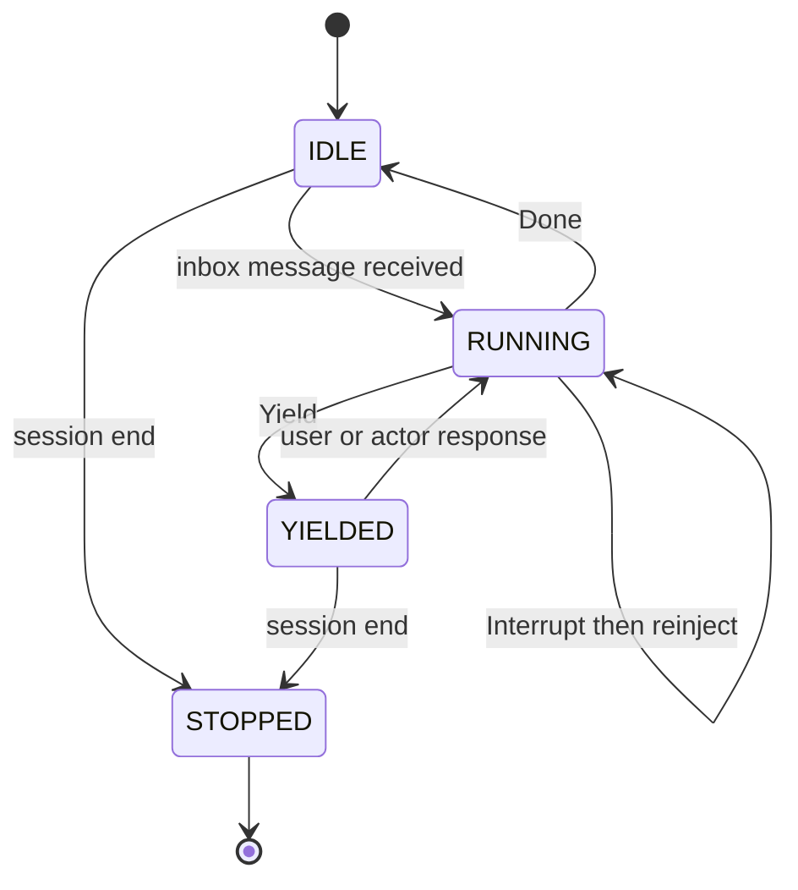

# Rust Agent v0.1 Specification

**Status:** Draft  
**Audience:** Pixma and coding agents implementing the project  
**Project location:** `~/dev/rust-agent`  
**Primary artifact:** A headless, single-binary Rust coding-agent core with an event API  
**Delivery model:** Four vertical phases, each a demonstrable end-to-end slice

## 1. Vision

Rust Agent is a personal, minimal-but-complete coding agent inspired by `pi` and `oh-my-pi`, but not constrained by compatibility with either. It must remain understandable, fast, reliable, and cooperative with its operator. The core agent loop should be approximately 200 lines of direct orchestration: call a model, execute requested tools, append results, and either continue, finish, or yield to the human.

The system is built around one unifying primitive: an asynchronous event bus connecting independent actors. Main agents, subagents, users, plugins, persistence, user interfaces, and the optional co-agent all participate through messages and events rather than bespoke integration paths.

The design deliberately leaves judgment to the model when judgment does not need to be enforced in code. The core enforces security, protocol integrity, process lifecycle, and state consistency. It does not encode gameable proxies for success such as requiring an empty todo list before a task may end.

## 2. Goals

Version 0.1 SHALL provide:

1. A headless Rust agent loop using an OpenAI-compatible model endpoint.
2. Streaming assistant text and tool calls.
3. Five native development tools: `read`, `write`, `edit`, `bash`, and `grep`.
4. Explicit `Continue`, `Done`, and `Yield` loop outcomes.
5. An asynchronous event bus with per-actor inboxes.
6. A local HTTP and SSE API implemented with Axum.
7. External-process plugins over JSON-RPC stdio.
8. MCP tool integration through `rmcp`.
9. Non-blocking subagents using the same loop as the main agent.
10. SQLite persistence implemented as an event-bus subscriber.
11. Standard project rules, persona, and skill file loading.
12. Hot reload for configuration, personas, and plugin definitions.
13. An optional co-agent implemented through the same plugin and event mechanisms.
14. A Ratatui client that consumes the server API rather than importing agent internals.

## 3. Non-Goals

Version 0.1 SHALL NOT attempt to provide:

- Drop-in compatibility with Claude Code, OpenCode, Codex, `pi`, or another agent.
- A provider abstraction supporting hundreds of provider-specific protocols.
- Protocols other than OpenAI-compatible chat completions.
- Embedded Python, JavaScript, WebAssembly, PyO3, or `deno_core` plugin runtimes.
- Automatic Rust self-modification followed by self-recompilation.
- A distributed worker scheduler or multi-host subagent cluster.
- A plugin marketplace, package manager, or remote plugin installation.
- A production multi-tenant service.
- A WebUI or mobile application.
- A mandatory todo system.
- Forced continuation until a goal, plan, or todo list is declared complete.
- Autonomous semantic compaction that silently discards conversation history.
- A secure OS sandbox for `bash` or external plugins.
- Perfect compatibility with every nominally OpenAI-compatible provider.
- Complex orchestration algorithms that can instead be expressed in a system prompt or co-agent prompt.
- Automatic skill selection inside the core.
- Memory or Contextd-specific privileges in the core.
- Mid-token steering that mutates an already-running model request.

## 4. Normative Language

The terms **MUST**, **MUST NOT**, **SHOULD**, **SHOULD NOT**, and **MAY** describe requirements for v0.1.

- **MUST** indicates a required invariant.
- **SHOULD** indicates the default unless implementation evidence justifies an exception.
- **MAY** indicates an optional behavior.
- **Actor** means an independently scheduled task or process with a mailbox.
- **Event** means an immutable record describing something that happened.
- **Command** means a targeted request delivered to one actor.
- **Turn** means one user- or agent-initiated unit of interaction.
- **Model step** means one request to the model and its streamed response.
- **Task** means the work correlated with an initiating inbox message. Task completion is advisory, not an enforced goal condition.

## 5. Core Principles

### 5.1 Keep the Agent Loop Small

The conceptual agent is:

1. Send the transcript and tool definitions to the model.
2. Stream and normalize the response.
3. If the response contains tool calls, execute them and continue.
4. If it contains final text, finish the turn.
5. If human action is required, yield.

Most complexity in production agents comes from streaming recovery, provider inconsistencies, process cancellation, context management, security, persistence, and UI synchronization. Version 0.1 implements only the portion of that long tail required for a dependable personal agent.

### 5.2 Do Not Encode Gameable Proxies

The harness MUST NOT equate observable proxies with actual task success.

Examples of prohibited constraints include:

- Refusing to stop while a todo list is non-empty.
- Treating deletion of a goal file as goal completion.
- Requiring a particular number of tool calls.
- Continuing merely because the model has unused token budget.
- Inferring success from a self-reported completion flag without exposing the result to the user.

Every enforced state MUST have an honest exit. When progress requires human action, unavailable credentials, clarification, or an external physical step, the correct outcome is `Yield`, not fabricated completion or forced continuation.

### 5.3 Prompt First, Code Only Necessary Invariants

Judgment, workflow style, planning preferences, and task-specific orchestration SHOULD live in prompts, personas, skills, or plugins.

Code SHALL be reserved for invariants such as:

- Protocol validation.
- Tool permission boundaries.
- Process lifecycle.
- Cancellation.
- Durable ordering.
- Event persistence.
- Hook timeouts.
- Path validation for native file tools.
- Model and tool allowlists.

### 5.4 One Extensibility Primitive

The event bus and actor model are the common mechanism for:

- User messages.
- Agent-to-agent messages.
- Subagent completion.
- Plugin observations.
- Hook invocations.
- UI updates.
- Persistence.
- Goal monitoring.
- Context retrieval.
- MCP tools.
- Co-agent behavior.

A feature that requires a second, unrelated orchestration framework SHOULD be rejected or redesigned.

### 5.5 Actors Never Mutually Wait

The main agent MUST NOT block waiting for a subagent result. Subagents MUST NOT require the main agent to synchronously receive their output. User messages MUST be accepted while an agent is running.

Bounded hook invocations are the sole exception: a pre-action hook may delay an action long enough to modify or deny it. Hook execution MUST have a timeout and explicit failure policy.

### 5.6 Make Mutations Visible

When a plugin rewrites a prompt, modifies tool arguments, changes a tool result, or denies an action:

- The original input MUST remain available in the event history where safe.
- The applied decision MUST be recorded.
- The UI SHOULD identify the responsible plugin.
- Hidden prompt mutation MUST NOT be presented as if it came directly from the user.

## 6. Architecture Overview

### 6.1 System Diagram


### 6.2 Runtime Model

The core is a single Rust binary with multiple operating modes:

```text
rust-agent serve
rust-agent tui
rust-agent run
```

- `serve` starts the authoritative core, event bus, agent actors, plugin supervisor, SQLite subscriber, and Axum API.
- `tui` is a client. It connects through HTTP (commands) and SSE (events) and MUST NOT reach directly into agent-loop state.
- `run` starts a local core for a single terminal invocation. It MAY use an in-process client, but that client MUST still communicate through the same command and event interfaces.

The binary remains mono-binary even though user-selected plugins run as external processes. Plugin language runtimes are not bundled or embedded.

### 6.3 Actor Isolation

Main agents and subagents SHOULD be Tokio tasks within the core process. Each actor owns:

- Its transcript.
- Its model configuration.
- Its persona.
- Its enabled tool set.
- Its state machine.
- Its inbox receiver.
- Its cancellation token.

No actor may mutate another actor's transcript directly. Communication MUST use a targeted inbox command or a published event.

External hook plugins, MCP servers, and the reference co-agent run as OS processes supervised by the core.

### 6.4 Commands Versus Events

The implementation MUST distinguish commands from events.

A command is targeted:

```json
{
  "command_id": "01J...",
  "session_id": "session-01J...",
  "source_actor_id": "user:tui-1",
  "target_actor_id": "agent:main",
  "mode": "next-turn",
  "content": [
    {
      "type": "text",
      "text": "Please run the focused test."
    }
  ],
  "created_at": "2026-09-03T10:00:00Z"
}
```

An event is immutable and broadcast:

```json
{
  "schema_version": 1,
  "event_id": "01J...",
  "seq": 42,
  "session_id": "session-01J...",
  "actor_id": "agent:main",
  "kind": "tool.post_call",
  "occurred_at": "2026-09-03T10:00:02Z",
  "causation_id": "01J...",
  "correlation_id": "task-01J...",
  "payload": {}
}
```

Events MUST have total order within one session through the monotonically increasing `seq` field. No global order across sessions is required.

## 7. Core Agent State Machine

An agent actor has four externally visible states:

```text
IDLE
RUNNING
YIELDED
STOPPED
```

Transitions:



- `IDLE` means no active model turn. A new inbox message wakes the actor immediately.
- `RUNNING` means a model request, stream, or tool execution is active.
- `YIELDED` means the actor explicitly requested human input or action.
- `STOPPED` means the session or actor has ended.

`Done` is a turn outcome, not a permanent actor state. After `Done`, the actor returns to `IDLE` unless queued messages immediately start another turn.

## 8. Agent Loop

### 8.1 Loop Outcomes

Every model step MUST resolve to one of three outcomes:

```rust
enum StepOutcome {
    Continue {
        tool_calls: Vec<ToolCall>,
    },
    Done {
        response: AssistantMessage,
    },
    Yield {
        request: HumanRequest,
    },
}
```

- `Continue` executes tool calls, appends their results, and performs another model step.
- `Done` publishes the assistant response, ends the current turn, and waits for another inbox message.
- `Yield` cleanly ends the active loop while preserving resumable state.

### 8.2 Rust-Flavored Pseudocode

```rust
async fn run_agent(mut actor: AgentActor) -> Result<()> {
    loop {
        actor.set_state(AgentState::Idle).await?;

        let initial = actor.inbox.wait_and_drain().await?;
        if initial.contains_shutdown() {
            return actor.stop().await;
        }

        let mut turn = actor.begin_turn(initial).await?;
        actor.set_state(AgentState::Running).await?;

        'turn: loop {
            // next-turn messages received during a previous turn are injected here.
            turn.inject_ready_messages(InjectionPoint::TurnStart);

            let turn_start = actor
                .hooks
                .apply("turn.start", turn.turn_start_payload())
                .await?;

            if let HookAction::Deny(reason) = turn_start.action {
                actor.yield_with_reason(reason).await?;
                break 'turn;
            }

            let prompt = actor.build_prompt(&turn).await?;

            let pre_llm = actor
                .hooks
                .apply("prompt.pre_llm", prompt.into_hook_payload())
                .await?;

            let prompt = match pre_llm.action {
                HookAction::Continue => pre_llm.payload,
                HookAction::Modify => pre_llm.payload,
                HookAction::Deny(reason) => {
                    actor.yield_with_reason(reason).await?;
                    break 'turn;
                }
            };

            let mut stream = actor.provider.start(prompt).await?;
            let mut response = ResponseAccumulator::new();
            let step_cancel = CancellationToken::new();

            loop {
                tokio::select! {
                    chunk = stream.next() => {
                        match chunk.transpose()? {
                            Some(chunk) => {
                                response.push(chunk)?;
                                actor.publish_stream_delta(response.last_delta()).await?;
                            }
                            None => break,
                        }
                    }

                    command = actor.inbox.recv() => {
                        let command = command?;

                        match command.mode {
                            DeliveryMode::NextTurn => {
                                actor.inbox_buffer.push(command);
                            }

                            DeliveryMode::Steer => {
                                // Never mutates the request already in flight.
                                actor.inbox_buffer.push(command);
                            }

                            DeliveryMode::Interrupt => {
                                actor.inbox_buffer.push(command);
                                step_cancel.cancel();
                                stream.cancel().await;
                                actor.record_interrupted_step().await?;
                                turn.inject_ready_messages(
                                    InjectionPoint::AfterInterrupt
                                );
                                continue 'turn;
                            }
                        }
                    }
                }
            }

            let normalized = response.finish()?;
            let normalized = actor
                .hooks
                .apply("llm.response", normalized.into_hook_payload())
                .await?
                .require_allowed()?;

            match classify_response(normalized)? {
                StepOutcome::Continue { tool_calls } => {
                    // v0.1 executes calls serially for deterministic behavior.
                    for call in tool_calls {
                        let pre_call = actor
                            .hooks
                            .apply("tool.pre_call", call.into_hook_payload())
                            .await?;

                        let result = match pre_call.action {
                            HookAction::Deny(reason) => {
                                ToolResult::denied(reason)
                            }
                            HookAction::Continue | HookAction::Modify => {
                                actor.execute_tool_cancellable(
                                    pre_call.payload,
                                    &mut actor.inbox_buffer,
                                ).await?
                            }
                        };

                        let result = actor
                            .hooks
                            .apply("tool.post_call", result.into_hook_payload())
                            .await?
                            .require_allowed()?;

                        turn.append_tool_result(result);

                        if actor.inbox_buffer.has_interrupt() {
                            actor.cancel_running_work().await?;
                            turn.inject_ready_messages(
                                InjectionPoint::AfterInterrupt
                            );
                            continue 'turn;
                        }

                        if actor.inbox_buffer.has_steer() {
                            // The end of a tool call is the normal steer boundary.
                            turn.inject_ready_messages(
                                InjectionPoint::AfterToolCall
                            );
                            continue 'turn;
                        }

                        if turn.last_tool_requested_yield() {
                            actor.publish_yield(turn.last_human_request()).await?;
                            actor.set_state(AgentState::Yielded).await?;
                            break 'turn;
                        }
                    }

                    continue 'turn;
                }

                StepOutcome::Done { response } => {
                    turn.append_assistant_message(response);
                    actor.finish_turn(&turn, TurnOutcome::Done).await?;

                    if actor.inbox_buffer.has_ready_next_turn() {
                        let next = actor.inbox_buffer.drain_for_next_turn();
                        turn = actor.begin_turn(next).await?;
                        continue 'turn;
                    }

                    break 'turn;
                }

                StepOutcome::Yield { request } => {
                    actor.publish_yield(request).await?;
                    actor.finish_turn(&turn, TurnOutcome::Yielded).await?;
                    actor.set_state(AgentState::Yielded).await?;
                    break 'turn;
                }
            }
        }
    }
}
```

The production implementation MAY split this function into helpers, but the control flow MUST remain legible from one primary loop. The architecture MUST NOT hide the loop behind a general workflow engine.

### 8.3 Yield and the `ask` Control Tool

`ask` is a core control-plane tool used when progress requires human input or action.

Example:

```json
{
  "question": "Please insert the SD card and confirm when it is visible.",
  "kind": "physical_action",
  "details": {
    "expected_device": "/dev/sdX"
  }
}
```

Calling `ask` MUST:

1. Publish `agent.yield`.
2. Persist the active transcript and turn state.
3. End the current model loop without reporting failure.
4. Leave the actor in `YIELDED`.
5. Resume only after a new inbox message is received.

A plain-text assistant question may still result in `Done`, but personas SHOULD instruct the model to use `ask` when explicit resumability is required.

## 9. Tools

### 9.1 Native Development Tools

The core exposes exactly five native development tools:

| Tool | Purpose | Required behavior |
|---|---|---|
| `read` | Read files or bounded line ranges | Normalize paths, report truncation, never invent missing content |
| `write` | Create or replace a file | Use atomic temporary-file plus rename where supported |
| `edit` | Apply exact, reviewable edits | Fail on no match or ambiguous multiple matches unless explicitly allowed |
| `bash` | Run a shell command | Set workspace cwd, capture stdout/stderr, support timeout and cancellation |
| `grep` | Search file contents | Prefer `rg`, bound result count and output bytes |

These are the only native development tools. Additional development integrations belong in MCP servers.

### 9.2 Core Control-Plane Tools

The following are core control primitives and are not counted among the five development tools:

- `ask`
- `spawn_agent`
- `load_skill`

They exist because they interact with core state rather than operating on the workspace.

### 9.3 Tool Safety Defaults

- `read`, `write`, `edit`, and `grep` MUST reject path traversal outside configured roots.
- Default writable roots SHOULD be the workspace and the Rust Agent user configuration directory.
- `bash` is not sandboxed in v0.1 and runs with the operator's OS permissions.
- Shell subprocesses MUST run in their own process group so `interrupt` can terminate descendants.
- Output MUST be bounded. Truncation metadata MUST include original byte counts when known.
- Tool denial MUST be represented as a structured tool result so the model can recover.
- Tool errors MUST never crash the agent actor.

## 10. Event Bus

### 10.1 Event Envelope

```rust
struct EventEnvelope {
    schema_version: u16,
    event_id: Ulid,
    seq: u64,
    session_id: SessionId,
    actor_id: ActorId,
    kind: String,
    occurred_at: DateTime<Utc>,
    causation_id: Option<Ulid>,
    correlation_id: Option<Ulid>,
    payload: serde_json::Value,
}
```

Requirements:

- Event IDs SHOULD be ULIDs for sortable uniqueness.
- `seq` MUST be assigned by the session sequencer.
- Payloads MUST be versioned by the envelope schema and validated by event kind.
- Core event kinds use reserved names without a vendor prefix.
- Plugin-defined event kinds MUST use `plugin.<plugin_id>.<name>`.
- Events are immutable after sequencing.
- Slow UI and observational subscribers MUST NOT block the agent loop.
- A reconnecting client MUST be able to resume from `seq` or SSE `Last-Event-ID`.

### 10.2 Hook Processing Versus Event Publication

For a hookable lifecycle point, the core performs:

```text
Construct candidate payload
        |
Invoke subscribed hooks in deterministic order
        |
Validate continue / patch / deny decisions
        |
Persist hook decisions and finalized event
        |
Publish finalized event
        |
Execute the permitted action
```

A hook mutates the candidate payload before the finalized event is published. It does not rewrite an event already present in the log.

### 10.3 Minimum Event Catalog

Hook policy legend:

- **Observe:** asynchronous notification only; no mutation.
- **Modify:** JSON Patch may modify the candidate payload.
- **Deny:** plugin may prevent the associated action.
- **No:** unavailable as a synchronous hook in v0.1.

| Event | Fired when | Payload shape | Hook policy |
|---|---|---|---|
| `session.start` | A new session has been configured but actors have not started | `{workspace, config, root_actor_id, client_ids}` | Modify, Deny |
| `session.end` | A session is shutting down after actor cleanup | `{reason, final_seq, actor_summaries}` | Observe |
| `message.received` | A user or actor command has been accepted into an inbox | `{command_id, source, target, mode, content}` | Observe |
| `turn.start` | An actor begins processing a drained inbox batch | `{turn_id, actor_id, messages, persona, task_id}` | Modify, Deny |
| `prompt.pre_llm` | Immediately before an OpenAI request is constructed | `{model, messages, tools, context_blocks, settings}` | Modify, Deny |
| `llm.delta` | A normalized text or tool-call delta is received | `{turn_id, step_id, delta_type, delta}` | Observe; high-volume |
| `llm.response` | A full streamed response has been normalized | `{turn_id, step_id, message, usage, finish_reason}` | Modify, Deny |
| `tool.pre_call` | Before native or MCP tool execution | `{tool_call_id, name, source, args, actor_id}` | Modify, Deny |
| `tool.progress` | A running tool emits bounded progress | `{tool_call_id, stream, chunk, truncated}` | Observe |
| `tool.post_call` | A tool has completed, before its result enters the transcript | `{tool_call_id, name, status, output, metadata}` | Modify, Deny |
| `context.pre_compact` | The actor is near its configured context limit | `{messages, estimated_tokens, limit, strategy}` | Modify, Deny |
| `agent.state` | An actor changes state | `{actor_id, from, to, reason}` | Observe |
| `agent.yield` | An actor pauses for human input or action | `{actor_id, turn_id, question, kind, details}` | Observe |
| `subagent.spawned` | A child actor has been created and scheduled | `{agent_id, parent_id, persona, model, background, tools}` | Observe |
| `subagent.done` | A child finishes, yields terminally, is cancelled, or fails | `{agent_id, parent_id, status, result, error, usage}` | Observe |
| `turn.end` | A turn reaches `done`, `yielded`, `interrupted`, or `error` | `{turn_id, actor_id, outcome, usage, duration_ms}` | Observe |
| `task.done` | An actor produces a final response for the initiating task | `{task_id, actor_id, result_message_id, status}` | Observe |
| `hook.decision` | A hook returns, times out, crashes, or is bypassed | `{plugin_id, event, decision, paths, reason, duration_ms}` | No |
| `plugin.error` | A plugin has a protocol, process, or timeout failure | `{plugin_id, phase, code, message, failure_mode}` | No |

`task.done` MUST NOT mean that a todo list is empty. It records that the actor finished responding to the current task correlation.

## 11. Plugin Architecture

### 11.1 Process Model

Plugins are external processes. The core starts them using configured commands such as:

```text
python plugin.py
bun plugin.ts
contextd plugin
./target/release/my-plugin
```

The core MUST NOT embed Python, JavaScript, or another runtime.

Benefits of this decision:

- OS process isolation.
- Independent crash boundaries.
- No GIL or async FFI integration.
- Poly-language plugins.
- No plugin-language dependencies in the core binary.
- Simple restart and hot-reload behavior.
- The Rust core remains auditable.

This isolation is not a security sandbox. A plugin still runs with the user's OS permissions.

### 11.2 Plugin Kinds

Version 0.1 supports two process kinds:

```toml
[[plugins]]
id = "contextd"
kind = "hook"
command = "contextd"
args = ["plugin"]
failure_mode = "open"

[[plugins]]
id = "filesystem-mcp"
kind = "mcp"
command = "bun"
args = ["/path/to/server.ts"]
```

- `hook` processes speak the mini hook protocol.
- `mcp` processes speak standard MCP through `rmcp`.

A single package may provide both functions, but v0.1 MUST launch them as separate process modes. Multiplexing MCP and hook messages over one stdio stream is out of scope.

### 11.3 Transport and Framing

Hook plugins speak JSON-RPC 2.0 over stdio using newline-delimited JSON.

Rules:

- One complete JSON-RPC message per stdout line.
- Newlines inside strings use normal JSON escaping.
- Plugin logs MUST go to stderr.
- The core MUST enforce a configurable maximum frame size, defaulting to 4 MiB.
- Malformed frames MUST produce `plugin.error`.
- Requests MUST have deadlines.
- Process exit MUST fail all outstanding requests.
- The supervisor MAY restart a crashed plugin with bounded exponential backoff.

### 11.4 Handshake

The core starts the process and sends:

```json
{
  "jsonrpc": "2.0",
  "id": 1,
  "method": "plugin.initialize",
  "params": {
    "protocol_version": "0.1",
    "core_version": "0.1.0",
    "workspace": "/home/pixma/dev/rust-agent",
    "session_id": "session-01J...",
    "capabilities": {
      "json_patch": "rfc6902",
      "bidirectional_rpc": true,
      "custom_events": true,
      "post_message": true
    }
  }
}
```

The plugin responds:

```json
{
  "jsonrpc": "2.0",
  "id": 1,
  "result": {
    "plugin_id": "contextd",
    "plugin_version": "0.1.0",
    "protocol_version": "0.1",
    "subscriptions": [
      {
        "event": "prompt.pre_llm",
        "mode": "hook",
        "priority": 50,
        "timeout_ms": 2000,
        "failure_mode": "open"
      },
      {
        "event": "turn.end",
        "mode": "observe"
      }
    ]
  }
}
```

The core validates the response and sends:

```json
{
  "jsonrpc": "2.0",
  "method": "plugin.ready",
  "params": {
    "accepted_subscriptions": [
      "prompt.pre_llm",
      "turn.end"
    ]
  }
}
```

A plugin MUST NOT receive events it did not subscribe to.

### 11.5 Hook Contract

The core invokes a synchronous hook with:

```json
{
  "jsonrpc": "2.0",
  "id": 28,
  "method": "hook.invoke",
  "params": {
    "event": "tool.pre_call",
    "event_version": 1,
    "session_id": "session-01J...",
    "actor_id": "agent:main",
    "correlation_id": "task-01J...",
    "payload": {
      "tool_call_id": "call-01J...",
      "name": "bash",
      "source": "native",
      "args": {
        "command": "cargo test"
      }
    }
  }
}
```

The plugin returns exactly one of three decisions.

Continue:

```json
{
  "jsonrpc": "2.0",
  "id": 28,
  "result": {
    "decision": "continue"
  }
}
```

Modify:

```json
{
  "jsonrpc": "2.0",
  "id": 28,
  "result": {
    "decision": "modify",
    "patch": [
      {
        "op": "replace",
        "path": "/args/command",
        "value": "cargo test --workspace"
      }
    ],
    "reason": "Workspace policy requires the full Rust test suite."
  }
}
```

Deny:

```json
{
  "jsonrpc": "2.0",
  "id": 28,
  "result": {
    "decision": "deny",
    "reason": "The command targets a protected path."
  }
}
```

Patches MUST use RFC 6902 JSON Patch. The core MUST:

1. Apply hooks sequentially by ascending priority, then plugin ID.
2. Give each hook the payload resulting from previous accepted patches.
3. Validate every patch against the event's payload schema.
4. Reject patches to immutable envelope fields.
5. Stop processing hooks after the first valid `deny`.
6. Record a `hook.decision` event with affected paths and hashes.
7. Avoid duplicating sensitive raw values in hook audit metadata.

### 11.6 Failure Policy

Each hook subscription declares:

```text
failure_mode = open | closed
```

- `open`: continue with the last valid payload if the plugin crashes or times out.
- `closed`: deny the action if the plugin crashes or times out.

Defaults:

- Context enrichment and co-agent hooks SHOULD fail open.
- Security gates MAY fail closed.
- Observational subscribers never affect the action.
- A timeout MUST produce `plugin.error` and `hook.decision`.

Closed failure behavior must remain recoverable:

- A denied tool call becomes a structured tool error.
- A denied prompt causes `Yield` with a visible reason.
- The core MUST NOT spin retrying a failed closed hook indefinitely.

### 11.7 Plugin-to-Core Methods

The stdio connection is bidirectional. Hook plugins MAY call:

#### `core.post_message`

```json
{
  "jsonrpc": "2.0",
  "id": 91,
  "method": "core.post_message",
  "params": {
    "target_actor_id": "agent:main",
    "mode": "next-turn",
    "content": [
      {
        "type": "text",
        "text": "Goal drift detected: the active task is still to fix streaming cancellation."
      }
    ]
  }
}
```

#### `core.publish`

```json
{
  "jsonrpc": "2.0",
  "id": 92,
  "method": "core.publish",
  "params": {
    "kind": "plugin.co-agent.summary",
    "payload": {
      "text": "The agent updated cancellation handling and is running tests."
    }
  }
}
```

The core MUST:

- Associate emitted messages and events with the plugin identity.
- Reject event names outside `plugin.<plugin_id>.*`.
- Apply normal inbox routing and delivery semantics.
- Rate-limit plugin-originated messages to prevent feedback loops.
- Prevent a plugin from impersonating the user or another actor.

## 12. Plugin Examples

### 12.1 Contextd Plugin

Contextd must be implementable without direct access to the core database, transcript objects, or provider internals.

Subscriptions:

```text
prompt.pre_llm  hook
turn.end        observe
session.end     observe
```

At `prompt.pre_llm`, Contextd retrieves relevant memory and appends a typed context block:

```json
{
  "jsonrpc": "2.0",
  "id": 14,
  "result": {
    "decision": "modify",
    "patch": [
      {
        "op": "add",
        "path": "/context_blocks/-",
        "value": {
          "source": "plugin:contextd",
          "label": "Relevant project memory",
          "content": "The prior implementation used a cancellation token per model step.",
          "metadata": {
            "memory_ids": ["mem-42"],
            "confidence": 0.91
          }
        }
      }
    ],
    "reason": "Relevant prior implementation decision."
  }
}
```

At `turn.end`, Contextd receives the finalized turn asynchronously and ingests it.

This is the plugin-protocol validity test:

> If automatic Contextd retrieval and ingestion require a privileged Contextd-specific API, the plugin protocol is not expressive enough.

Contextd MAY also expose explicit search and ingest tools through a separate MCP process.

### 12.2 Pre-Tool Security Gate

A security plugin subscribes to `tool.pre_call` with `failure_mode = "closed"`.

Given:

```json
{
  "name": "bash",
  "args": {
    "command": "rm -rf /"
  }
}
```

It returns:

```json
{
  "jsonrpc": "2.0",
  "id": 28,
  "result": {
    "decision": "deny",
    "reason": "Destructive command targets the filesystem root."
  }
}
```

The model receives a structured result:

```json
{
  "status": "denied",
  "error": {
    "code": "plugin_denied",
    "plugin_id": "destructive-command-gate",
    "message": "Destructive command targets the filesystem root."
  }
}
```

The agent may explain the denial, choose a safer command, or use `ask`. It MUST NOT automatically bypass the plugin.

## 13. MCP Integration

The core is an MCP client using `rmcp`.

Version 0.1 SHALL support:

- MCP servers launched as configured stdio child processes.
- Tool discovery after initialization.
- JSON Schema validation of tool arguments.
- Tool invocation.
- Cancellation where supported.
- Connection loss and restart reporting.
- Namespaced tool names.

MCP tools SHOULD be exposed to models as:

```text
mcp.<server_id>.<tool_name>
```

Example:

```text
mcp.contextd.search
mcp.github.get_issue
```

This prevents collisions with native tools and tools from other servers.

Version 0.1 does not require:

- Remote HTTP MCP transport.
- MCP resources.
- MCP prompts.
- Exposing Rust Agent itself as an MCP server.
- Dynamic installation of MCP servers.

MCP covers external tools. The mini hook protocol covers inverse control flow where the core calls a plugin during lifecycle processing.

## 14. Subagents

### 14.1 Definition

A subagent is another instance of the same agent loop with:

- A distinct actor ID.
- Its own transcript.
- Its own inbox.
- A selected persona.
- A selected model.
- A restricted tool set.
- A parent actor ID.
- A task correlation ID.

There is no separate subagent execution engine.

### 14.2 `spawn_agent`

Schema:

```json
{
  "persona": "reviewer",
  "model": "fast",
  "prompt": "Review the cancellation design for race conditions.",
  "background": true,
  "tools": ["read", "grep", "bash"]
}
```

Result:

```json
{
  "agent_id": "agent-01J...",
  "status": "spawned"
}
```

`spawn_agent` MUST return immediately after successful actor creation. It MUST NOT wait for the child model, tools, or final response.

Parameter semantics:

- `persona`: references `agents/<name>.md`.
- `model`: optional override of the persona's configured model.
- `prompt`: explicit child task.
- `background`: controls lifetime, not blocking.
- `tools`: requested subset of permitted tools.

`background = false` means the child is cancelled if its parent task is cancelled or ends.  
`background = true` means the child may continue after the parent turn ends.

Both modes are non-blocking.

### 14.3 Permissions

A child tool set MUST be the intersection of:

```text
requested tools
∩ persona-allowed tools
∩ parent-delegable tools
∩ session policy
```

A child model override MUST reference a configured model alias. Models and arbitrary API endpoints MUST NOT be introduced through tool arguments.

### 14.4 Context

A child SHOULD receive:

- The core system contract.
- Applicable global, user, and project rules.
- Its persona body.
- The explicit spawn prompt.
- Small, explicit context attachments selected by the parent.

A child MUST NOT receive the full parent transcript by default. This keeps context small and prevents accidental propagation of irrelevant or sensitive material.

### 14.5 Completion

A child completion emits:

```json
{
  "kind": "subagent.done",
  "payload": {
    "agent_id": "agent-01J...",
    "parent_id": "agent:main",
    "status": "done",
    "result": {
      "type": "text",
      "text": "The cancellation design has one race..."
    },
    "error": null,
    "usage": {
      "input_tokens": 3120,
      "output_tokens": 640
    }
  }
}
```

Allowed statuses:

```text
done
yielded
cancelled
error
```

The result is also routed to the parent inbox using `next-turn` unless session policy disables automatic routing.

Spawning N subagents SHALL create N independently scheduled actors. Completion order is event order, not spawn order. The main agent MUST remain responsive while any child runs.

## 15. Message Delivery Modes

Every message sent by a user, subagent, or plugin uses the same delivery selector.

| Mode | Meaning | Injection point |
|---|---|---|
| `next-turn` | Normal follow-up that must not disturb active work | End of current turn or beginning of next turn |
| `steer` | Reorient active work without discarding completed tool work | After the current tool call finishes, before the next model request |
| `interrupt` | Stop the current turn and immediately prioritize the new message | After cancellation and cleanup of the active stream or tool |

### 15.1 Idle Behavior

When the target actor is `IDLE` or `YIELDED`:

- Any message wakes it immediately.
- The inbox is drained as one ordered batch.
- `next-turn`, `steer`, and `interrupt` all begin a new turn.
- Mode metadata remains recorded for audit, even when its timing effect is equivalent.

### 15.2 Running Behavior

When the target actor is `RUNNING`:

- `next-turn` remains buffered until the active turn ends.
- `steer` remains buffered until a natural boundary.
- `interrupt` triggers cancellation immediately and is injected after cleanup.

The system uses one logical inbox buffer. Delivery mode controls eligibility at each injection point; it does not create three unrelated queues.

### 15.3 Steer Semantics

Version 0.1 deliberately implements sane steering, not mid-stream request mutation.

If `steer` arrives:

- During model streaming that later requests a tool, the tool call is allowed to complete, then steer is injected before the next model request.
- During a running tool call, the tool is allowed to complete, then steer is injected.
- During a final text response with no tool call, the response finishes and steer starts the next turn.
- Before a new model request, all eligible steer messages are injected in inbox sequence order.

### 15.4 Interrupt Semantics

An interrupt MUST:

1. Mark the current model step or tool call as cancellation-requested.
2. Cancel the HTTP request or subprocess.
3. Wait for bounded cleanup.
4. Record an interrupted result.
5. Inject the interrupting message.
6. Start a fresh model step with the preserved transcript.

For `bash`, cancellation SHOULD send `SIGTERM` to the process group, wait a short grace period, then send `SIGKILL`. The exact grace period remains configurable.

The UI MUST acknowledge message acceptance immediately, independent of injection timing.

## 16. Meta-Loop and Co-Agent

### 16.1 Definition

The co-agent is an optional external plugin using a small, cheap, fast model. It maintains its own context and subscribes to the event bus. It is not inserted into the main agent transcript unless it deliberately posts a message or modifies a hook payload.

The co-agent MUST NOT become a second mandatory orchestration engine. Its advice remains inspectable and non-authoritative unless the user configures a specific hook as a security gate.

### 16.2 Initial Responsibilities

The reference co-agent MAY implement:

1. **UI summaries:** Summarize the last meaningful event or assistant response and publish `plugin.co-agent.summary`.
2. **Goal drift detection:** At `turn.end`, compare recent actions with `goal.md`.
3. **Todo integrity observation:** Detect a todo list being cleared without corresponding work evidence.
4. **Prompt improvement:** At `turn.start`, propose a clearer formulation of the user request.
5. **Motivation:** Inject a short reminder at the next `prompt.pre_llm` when the actor is drifting.

### 16.3 Emergent Goal Feature

The goal feature is intentionally file-based:

```text
goal.md
```

The core only loads the file as ordinary context when configured. The co-agent:

1. Watches `goal.md`.
2. Observes turns and tool events.
3. Evaluates whether work still matches the goal.
4. Posts a `next-turn` or `steer` reminder when useful.

There is no goal-state machine and no forced goal completion.

### 16.4 Anti-Todo-Hacking Behavior

The core MUST NOT force todos to be empty.

The co-agent may detect suspicious behavior such as:

- Todos removed without relevant edits or commands.
- A completion claim immediately after deleting the task list.
- Repeated rewriting of task wording without progress.

It may then post:

```text
The todo list was cleared, but the requested test has not run and no
implementation event supports completion. Re-check the actual goal.
```

This works because the observer is outside the main loop and has an independent context. It remains advisory and therefore cannot trap the main agent in a forced-continuation loop.

### 16.5 Prompt Rewrite Transparency

If the co-agent rewrites a user prompt:

- `message.received` retains the original.
- `turn.start` records the applied patch.
- The UI SHOULD show that a co-agent rewrite occurred.
- The rewrite MUST NOT change the user's authorization intent.
- Security-sensitive escalation, such as adding permission to run destructive commands, MUST be rejected.

## 17. Persistence

### 17.1 Model

SQLite persistence is a durable event-bus subscriber, not an independent orchestration layer.

The event log is canonical. Tables such as `messages` are rebuildable projections.

Recommended tables:

```text
workspaces
sessions
actors
events
messages
inbox_messages
plugin_state
```

Conceptual schema:

```sql
workspaces(
    workspace_id TEXT PRIMARY KEY,
    root_path TEXT NOT NULL,
    created_at TEXT NOT NULL,
    last_opened_at TEXT NOT NULL
)

sessions(
    session_id TEXT PRIMARY KEY,
    workspace_id TEXT NOT NULL,
    root_actor_id TEXT NOT NULL,
    status TEXT NOT NULL,
    created_at TEXT NOT NULL,
    updated_at TEXT NOT NULL
)

actors(
    actor_id TEXT PRIMARY KEY,
    session_id TEXT NOT NULL,
    parent_actor_id TEXT,
    persona TEXT NOT NULL,
    model TEXT NOT NULL,
    state TEXT NOT NULL
)

events(
    session_id TEXT NOT NULL,
    seq INTEGER NOT NULL,
    event_id TEXT NOT NULL UNIQUE,
    actor_id TEXT NOT NULL,
    kind TEXT NOT NULL,
    occurred_at TEXT NOT NULL,
    causation_id TEXT,
    correlation_id TEXT,
    payload_json TEXT NOT NULL,
    PRIMARY KEY(session_id, seq)
)

messages(
    message_id TEXT PRIMARY KEY,
    session_id TEXT NOT NULL,
    actor_id TEXT NOT NULL,
    turn_id TEXT NOT NULL,
    role TEXT NOT NULL,
    content_json TEXT NOT NULL,
    source_event_id TEXT NOT NULL
)

inbox_messages(
    command_id TEXT PRIMARY KEY,
    session_id TEXT NOT NULL,
    source_actor_id TEXT NOT NULL,
    target_actor_id TEXT NOT NULL,
    mode TEXT NOT NULL,
    content_json TEXT NOT NULL,
    status TEXT NOT NULL,
    created_at TEXT NOT NULL
)
```

Production migrations SHOULD use typed Rust domain functions rather than spreading SQL throughout the codebase.

### 17.2 Durability Ordering

For state-changing events:

1. The session sequencer assigns `seq`.
2. The persistence subscriber writes the event in a transaction.
3. The durable write is acknowledged.
4. The event is broadcast to non-durable subscribers.

This makes the database a bus subscriber while ensuring the UI never observes a state transition that cannot be resumed after a crash.

High-volume `llm.delta` events MAY be configured as non-durable. Final `llm.response`, messages, tool calls, tool results, state changes, and hook decisions MUST be durable.

### 17.3 Replay and Resume

Resume consists of:

1. Loading the session and workspace.
2. Replaying durable events through pure state reducers.
3. Reconstructing actor transcripts and inbox state.
4. Marking any uncompleted model or tool operation as interrupted.
5. Restarting actors in `IDLE` or `YIELDED`.
6. Restarting plugins and MCP servers.
7. Waiting for a message or explicit retry.

Replay MUST NOT re-execute model requests, tools, or plugin side effects. It reconstructs state only.

If a crash occurred during a tool call, the core MUST NOT blindly repeat it. The resumed transcript receives an interrupted tool result and the agent or user decides whether retrying is safe.

### 17.4 Database Defaults

- SQLite SHOULD use WAL mode.
- One writer task SHOULD serialize writes.
- The database file SHOULD be created with user-only permissions.
- Tool outputs MUST be bounded before persistence.
- Secrets SHOULD not be duplicated across event payloads.
- Encryption at rest is out of scope for v0.1 and must be documented to the operator.

## 18. Standard File Loading

### 18.1 Instruction Precedence

Instruction sources are loaded from lowest to highest precedence:

```text
embedded core contract
global rules
user rules
project rules
persona
explicit user message
```

Conflict precedence is:

```text
project > user > global
```

Security invariants enforced by the core cannot be overridden by files or prompts.

Suggested locations:

```text
/etc/rust-agent/AGENTS.md
/etc/rust-agent/rules.md

~/.config/rust-agent/AGENTS.md
~/.config/rust-agent/rules.md

<workspace>/AGENTS.md
<workspace>/rules.md
<workspace>/<nested-path>/AGENTS.md
<workspace>/<nested-path>/rules.md
```

For project files, discovery proceeds from the workspace root toward the active working directory. More specific nested files are appended later and take precedence.

Every injected block SHOULD include its source path.

### 18.2 Personas

Personas are Markdown files with YAML frontmatter:

```markdown
---
model: fast
tools:
  - read
  - grep
  - bash
thinking: medium
---

You are a focused Rust reviewer.

Inspect the requested change for correctness, cancellation safety,
error handling, and unnecessary abstraction. Do not edit files.
```

Search order:

```text
<workspace>/agents/<name>.md
~/.config/rust-agent/agents/<name>.md
/etc/rust-agent/agents/<name>.md
```

The first match wins.

Required frontmatter fields:

- `model`
- `tools`

Optional fields:

- `thinking`
- `description`
- `max_steps`
- `timeout_seconds`

Unknown fields SHOULD produce a warning rather than being silently accepted.

### 18.3 Skills

Skills use progressive disclosure:

```text
<workspace>/skills/<name>/SKILL.md
~/.config/rust-agent/skills/<name>/SKILL.md
/etc/rust-agent/skills/<name>/SKILL.md
```

The core exposes:

```json
{
  "name": "load_skill",
  "arguments": {
    "name": "debugging"
  }
}
```

The core performs only deterministic discovery, loading, and provenance reporting. It does not decide which skill is relevant.

Skill selection belongs in:

- The main system prompt.
- A persona.
- A plugin.
- The co-agent.

### 18.4 Hot Reload and Self-Awareness

The `notify` crate watches:

```text
AGENTS.md
rules.md
agents/*.md
skills/*/SKILL.md
plugins/*.toml
models.json
```

Reload semantics:

- Rule changes apply at the next `prompt.pre_llm`.
- Persona changes apply to new subagents and to existing actors at their next turn when configured.
- Model configuration changes apply to the next model request.
- Plugin manifest changes trigger a supervised restart at a safe boundary.
- Invalid new configuration leaves the last valid configuration active and emits `plugin.error` or a configuration event.

This provides self-awareness levels 1 and 2:

1. Agent behavior is represented as inspectable files.
2. The agent may edit those files and observe live reload.

Level 3, editing Rust source and recompiling or replacing the running core, is out of scope. A future implementation may use an external supervisor and atomic binary replacement.

## 19. Core Versus Plugin Rule

The core owns:

- The agent loop.
- The five native development tools.
- The three control-plane tools.
- Actor mailboxes.
- Event sequencing and publication.
- Hook protocol validation.
- MCP transport.
- Provider transport.
- Server API.
- Deterministic file loading.
- Process supervision.
- Persistence ordering.

Plugins own intelligence or policy that is not a core invariant:

- Memory retrieval.
- Contextd integration.
- Skill relevance.
- Prompt improvement.
- Goal drift detection.
- Todo integrity observation.
- Security policy beyond basic process and path safety.
- Specialized tools.
- Summarization and semantic compaction.

The decision test is:

> Could Contextd be implemented as an ordinary external plugin with no database access, no private transcript pointer, and no Contextd-specific core branch?

If not, improve the general hook, event, or MCP contract instead of adding a Contextd exception.

## 20. Server API

### 20.1 Binding and Trust Model

Version 0.1 is a personal local service.

Defaults:

```text
bind = 127.0.0.1
port = 7310
```

The server MUST NOT bind to a non-loopback address without an explicit configuration change. Remote authentication and TLS termination are not a v0.1 feature. Operators exposing it remotely are responsible for an authenticated reverse proxy or private network.

### 20.2 Minimum HTTP API

```text
POST   /v1/sessions
GET    /v1/sessions/:session_id
POST   /v1/sessions/:session_id/messages
GET    /v1/sessions/:session_id/events
GET    /v1/sessions/:session_id/ws
POST   /v1/sessions/:session_id/stop
GET    /v1/health
```

Create session:

```json
{
  "workspace": "/home/pixma/dev/project",
  "persona": "main",
  "model": "default"
}
```

Post message:

```json
{
  "target_actor_id": "agent:main",
  "mode": "steer",
  "content": [
    {
      "type": "text",
      "text": "Do not change the public API."
    }
  ]
}
```

Response:

```json
{
  "command_id": "01J...",
  "accepted": true,
  "actor_state": "running"
}
```

### 20.3 SSE

`GET /v1/sessions/:session_id/events` returns sequenced event envelopes.

Requirements:

- SSE `id` equals the session `seq`.
- Clients may send `Last-Event-ID`.
- Reconnect replays durable events after that sequence.
- Live events follow replay without a gap.
- Slow clients receive bounded buffering and are disconnected rather than blocking actors.

### 20.4 WebSocket

> **Removed 2026-10-01.** The WebSocket transport (`GET /v1/sessions/:session_id/ws`) was removed from the implementation because the only client uses HTTP + SSE. The text below is kept as historical specification and is not implemented.

WebSocket is the preferred bidirectional transport for the TUI.

Client frames carry commands:

```json
{
  "type": "message.send",
  "request_id": "client-42",
  "payload": {
    "target_actor_id": "agent:main",
    "mode": "next-turn",
    "content": [
      {
        "type": "text",
        "text": "Continue."
      }
    ]
  }
}
```

Server frames carry:

- Command acknowledgements.
- Event envelopes.
- Replay completion.
- Recoverable protocol errors.

All clients observe the same core event history. No UI owns authoritative transcript state.

## 21. Provider Configuration

### 21.1 Scope

The core supports OpenAI-compatible chat completions only.

Required endpoint:

```text
POST <base_url>/chat/completions
```

Streaming uses:

```json
{
  "stream": true
}
```

OmniRoute works directly because it exposes an OpenAI-compatible endpoint.

### 21.2 `models.json`

Recommended shape:

```json
{
  "providers": {
    "omniroute": {
      "base_url": "http://localhost:20128/v1",
      "api_key_env": "OMNIROUTE_API_KEY",
      "headers": {},
      "connect_timeout_ms": 5000,
      "request_timeout_ms": 600000
    }
  },
  "models": {
    "default": {
      "provider": "omniroute",
      "model": "openai/gpt-5.1-codex",
      "context_window": 200000,
      "max_output_tokens": 32000,
      "supports_tools": true,
      "supports_parallel_tool_calls": true,
      "thinking": "medium"
    },
    "fast": {
      "provider": "omniroute",
      "model": "openai/gpt-5-mini",
      "context_window": 128000,
      "max_output_tokens": 16000,
      "supports_tools": true,
      "supports_parallel_tool_calls": true,
      "thinking": "low"
    }
  }
}
```

Model IDs above are examples and MUST be replaced with models actually available through the operator's OmniRoute deployment.

Rules:

- Configuration stores API key environment-variable names, not secret values.
- Persona and `spawn_agent` model references use aliases such as `default` and `fast`.
- Unknown model aliases fail before starting a model request.
- Unsupported optional parameters produce a visible warning.
- v0.1 may execute parallel tool calls serially even if the model emits them in parallel.

### 21.3 Streaming Parser

The implementation SHOULD use `reqwest` plus a focused SSE decoder.

It MUST correctly handle:

- Arbitrary chunk boundaries.
- `\n\n` and `\r\n\r\n` event boundaries.
- Multiple `data:` lines.
- Comment lines.
- `[DONE]`.
- Incremental text deltas.
- Incremental tool-call IDs, names, and argument fragments.
- A final unterminated event at EOF where reasonable.
- Provider errors delivered before or during streaming.
- Cancellation.

The parser MUST NOT assume that one HTTP byte chunk equals one SSE event.

## 22. Stack

| Concern | Choice |
|---|---|
| Async runtime | `tokio` |
| HTTP client | `reqwest` |
| HTTP server | `axum` |
| Serialization | `serde`, `serde_json`, `toml` |
| MCP client | `rmcp` |
| TUI | `ratatui`, `crossterm` |
| SQLite | `rusqlite` or `sqlx` with SQLite |
| File watching | `notify` |
| IDs | `ulid` |
| Cancellation | `tokio-util::sync::CancellationToken` |
| Logging | `tracing`, `tracing-subscriber` |
| Errors | Typed domain errors with `thiserror`; `anyhow` only at application boundaries |

A synchronous SQLite writer actor using `rusqlite` is preferred for v0.1 unless async query requirements become real. SQLite operations remain behind that actor, avoiding accidental blocking across the async runtime.

## 23. Rig Versus Hand-Rolled Core

### Decision

The v0.1 code-agent loop SHALL be hand-rolled using `reqwest`, typed OpenAI request and response structures, and a focused SSE parser. `rig-core` SHALL NOT own the central loop.

### Rationale

`rig-core 0.39` is valuable for:

- Embedding pipelines.
- RAG.
- Vector-store integrations.
- Structured agent composition.
- Contextd-like retrieval systems.

It provides less leverage for this core because:

- Only one wire protocol is required.
- Exact streaming and cancellation behavior matters.
- Tool-call accumulation must integrate with inbox injection points.
- `Yield`, `steer`, `interrupt`, and hook boundaries are project-specific.
- The desired loop is intentionally small.

Using Rig for the core risks wrapping its abstractions in another control layer to regain the required behavior. That is more complex than directly implementing the loop.

Rig remains an appropriate dependency inside Contextd or another external plugin.

### Reconsideration Trigger

Reconsider a framework only if at least one becomes true:

- Multiple model protocols beyond OpenAI compatibility are required.
- Provider DTO maintenance materially exceeds the loop itself.
- The same retrieval and embedding abstractions appear repeatedly in the core.
- Rig exposes cancellation and streaming hooks that directly match this architecture.
- The hand-rolled implementation grows into an accidental provider framework.

Until then, direct ownership is simpler.

## 24. Context Management and Compaction

Semantic compaction is not a default v0.1 core feature.

The core SHOULD estimate context pressure from:

- Configured `context_window`.
- Provider-reported usage.
- A conservative local estimate for newly appended messages.

When approaching the configured threshold, it emits `context.pre_compact`.

A plugin MAY return a modified message set containing a summary. Without a successful compaction hook, the core MUST NOT silently discard history. It SHOULD:

1. Warn the actor and UI.
2. Allow the model request if still within the known limit.
3. On a context-limit failure, transition to `Yield`.
4. Ask the user to start a fresh session or enable a compaction plugin.

This is less convenient than hidden truncation but preserves correctness and follows the honest-exit principle.

## 25. Security and Reliability Boundaries

### 25.1 Trusted Personal Agent

This is a personal developer tool, not a hostile multi-tenant execution service. The user intentionally grants it access to source code and shell commands.

Nevertheless, the core MUST:

- Bind locally by default.
- Validate all protocol payloads.
- Bound message, event, and tool-output sizes.
- Avoid inheriting unnecessary secret environment variables into plugins.
- Allow plugin-specific environment allowlists.
- Normalize native file-tool paths.
- Record tool and hook actions.
- Support tool-gate plugins.
- Cancel process groups rather than only direct child PIDs.
- Never treat model text as trusted protocol data without parsing and validation.

### 25.2 External Processes Are Not Sandboxes

Running a plugin externally prevents memory corruption and runtime entanglement in the core, but does not prevent the plugin from reading user files or using the network.

The plugin manifest SHOULD support:

```toml
inherit_env = false
env_allow = ["PATH", "HOME", "CONTEXTD_URL"]
working_directory = "/home/pixma/dev/project"
```

Real OS sandboxing may be added later through Bubblewrap, containers, or platform-specific mechanisms. It is not implied by the external-process architecture.

### 25.3 Backpressure

- Every subscriber gets a bounded channel.
- Persistence is durable and participates in the publication barrier.
- UI and observational subscribers may lag or disconnect.
- Hook plugins are bounded by timeout rather than channel capacity.
- `llm.delta` may be dropped for lagging observational subscribers.
- Final messages and state transitions MUST remain replayable.

## 26. Open Questions and Risks

These questions do not block the architecture, but implementation must make their defaults explicit.

| Issue | v0.1 default | Risk or unresolved point |
|---|---|---|
| Steer during model text streaming | Wait until the response or tool boundary | A long textual response may delay steering more than expected |
| Interrupting shell tools | Cancel process group with `SIGTERM`, grace period, then `SIGKILL` | Some tools may leave external side effects or detached processes |
| Hook schema evolution | Version every event and protocol envelope | JSON Patch paths couple plugins to payload structure |
| Multiple modifying hooks | Sequential priority order, validate after each patch | Plugin order can change behavior and must remain visible |
| Hook timeouts | Per-subscription timeout; enrichment fails open | Slow hooks may add latency at every model step |
| Context compaction | No silent built-in semantic compaction | Long sessions eventually yield instead of continuing automatically |
| Event durability | Commit final events before live publication | SQLite latency becomes part of state-transition latency |
| Delta persistence | Non-durable by default | Exact partial stream reconstruction is unavailable after a crash |
| In-flight resume | Mark interrupted, never replay side effects | The user or model must decide whether a tool is safe to retry |
| OpenAI compatibility | Support the tested OmniRoute subset | Some providers use subtly incompatible SSE or tool-call formats |
| Co-agent feedback loops | Rate-limit plugin messages and tag their origin | A co-agent may repeatedly react to its own reminders |
| Prompt rewriting | Preserve original and audit applied patch | A poor rewrite can change intent even without malicious behavior |
| Tool-call concurrency | Execute serially per actor | Slower than parallel execution but deterministic and easier to cancel |
| Plugin restart semantics | Restart at safe boundaries | Stateful plugins need an explicit strategy for restoring their context |
| Token estimation | Conservative approximation plus provider usage | Exact tokenizers vary by model and may require future adapters |

The hardest practical areas are expected to be:

1. Cancellation that works consistently across HTTP streams and process trees.
2. Deterministic inbox injection while preserving an understandable transcript.
3. A hook schema stable enough for real plugins without becoming a generic workflow language.
4. Context management that remains honest without making long sessions unusable.
5. Durable replay that reconstructs state without replaying side effects.

## 27. Suggested Repository Layout

```text
rust-agent/
├── Cargo.toml
├── README.md
├── models.json
├── docs/
│   └── SPEC.md
├── agents/
│   ├── main.md
│   ├── reviewer.md
│   └── researcher.md
├── skills/
│   └── example/
│       └── SKILL.md
├── plugins/
│   ├── contextd.toml
│   └── co-agent.toml
├── src/
│   ├── main.rs
│   ├── app.rs
│   ├── agent/
│   │   ├── mod.rs
│   │   ├── actor.rs
│   │   ├── loop.rs
│   │   ├── prompt.rs
│   │   └── response.rs
│   ├── bus/
│   │   ├── mod.rs
│   │   ├── command.rs
│   │   ├── event.rs
│   │   ├── inbox.rs
│   │   └── sequencer.rs
│   ├── provider/
│   │   ├── mod.rs
│   │   ├── config.rs
│   │   ├── openai.rs
│   │   └── sse.rs
│   ├── tools/
│   │   ├── mod.rs
│   │   ├── native.rs
│   │   ├── control.rs
│   │   └── mcp.rs
│   ├── plugins/
│   │   ├── mod.rs
│   │   ├── protocol.rs
│   │   ├── hooks.rs
│   │   └── supervisor.rs
│   ├── persistence/
│   │   ├── mod.rs
│   │   ├── sqlite.rs
│   │   ├── migrations.rs
│   │   └── replay.rs
│   ├── config/
│   │   ├── mod.rs
│   │   ├── rules.rs
│   │   ├── persona.rs
│   │   ├── skills.rs
│   │   └── watch.rs
│   ├── server/
│   │   ├── mod.rs
│   │   ├── routes.rs
│   │   └── sse.rs
│   └── tui/
│       ├── mod.rs
│       ├── client.rs
│       ├── stream.rs
│       ├── reducer/
│       ├── runtime/
│       └── view/
└── tests/
    ├── agent_loop.rs
    ├── delivery_modes.rs
    ├── hook_protocol.rs
    ├── persistence_replay.rs
    ├── sse_parser.rs
    └── subagents.rs
```

Modules SHOULD remain small and explicit. The project SHOULD avoid creating generic `manager`, `engine`, or `framework` abstractions unless a concrete second implementation requires them.

## 28. Vertical-Phase MVP Roadmap

The roadmap is a sequence of vertical slices. Each phase ends with a usable or demonstrable system. A phase is not complete merely because types compile.

### Phase 1: Single-Agent Vertical Slice

**Goal:** One headless agent can edit a Rust project through OmniRoute.

#### Foundation

1. Create the crate, configuration types, tracing, and CLI entry points.
2. Implement `models.json` loading with environment-based credentials.
3. Implement typed OpenAI chat-completions requests.
4. Implement and test the SSE decoder.
5. Stream normalized assistant text to stdout.

#### Loop and Tools

1. Implement tool-call accumulation.
2. Implement `read`, `write`, `edit`, `bash`, and `grep`.
3. Implement `ask`.
4. Implement the `Continue`, `Done`, and `Yield` loop.
5. Add cancellation tokens around provider and tool operations.

#### Exit Criteria

- A real OmniRoute model can inspect and modify a temporary Rust project.
- The model can run `cargo test` through `bash`.
- Tool results feed back into the next model request.
- `ask` exits to a resumable yielded state.
- SSE tests cover split frames, CRLF, multi-line data, tool-call fragments, `[DONE]`, and malformed JSON.
- The core loop remains directly readable and does not depend on Rig.

### Phase 2: Bus, Plugins, MCP, and Server

**Goal:** Convert the vertical slice into a headless multi-client core without changing its reasoning behavior.

#### Bus and Server

1. Add event envelopes, session sequencing, and bounded subscribers.
2. Add per-actor inboxes and command routing.
3. Move stdout rendering behind an event subscriber.
4. Add Axum session, message, SSE, and health endpoints.
5. Verify two clients can observe the same session.

#### Plugins and MCP

1. Add the hook-plugin supervisor and JSON-RPC stdio framing.
2. Implement handshake, subscriptions, timeouts, and failure policies.
3. Implement RFC 6902 patches and deterministic hook ordering.
4. Add stdio MCP servers through `rmcp`.
5. Build one context-injection example and one tool-denial example.

#### Exit Criteria

- The agent runs headlessly through the server.
- A client can send a message while the agent is running.
- SSE reconnect resumes from an event sequence without gaps.
- A hook plugin can inject a context block.
- A closed security hook can deny `bash`.
- An MCP tool appears namespaced and can be called by the model.
- A crashed enrichment plugin does not crash the session.

### Phase 3: Non-Blocking Subagents and Persistence

**Goal:** Establish asynchronous delegation and durable continuity using the same bus.

#### Subagents

1. Refactor the main loop into a reusable actor constructor.
2. Implement `spawn_agent`.
3. Add parent-child cancellation relationships.
4. Publish `subagent.spawned` and `subagent.done`.
5. Test N concurrent subagents completing out of order.
6. Implement next-turn, steer, and interrupt eligibility.

#### Persistence

1. Add SQLite migrations and the single writer subscriber.
2. Persist sessions, actors, inbox commands, messages, and durable events.
3. Implement pure replay reducers.
4. Resume idle and yielded actors.
5. Mark in-flight operations interrupted after simulated crashes.

#### Exit Criteria

- `spawn_agent` returns before the child finishes.
- The main agent remains usable while multiple children run.
- Child results arrive through `subagent.done`.
- User and subagent messages use the same inbox command shape.
- A process restart reconstructs the transcript and pending messages.
- Restart never reruns a completed or in-flight shell command automatically.
- Steer waits for a natural boundary.
- Interrupt cancels a model stream and starts from the new message.

### Phase 4: Personal Usability Layer

**Goal:** Add the user-facing behaviors without introducing new architectural primitives.

#### Config Loading and Co-Agent

1. Implement hierarchical `AGENTS.md` and `rules.md` loading.
2. Implement persona frontmatter and `agents/<name>.md`.
3. Implement deterministic skill discovery and `load_skill`.
4. Add `notify`-based hot reload.
5. Implement the reference co-agent plugin with summaries and goal reminders.

#### Ratatui Client

1. Build the Ratatui HTTP + SSE client.
2. Show actor state, streaming text, tool activity, yields, and subagent completion.
3. Support user selection of `next-turn`, `steer`, and `interrupt`.
4. Show prompt and tool mutations with plugin attribution.
5. Run an end-to-end session on a real Rust repository.

#### Exit Criteria

- Editing a persona changes the next applicable turn without restarting the core.
- Main and subagent personas use the same file format.
- The co-agent summary reaches the TUI without entering the main transcript.
- `goal.md` reminders are advisory and do not force continuation.
- The TUI can disconnect and reconnect without losing durable state.
- No TUI logic is imported into the core agent loop.

## 29. Strict Scope Fence

The v0.1 architecture has exactly four foundational primitives:

1. The core loop and native control invariants.
2. The event bus and actor mailboxes.
3. External MCP and hook-plugin boundaries.
4. The headless server API.

Everything else in the roadmap MUST be expressed as a composition of those primitives:

- A subagent is another loop actor.
- Persistence is a bus subscriber.
- The co-agent is a plugin.
- The TUI is a server client.
- Contextd is a hook plugin and optionally an MCP server.
- Goal tracking is a file plus a co-agent observation.
- Resume is event replay.
- User input and subagent output are inbox commands.

The following SHALL trigger explicit scope rejection during v0.1:

- Adding another orchestration engine.
- Adding a second provider protocol.
- Embedding a scripting runtime.
- Building a plugin marketplace.
- Building a WebUI before the TUI and server contract are stable.
- Adding automatic semantic compaction before cancellation and replay are reliable.
- Adding distributed subagent execution.
- Making todo or goal completion a core state-machine constraint.
- Adding self-recompilation.
- Generalizing an interface without a second concrete use case.

If a planned feature cannot be expressed through the four primitives, the first response is to test whether the existing event or hook contract lacks one general capability. The response is not to create a feature-specific subsystem.

## 30. Definition of v0.1 Complete

Version 0.1 is complete when all of the following are true:

1. A user can start the server and connect with the Ratatui client.
2. A configured OmniRoute model can stream text and invoke tools.
3. The five native development tools work against a real Rust workspace.
4. The agent can finish, continue, or yield without a forced-continuation mechanism.
5. User messages remain accepted during model and tool execution.
6. Steer and interrupt follow the specified boundaries.
7. Multiple subagents run concurrently without blocking the parent.
8. External MCP servers provide non-native tools.
9. Hook plugins can observe, modify, and deny supported lifecycle actions.
10. Contextd can be integrated without a privileged core path.
11. SQLite replay restores transcript, inbox, actor, and session state without replaying side effects.
12. Rules, personas, skills, and plugin definitions hot-reload safely.
13. The TUI derives its state entirely from server commands and events.
14. The core remains understandable without a workflow framework.
15. No out-of-scope provider, UI, runtime, marketplace, self-recompile, or forced-todo feature has entered the design.

The central success criterion is not feature count. It is that one small, owned agent loop can support many faces and behaviors through a coherent event-driven boundary without fighting its operator.
