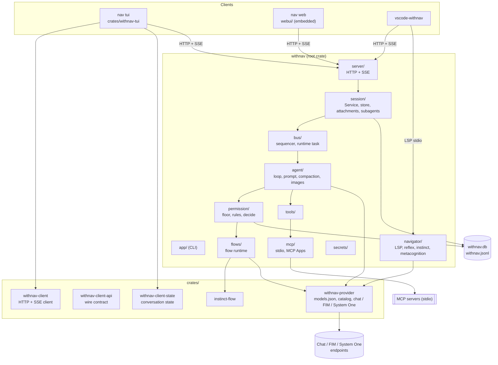
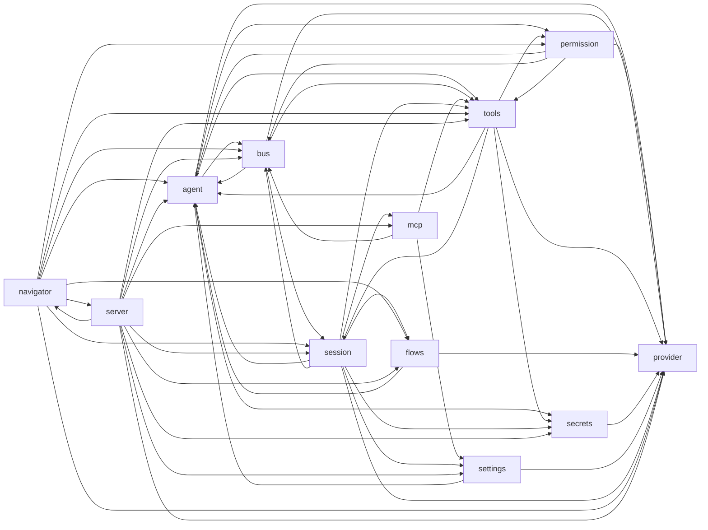
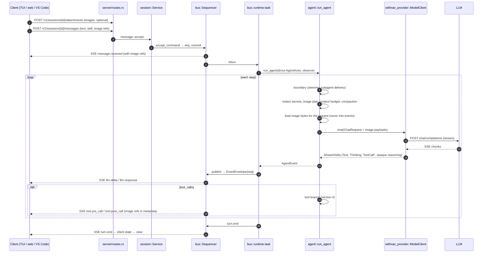
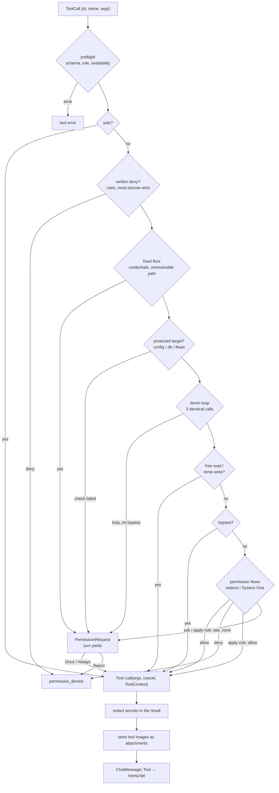

# WithNav 0.8 — current state

Diagrams of the code as it stands on `develop` (8 November 2026, after 0.8.2: images, secrets,
MCP Apps, subagent budget renewal). The target it moves towards: [`v1/`](v1/README.md).
Reference prose: [`ARCHITECTURE.md`](../../ARCHITECTURE.md); decisions: [`docs/adr/`](../adr/).

## 1. Processes, crates and layers

One binary, `nav`, built from the root crate `withnav` (about 90k lines) and six crates under
`crates/` (about 33k lines). The terminal client and the model access layer are already out of
the root; the server, the engine and the navigator are still in it.

| Crate | Lines | Depends on (WithNav crates) |
| --- | ---: | --- |
| `withnav` (root) | ~89.5k | all of them |
| `withnav-tui` | ~16.2k | `withnav-client`, `withnav-client-state`, `withnav-client-api` |
| `withnav-provider` | ~6.9k | `withnav-client-api`, `instinct-flow` |
| `instinct-flow` | ~4.7k | none |
| `withnav-client-api` | ~2.6k | none |
| `withnav-client-state` | ~2.0k | `withnav-client-api` |
| `withnav-client` | ~0.9k | `withnav-client-api` |

The crate boundaries are enforced by Cargo: `withnav-tui` and `withnav-provider` never see the
root (`cargo tree -p withnav-tui -e normal` shows no `withnav v`).

## 2. Dependencies between root modules (non-test `crate::` imports)

Inside the root crate the documented rule ("a module never imports one above it") is still not
enforced. Measured on 8 November 2026:

Cycles left: `agent⇄bus`, `agent⇄permission`, `agent⇄tools`, `permission⇄tools`, `bus⇄session`,
`session⇄tools`, `navigator⇄server`.

Gone since October: `provider→session/settings` (the provider layer is its own crate),
`permission⇄flows`, `flows⇄navigator`, `session⇄server`. `provider` in the graph is now the root's
re-export module (`src/provider/mod.rs`: `pub use withnav_provider::*`, plus the assignment layers).

## 3. A Captain message: client → LLM → client

## 4. A tool call: today's decision chain

Order as implemented in `permission/decide.rs::decide_with`. It still differs from the prose in
`ARCHITECTURE.md`: a written deny wins before the floor, and bypass skips the doom-loop question.
Flows are reached through the `PermissionFlows` trait.

## 5. Key types today

| Type | File | Fields / role |
| --- | --- | --- |
| `ChatMessage` | `crates/withnav-provider/src/openai.rs` | `System`, `User{provenance, images}`, `Assistant{tool_calls, opaque}`, `Tool{tool_call_id, answered_by, images}`: still both the transcript **and** the chat-completions wire shape; the wire form is now written by hand (`Wire`), so request-only messages (tool images) never touch the transcript |
| `ToolCall` / `StreamDelta` | `crates/withnav-provider/src/lib.rs` | `id, name, args: Value, args_valid` / `Text`, `Thinking`, `ToolCallStarted`, `ToolCallArgs` |
| `Opaque` | `crates/withnav-provider/src/opaque.rs` | provider-only reasoning kept on assistant messages, tagged with its dialect (`chat_completions`, `anthropic`, `gemini`, `responses`) and replayed only to the same wire (ADR 0016) |
| `ImageRef` / `ImagePayload` | `crates/withnav-client-api/src/attachment.rs`, `openai.rs` | a stored image by id (events, transcript) / its base64 bytes, loaded per request only |
| `Tool` / `ToolResult` | `src/tools/mod.rs` | `name()`, `schema() -> Value`, `call(args, cancel, &ToolContext)`; `ToolResult.images` carries raw bytes, never serialized |
| `permission::Input` / `Decision` | `src/permission/decide.rs` | `Control`, call, commands, floor, store, agent… → `Verdict{Run, Deny, AskCaptain}` + `Trace` |
| `EventEnvelope` / `EventKind` | `crates/withnav-client-api/src/event.rs` | `schema, event_id, seq, session_id, actor_id, kind, at, causation, correlation, payload: Value`; 25 kinds: `session.*`, `message.received`, `turn.*`, `llm.*`, `tool.*`, `permission.*`, `context.*`, `subagent.*`, `agent.*`, `task.done`, `command.result`, `model.changed`, `mcp.status` |
| `ModelConfig` / `ApiKind` | `crates/withnav-provider/src/config.rs` | `Chat`, `Fim`, `SystemOne`: still one wire family for chat (OpenAI-compatible); `images: Option<bool>`, else learnt from the gateway's model list |

## 6. What works, what hurts

**Works (keep):** one server API for every client · sequencer + `seq` + SSE replay · pure
`decide` over a trait · flows as data · durable child delivery, with budget renewal ·
`instinct-flow`, `withnav-provider` and the four client crates extracted with Cargo-enforced
boundaries · one wire contract crate (`withnav-client-api`) for the Rust side · attachments and
secrets that never reach events or logs.

**Hurts:**
- **Cycles inside the root** (section 2): engine, permission, tools and session still cannot be
  built or tested alone; a change in any of them recompiles the whole root.
- **God files**: `bus/runtime.rs` 3.9k lines, `agent/loop.rs` 3.7k, `session/store.rs` 3.7k,
  `session/service.rs` 3.6k, `flows/runtime.rs` 2.6k.
- **One chat format**: `ChatMessage` is still the transcript and the chat-completions shape at
  once. Opaque reasoning (ADR 0016) and the hand-written `Wire` serializer are the first steps
  out, not the end: Anthropic, Responses and Gemini have no native client.
- **Hooks are ad hoc**: the `tool.pre_call` flow trigger, `ToolCallFlows`, the boundary,
  `ConversationFeed`, delivery, secret redaction and tool-image storage each have their own call
  site. No common chain, no plugin entry point.
- **Payloads are `serde_json::Value`** (event payload, tool args and schema, tool metadata such as
  `images`, `mcp_ui`): contracts live in prose, not types.
- **TypeScript wire types are hand-written** in `webui/src/api/` and `vscode-withnav/src/`: the
  Rust side has one contract crate, the two TypeScript clients copy it by hand.
- **Telemetry**: about 100 `tracing` calls, a JSONL decision log, `flow_trace` in SQLite; no
  metrics, no spans per turn or tool.
