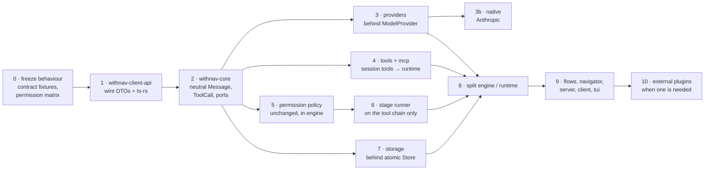

# Migration

Small steps, each one green (`cargo build/test/clippy/fmt`, `npm run compile`, web tests).
Old module paths stay as `pub use` re-exports until the end: no flag-day import rewrite.

| Step | Done when |
| --- | --- |
| 0 | permission decision table and event JSON fixtures pinned in tests |
| 1 | `webui/` and `vscode-withnav/` compile against generated TS; stored events still decode |
| 2 | engine signatures no longer mention OpenAI types; old transcripts load |
| 3 | existing wire-golden / streaming / cancellation tests pass unchanged through the port |
| 4 | `withnav-tools` and `withnav-mcp` build without `agent`, `session`, `bus` |
| 5 | permission matrix from step 0 unchanged |
| 6 | one real stage (e.g. output redaction) runs through the runner, with telemetry |
| 7 | crash-window, replay-cursor and outbox tests pass on SQLite |
| 8 | `bus/runtime.rs`, `agent/loop.rs` no longer exist as god files |
| 9 | `nav` is the only crate depending on everything |

Steps 3, 4, 5, 7 are independent after 2: parallel worktrees possible.

## Progress (8 November 2026)

| Step | State |
| --- | --- |
| 0 | partly: wire goldens pinned (`tests/wire_golden_manifest.rs`, `tests/variants_wire_golden.rs`, the FIM and System One goldens in `crates/withnav-provider/tests/`); the permission decision table lives as unit tests in `src/permission/decide.rs`, not yet as a fixture |
| 1 | half: the Rust contract is one crate, `withnav-client-api`, shared by the server, `withnav-client` and `withnav-tui`; `webui/` and `vscode-withnav/` still copy it by hand (no `ts-rs`) |
| 2 | started: the transcript keeps provider-opaque reasoning next to the message (ADR 0016) and the chat wire is written by a dedicated serializer, but `ChatMessage` is still the OpenAI shape and no `withnav-core` exists |
| 3 | started: the model access layer is its own crate, `withnav-provider`, with no dependency on the root; one chat wire only, no `ModelProvider` port yet; 3b (native Anthropic) not started |
| 4 to 10 | not started |

Done outside the plan and worth keeping: the terminal client is four crates
(`withnav-client-api`, `withnav-client`, `withnav-client-state`, `withnav-tui`) that never compile the
root; that is step 9's `client` and `tui` already out.

## Do not

- make the floor, written deny or yolo reorderable;
- change permission behaviour inside a refactoring step;
- split event append and state save into two writes;
- turn `core` into a service locator or config loader;
- make everything a plugin (sequencing, provenance, authorization stay in the host);
- add WASM, `.so` loading, a marketplace, multi-tenant RBAC.

## Open questions for the Captain

1. **Jev and a written `ask`.** The project decision says "Jev only escalates, never relaxes a written
   rule". The code (`decide.rs`: `FlowAnswer::Allow` → run, whatever the rule) and ADR 0015 let a flow
   allow over a written `ask`. Which one is right? Fixing it is a behaviour change, separate from the refactor.
   Still open: `decide.rs` runs on `FlowAnswer::Allow` whatever the written rule.
2. **`ARCHITECTURE.md` vs code**: the prose puts the floor before written deny and doom loop before bypass;
   the code checks written deny first and lets bypass skip the doom-loop question. Pin the code's order?
3. **Remote clients** (mobile): needs TLS + a paired device credential before the API leaves loopback.
   In v1 scope or later?
4. **Number of crates**: 14 is the target map; the workspace has 7 today and grew one boundary at a
   time (`client-api`, `client`, `client-state`, `tui`, `provider`). Keep growing only where a
   boundary hurts, next `core`?
